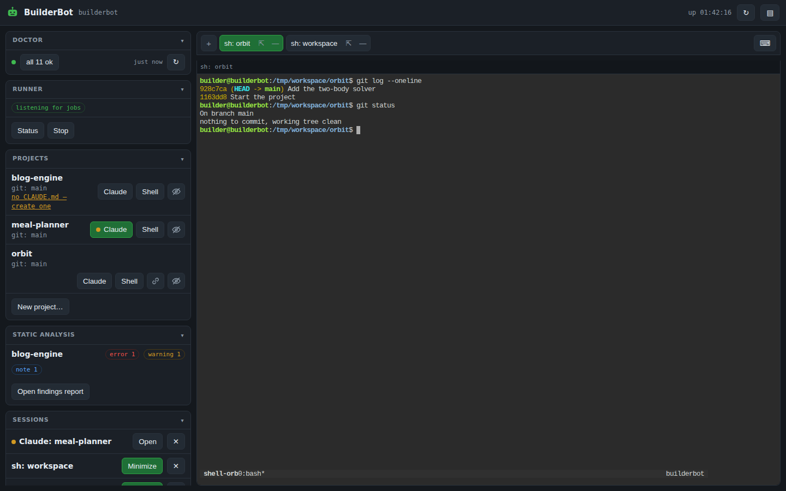
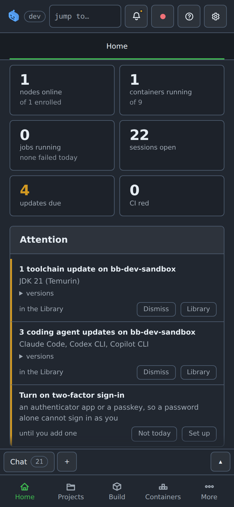
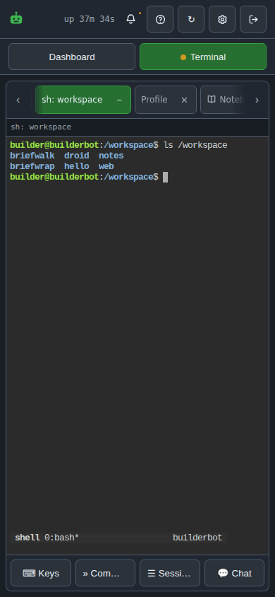

# BuilderBot

One container that is the **controller for your build nodes**: the machines
where Claude sessions, builds, tests, CI and the Android emulator run: built
to live on an Unraid server with your projects mounted straight in.

```
  ┌─────────────────────── BuilderBot ────────────────────────┐
  │  the dashboard · the notebook · the record                │
  │  node 22 · python 3 + uv · gh · docker · playwright       │
  │                                                           │
  │  nodes ──► sessions, builds, tests, CI and the emulator:  │
  │            claude · jdk · android sdk · … from a store    │
  │                                                           │
  │  /workspace  ◄─────────  /mnt/user/projects               │
  │    every folder in there is a project                     │
  └───────────────────────────────────────────────────────────┘
```

The container starts, runs its install/setup hooks, and stays up. It carries
**no Claude Code**: a session runs on the node its project is bound to, opened
from the dashboard, and the controller keeps the dashboard, the notebook and
the record. New images publish automatically to GHCR whenever a push to
`main` changes what the image is built from (plus a weekly refresh), so
updating is Unraid's one-click **update ready** flow.

## What it looks like

The [dashboard](#web-dashboard): projects, sessions, findings and the runner
on one side, real terminals on the other: the same page on a phone, where
the two sides become a switch.



<p>
  
  &nbsp;
  
</p>

(Staged data. The pictures regenerate with `bash tools/readme-shots.sh`,
which boots the checkout's dashboard against an invented workspace on a
private tmux server and photographs it with `bb shot`: the pattern the
[`bb` helper section](#the-bb-helper) preaches, practiced.)

## What's in the image

| | |
|---|---|
| **Claude Code** | Not in the image: a session runs on a node, and the node installs it |
| **Node** | 22.x (NodeSource) + npm, corepack (yarn/pnpm shims) |
| **Python** | 3.12, `uv`, `pipx`, venv |
| **Playwright** | CLI + the system deps; the browsers themselves install to the [package store](#the-package-store-lives-outside-the-image) and appear at `/opt/pw-browsers` |
| **Android, Java, Flutter, .NET…** | Not in the image. A node's, from its packages store: the JDK, the SDK, the emulator and the system images are recipes on the Tools tab, installed with the node picked |
| **Git** | git, git-lfs, `gh` CLI |
| **Docker** | CLI + compose/buildx plugins (needs the opt-in socket mount) |
| **Search** | ripgrep, fd, fzf, jq, yq |
| **Build** | build-essential, cmake, pkg-config |
| **Lint** | shellcheck, hadolint, actionlint, ruff: `bb lint` runs the right ones over a repo |
| **Media** | ffmpeg, imagemagick |
| **Runner** | latest `actions/runner`, ephemeral by default |
| **Versioning** | `mise` for per-project tool pinning (gradle, go, rust, on demand) |

Slimmer builds: `--build-arg INSTALL_PLAYWRIGHT=false`, `INSTALL_ANDROID=false`.
The heavyweight toolchains (Flutter, .NET, Swift, extra Android packages)
are never in the image at all; `bb packages install` puts them on a share that an
update cannot touch. See [the package store lives outside the image](#the-package-store-lives-outside-the-image).

---

## Setup, start to finish

The Unraid-specific detail for every step lives in
**[docs/unraid.md](docs/unraid.md)**; this is the complete checklist with the
decisions you need to make.

### 0. Know the three credentials (they are NOT interchangeable)

| Credential | Lives where | Used for |
|---|---|---|
| **GHCR pull token**: classic PAT, `read:packages` scope only | On the Unraid **host** (`docker login`) | Lets the server pull the image while the package is private; a public package needs none. Fine-grained PATs don't work for GHCR pulls |
| **Runner token** (fine-grained, owned by the org, and only for registering runners on your *nodes*. Repo: *Administration R/W*. Org: *Self-hosted runners R/W*. Nothing else) | Typed into the runner section of the node's row on the **Nodes tab**; kept root-only on the controller | Registers that node's runner with your repo or org. Never visible to sessions |
| **Git SSH key(s)** | `secrets/ssh/` (shielded) or `home/.ssh/` (simple) | `git clone/pull/push` in your projects. Shielded keys are usable but unreadable |

### 1. Authorize the server to pull the image (one-time)

```bash
docker login ghcr.io -u <your-github-username>     # paste the read:packages PAT

# Unraid wipes root's filesystem every boot, so persist the login:
cp /root/.docker/config.json /boot/config/ghcr-auth.json
echo 'install -D -m 600 /boot/config/ghcr-auth.json /root/.docker/config.json' >> /boot/config/go
```

The auth file stores the PAT base64-encoded (not encrypted) on flash, which
is why it must be a `read:packages`-only token.

### 2. Create the state directories

```bash
mkdir -p /mnt/user/appdata/BuilderBot/{home,config/startup.d,work}
chown -R 99:100 /mnt/user/appdata/BuilderBot
```

| Dir | Holds |
|---|---|
| `home/` | each account's home (shell history, npm globals) and the AVDs; survives image updates |
| `config/` | your custom startup hooks (`config/startup.d/*.sh`) + persistent logs (`config/logs/`) |

The dashboard starts early in the boot, before any project's own `setup.sh`
and the SDK/Playwright hooks, so the web UI is reachable in seconds rather
than after the whole start-up. For a few of those seconds it knows less than
it will: the package store is listed as a project until the hook that marks
it runs, and git columns are blank. All of that corrects itself on the next
poll. `bb logs` now times each
hook and prints how far into the boot it started, so "what is the wait" is a
question the log answers.
| `work/` | GitHub Actions job checkouts + runner diagnostics |

Keep these on a cache/SSD-backed share: `work/` and `home/` do heavy
small-file IO. (Logs can be relocated to the array; see step 6.)

### 3. Create the secrets folder (recommended)

Root-owned, so its contents are **never readable by Claude sessions**:

```bash
mkdir -p /mnt/user/appdata/BuilderBot/secrets/ssh

cp /path/to/git-key /mnt/user/appdata/BuilderBot/secrets/ssh/id_ed25519

# only if a session publishes to npm: any *.env file here is loaded the same way
cat > /mnt/user/appdata/BuilderBot/secrets/builderbot.env <<'EOF'
NPM_TOKEN=npm_xxxxxxxxxxxxxxxx
EOF

chown -R root:root /mnt/user/appdata/BuilderBot/secrets
chmod -R go-rwx    /mnt/user/appdata/BuilderBot/secrets
```

What this buys you: SSH keys are served by a root-owned `ssh-agent`
(sessions can push with them, never read them), a token in a `*.env` file
here never enters a session's environment, and all logs are redacted of
token patterns *and* the literal secret values. A node's runner token is
not a file here: it is typed on the Nodes tab and kept root-only by the
controller. Details and threat model: [docs/unraid.md, Shielding
secrets](docs/unraid.md#shielding-secrets-pat--ssh-keys-from-claude-sessions).

Skippable if you don't care about shielding: put keys in `home/.ssh/`
instead; everything works, Claude can just see them.

### 4. Install the container

**Docker template (recommended)**: get
[`unraid/builderbot.xml`](unraid/builderbot.xml) into
`/boot/config/plugins/dockerMan/templates-user/`, then **Docker → Add
Container →** pick *builderbot*. The repo is private, so the raw URL 404s
without auth: easiest is to save the file from your browser and drop it on
the `flash` SMB share; [docs/unraid.md](docs/unraid.md#install) also has an
API-based `curl` (which needs a *contents*-read token, not the
`read:packages` one).

**Compose Manager**: copy `docker-compose.yml` + `.env.example`→`.env` into
a compose stack. Same container either way; don't run both.

### 5. Fill in the fields

Required / usually touched:

| Field | Set it to |
|---|---|
| Projects folder | One mapping for all of them: `/mnt/user/projects` → `/workspace`. Every folder inside it is a project |
| State paths | Pre-wired to `/mnt/user/appdata/BuilderBot/{home,config,work}` |
| **Secrets directory** | The folder from step 3 (or leave empty if unshielded) |
| `TZ` | Your timezone |
| `ANTHROPIC_API_KEY` | Leave **empty** for Claude subscription login (step 7); set only for API-key billing |

Everything else has sane defaults: full reference below.

### 6. Optional features

| Want | Do |
|---|---|
| Android emulator, builds, CI | Enroll a node from the dashboard's Nodes tab. This container compiles nothing and renders nothing: the toolchains, the card and `/dev/kvm` are that machine's |
| Web dashboard | Always on (it is the controller. Map port 7680 and open it: the first page asks you to make the owner account) see [Web dashboard](#web-dashboard) |
| Logs on the array | Set the **Logs directory** path field (template) / uncomment the `/logs` volume (compose) |
| Static analysis reports | Point the **Scanner reports** path at your scanner's output dir: read-only; see [Static analysis reports](#static-analysis-reports) |
| Docker builds inside (CI jobs, Claude) | Fill the **Docker socket** path field: **off by default; this is root-equivalent on the host**, read the warning in the docs first |
| Extra tools | the package manager on the Tools tab, per node; the controller carries what it needs in the image |

### 7. First boot

```bash
docker logs -f BuilderBot          # banner → hooks → runner registered → ready
docker exec -it BuilderBot bb doctor
```

Every `bb doctor` line should be `[ok]` or an expected `[skip]`. It verifies:
Claude on PATH, connectivity to Anthropic/GitHub, git identity, **runner
credential mode** (shielded vs in-environment), **SSH auth against GitHub**
(agent key vs file key), the **Docker daemon** on the sandbox node: whether
it actually answers, and says it is a sandbox; and, when a GPU is passed through,: whether its **graphics stack** is usable or
only CUDA is.

If you're on a Claude subscription (no API key), sign in from the dashboard's
**Sign in** button, under the doctor verdict. The flow runs on a node: the
machine Claude Code is installed on, and the code is pasted back into the
card. Each node signs in for itself and keeps the grant it alone refreshes;
the controller holds no credential, only which Anthropic account you are
bound to.

**CI runs on a node, not in this container.** Enroll one (step 9 in
`docs/unraid.md`: a token from the Nodes tab, then `provision-linux.sh` on the
machine), open its row on the Nodes tab, add a runner for your git host
and press **Install runner** on it. It registers under the node's own name,
which is the label a workflow uses:

```yaml
jobs:
  build:
    runs-on: [self-hosted, bb-sandbox]
```

**Every label in `runs-on` must be one some runner carries.** A job asking for
a label nothing has sits in *Waiting for a runner* forever while the runners
show *Idle*: the job is simply not addressed to any of them, and neither
screen mentions the other. `bb ci-labels` lists every label the registry
knows, `bb lint` refuses a `runs-on` naming one that nothing carries, and
stale **Offline** runners carrying a label a job wants are worth deleting for
the same reason; they make a job look routable when nothing will pick it up.

### 8. Daily use and updating

A Claude session is opened from the dashboard, on the project's row, and runs
on that project's node. There is no `claude` in this container to exec into.

```bash
docker exec -it BuilderBot bb shell                        # shell as builder
docker exec -it BuilderBot bb status                       # what this box is
```

**Adding a project**: make a folder in the projects share. That is the whole
step: the folder is mounted along with everything else beside it, and it
appears on the dashboard at the next poll. A directory that is not a working
project is not hidden but reported: no git repository or the wrong ownership in
red, no `CLAUDE.md` in amber, both behind **Show projects with errors**. Only
empty directories, hidden ones and the runner's `_work` are left out.

**Updating**: CI publishes `:latest` for any push to `main` that touches the
image's inputs (Dockerfile, `scripts/`, `config/`) + a weekly freshness
rebuild. Unraid's *Check for Updates* flips the container to **update ready**,
so click it. Builds seed their layer cache from the previous `:latest`, so a
scripts-only change is a small pull; the Monday rebuild is uncached on purpose
and is always the big one. *Run workflow* takes a **Rebuild every layer** box
for the same effect on demand: leave it off and a manual run is a cheap retry,
tick it to force a fresh pull of everything. Rollback = point the Repository field at a
`sha-<commit>` tag. Compose: `docker compose pull && docker compose up -d`.

---

## Configuration reference

| Variable | Default | Purpose |
|---|---|---|
| `PUID` / `PGID` | `99` / `100` | File ownership (Unraid `nobody:users`) |
| `TZ` | `Etc/UTC` | Container timezone: set yours, or timestamps read as somebody else's day |
| `ANTHROPIC_API_KEY` | *(empty)* | API-key billing, passed to the sessions on your nodes; empty = subscription login, from the dashboard's Sign in |
| `SDK_ROOT` | `/sdk` | Where the toolchains *you* install are kept; see [the package store lives outside the image](#the-package-store-lives-outside-the-image). Falls back to the home volume when no share is mapped. Not CI's: a node runner keeps its own toolchains in its tool cache |
| `NPM_TOKEN` | *(none)* | `npm publish` auth (lands in `~/.npmrc`, session-visible by necessity) |
| `CHOWN_PROJECTS` | `false` | Recursive chown of project mounts to `PUID:PGID` |
| `BUILDERBOT_PULL` | `missing` | compose's pull policy for the image: `missing` pulls (an install); `build` builds this checkout, which is what BuilderBot's own dev instance sets, with `BUILDERBOT_TAG=dev` |
| `COMPOSE_PROFILES` | empty | compose's own switch: `lab` in a dev instance's env file starts the lab's Gitea beside it (the `gitea` service), for `bb tests lab` |
| `BB_LAB_HOST` | `127.0.0.1` | the address other machines reach that Gitea on |
| `CHOWN_HOME` | `true` | Recursive chown of the home volume at startup. Set `false` if it is large and already correct |
| `DASHBOARD_PORT` | `7680` | The one published port: page, API and terminals (proxied under `/term`) |
| `DASHBOARD_TTYD_PORT` | `7681` | ttyd's loopback bind inside the container; never published |

Mounts: the projects folder, three state dirs (`home`, `config`, `work`), and
three optional ones: `/secrets` (ro, shielded credentials), `/logs`
(relocate logs).

## Security model, in short

- **Repo mounts** expose only those trees; writes land as `nobody:users`.
- **No Docker socket by default**, with it absent, reaching the host
  requires a kernel exploit.
- **Secrets shielding**: PAT scrubbed from session env + root-only sudo
  helper for runner tokens; SSH keys usable via root-owned agent but not
  readable; logs redacted (patterns + literal values).
- **No passwords, no general sudo**: `root` and `builder` are locked
  accounts; brute-forcing has no target. Builder may sudo exactly one
  command (`mint-runner-token`), which only emits 1-hour tokens.
- **Your root door** is host-side: `docker exec -it -u 0 BuilderBot bash`.
- Don't attach the runner to public repos; treat container-produced commits
  and packages with normal review.

Full discussion: [docs/unraid.md](docs/unraid.md#notes-and-gotchas).

## Startup hooks

The entrypoint runs as root: stash/scrub secrets, remap `builder` to
`PUID:PGID`, seed the home volume (never overwriting), start the ssh-agent,
then executes hooks and drops privileges:

| Hook | Does |
|---|---|
| `30-git-and-auth.sh` | git identity, GitHub host keys, `gh` auth (unshielded mode only) |
| `35-publishing.sh` | npm publish auth, ghcr docker login (socket + PAT present) |
| `40-projects.sh` | project report, optional per-project bootstrap |

Your own hooks go in `config/startup.d/` on the share: `*.root.sh` runs as
root, `*.disabled.sh` is skipped, filename order. All hooks are idempotent:
they check state before installing.

## The `bb` helper

Bare `bb` prints this list; `bb status` is the tool-version wall.

```
bb status          tool versions, runner registration, mounted projects
bb version         this project's version, and who is allowed to move it
bb version --code  one form only: --code (Android versionCode), --quad (= --win:
                   manifest.json and Windows VERSIONINFO), --msi, --pep440,
                   --file, --semver, --json
bb version bump major|minor|patch    move the target, if the policy allows it.
                   A bump decides the number and closes the changelog under
                   it; it does not release anything. **Release** on the
                   Artifacts tab is the second gesture: an annotated tag
                   (vX.Y.Z, or DIR-vX.Y.Z for a component) on the commit you
                   are on, pushed to the remote. Until that tag exists every
                   build reads X.Y.Z-dev.N+sha, which sorts BEFORE X.Y.Z,
                   heading for it rather than at it; from the tag on, a build
                   of that commit is the bare number. Releasing is the
                   operator's whatever the policy says, and a pushed tag is
                   never moved or deleted from the dashboard.
                   A repo that carries its number somewhere else as well
                   (an agent's protocol number, a template's stamp) declares
                   that by carrying an executable `tools/version-stamp`, run
                   from the repo root with the new version and the part that
                   moved. Whatever it changes is committed with VERSION, so
                   the bump is one commit or none: a hook that fails refuses
                   the bump rather than leaving the number moved and its twin
                   behind. A repo without one is unaffected
bb version init X.Y.Z  give this project (or --for DIR) its first VERSION
bb version unbump      take an unreleased bump back; its changelog section
                   dissolves into Unreleased, the code stays
bb version --list  every version this repo carries: its own, and any component
bb version --for DIR   ask about a component: a directory with its own VERSION
bb version policy  what a session may move here, and who decides. The
                   operator picks it on the Artifacts tab, before or after
                   there is a version: locked (theirs entirely), may start
                   one (a session writes the FIRST version and moves nothing
                   after), patch, patch and minor, or anything
bb changelog       this project's user-facing changelog (--for DIR for a component)
bb changelog add "..."   log what a change means for the person using it; the
                   next version bump dates the accumulated lines. --cat NAME
                   files it under a `### Name` category, made at the end of
                   the section if it is new, which categories exist and what
                   order they and their lines sit in is the operator's, on the
                   Changelog editor beside the version
bb changelog unreleased  the entries waiting for a bump, numbered straight
                   through the section by category, in the arranged order
bb changelog edit N "..."  reword one of them: a change that tweaks something
                   already logged this cycle corrects its line rather than adding one,
                   and the line gains that commit. --cat NAME on its own moves it
                   and leaves the words, filing it at the end of that category the
                   way add --cat does, so re-filing a line into its own category
                   sends it to the bottom, which is the ordering a session has.
                   --no-stamp corrects a line without claiming a commit made it,
                   which is what a pass over the wording is
bb changelog merge N M "..."   one line for several, carrying all their commits
bb changelog split N     back into one line per commit it carries
bb changelog rm N        drop one that stopped being true
bb projects        mounted project dirs and their branches
bb shell           login shell as the builder user
bb login           Claude Code subscription auth flow, on the machine it is
                   run on. Nothing is copied anywhere
bb login --check   what THIS machine is signed in as, told to the controller,
                   and a sign-out taken here. The grant never travels: every
                   failure this had came from one OAuth pair living on several
                   machines: a refresh rotates the refresh token, so two
                   copies sign each other out, and a machine that was away
                   holds one the server has retired. Each machine signs in for
                   itself and keeps the grant it alone refreshes. What crosses
                   the wire is "I am signed in as X" going up and a generation
                   coming back; behind means the account was signed out while
                   this machine was not listening, and the answer is
                   `claude auth logout` here. Run on every connection and
                   every prompt
bb git push|fetch|pull|ls-remote [ARGS]
bb git policy      what a session may push here (its branch, main) from the
                   project's Git view; the controller enforces it on the relay
                   git's network half, run where the credential is: from a
                   session on a node it goes through the controller
bb emu start [api] | stop | status | list | log [-p]
bb claude-md       is this project's environment block current? The block is
                   `CLAUDE.local.md`, rendered by BuilderBot and kept out of
                   git (`.git/info/exclude`); `CLAUDE.md` beside it is the
                   project's own notes and is committed. `--update` rewrites
                   the first and never touches the second.
                   The block is rendered per project, not copied: the shipped
                   template marks its Android and compose sections with the
                   evidence that makes them apply, so a plain project's
                   sessions start on about a thousand fewer words and a
                   session is not told how to drive an emulator it has none of
bb claude-md --update   refresh that block only
bb claude-md --is-stale exit 0 when the block exists and has drifted
bb claude-md --out-of-window  exit 0 when the block is from another compatibility
                        window than the template: the gate the ghosted Claude
                        button and bb-tty both ask; --window prints a block's window
bb claude-md --init     create one here from the template
bb lint [path]     lint a repo's infrastructure files: shell scripts,
                   Dockerfiles, workflows, compose files, XML
bb nodes           the machines enrolled as nodes, read-only in a terminal;
                   the Nodes tab is where they are edited
bb settings        this project's settings as the dashboard has them: node,
                   model, effort, build and test commands, lock. Read-only;
                   on a node it is relayed from the controller, and it is
                   what bb-tty and bb build read there.
bb users           the dashboard's accounts. `passwd NAME` resets one from a
                   shell, which is the way back when the owner is locked out
bb work            who else is working this project, and which files two of
                   you have uncommitted at once: read-only
bb jobs [-n N | ID]    the recent jobs: state, node, what ran, how it ended,
                   read-only; the Jobs tab is where one is stopped. An id
                   prints that job's log, which is where a failed job says
                   what happened rather than only that it failed
bb run [opts] -- CMD   snapshot this tree, run CMD on the project's node and
                   stream the log back; `--out GLOB` brings what matches into
                   dist/ with its provenance; `--node` names another node
bb build           the project's build command on its node, with the outputs
                   it lists: all set in the project's settings dialog
bb test [ARGS]     the same for its test command; ARGS are appended to it, so a
                   suite that takes file names runs only those
bb devapp          this project's dev instance: what it was built from, whether it is
                   running, and whether its daemon answers
bb devapp rebuild [--why "..."]
                   build it and bring it up. Only where the project has handed that
                   over: the dial is on its row in the Docker tab, beside the
                   Rebuild it hands over, and reads deny (the default, refused with
                   the sentence that names it), ask (the reason goes to a person and
                   the command waits for Allow) or auto. Making a container, removing
                   one, Up, Down and Env stay the operator's whatever it says
bb emu create API  build the AVD for an API level, installing its image if missing
bb emu install APK install an APK on the running emulator
bb emu shot [FILE] screenshot the emulator into dist/emu/
bb emu gfx PKG     a package's per-frame timings (gfxinfo framestats) into
                   dist/emu/, and every emu verb runs on the project's node
                   when it has one, its output coming back into dist/
bb ci-labels       the runner labels the registry knows; this box's and every
                   node runner's; `--write` regenerates .github/actionlint.yaml
bb findings        this project's scanner findings (--all for every project)
                   narrow with --level error|warning|note, --rule ID, --find TEXT
bb findings history   what the scanner stopped and started saying here
                      (-n N, --since 7d, --find TEXT, as the other logs)
bb roadmap            this project's roadmap: items are R1, R2, ...; bugs are B1, B2
bb roadmap show N     one item in full: its details, its steps and theirs (N is R12 or 12)
bb roadmap add "..."  put something on it; `done N` finished, `rm N [why]` abandoned
bb roadmap restore N  put a dropped one back from the history, as it was
bb roadmap shelve N   park one without dropping it; `mv N up|down` moves it
bb roadmap add "..." --step "..." --step "..."   an ordered group of steps
bb roadmap edit N "..."               reword one; `step add|edit|rm|done` for one step
bb roadmap info N [M] "..."           attach the technical details to one, or step M
bb roadmap begin      work one out; `commit` records it as one change, `revert` undoes
bb roadmap pending    what a session added that is waiting for your approval
bb bug             the bug tracker: open bugs; `all`, `show N` for one in full
bb bug find TEXT   search the reports themselves: area, repro and notes too
bb bug begin       the same notebook batch `bb roadmap begin` opens; `commit`, `revert`
bb bug pending     reports a session filed that are waiting for your approval
bb bug add "..."   report one (--sev, --area, --repro, ...); `note N`, `fix N`,
                   `wontfix N`, `na N`, `reopen N`, `rm N`, `history`
bb tests run [ARGS]  run the project's test command, time it, and record the run: says first when it should
                   finish, and ends by NAMING what went wrong: the failed assertions per file, and for a file
                   that CRASHED the line it died on, the assertions that had already failed before it did,
                   and the fact that nothing after it ran. A crash prints no `FAIL` line and no totals, so a
                   run that only said "failures above" cost four whole runs to read once. ARGS go to the
                   command, so `bb tests run auth cards` times and records those two files and nothing else
bb tests last      that verdict again off the last run's log, running nothing
bb devapp test [ARGS]  the project's test command inside its running dev instance, as a compose job on
                   its node: the whole log, and the job's exit code. `bb test` takes this path on its own
                   whenever the instance is up, so a suite that tests BuilderBot cannot disturb the
                   BuilderBot it runs on (roadmap R48)
bb tests lab       the lab suites (test/lab-*.mjs) against a real Gitea: the `gitea` service of
                   BuilderBot's own dev stack, under its compose file's `lab` profile, brought up
                   from the Docker tab like any project's stack. Each skips in one line without one,
                   and nothing records them: a lab run is a proof, not a timing
bb tests projection  when a run should finish, from what the last one took (--secs for the number)
bb tests accept KEY "why"   the wait is the work: stop flagging it, saying why (--no undoes)
bb rules           the house rules for this project: the operator's and yours
bb rules show NAME one of them in full: what a conditional rule says
bb rules add NAME "..." [--files ...] [--words ...] [--doc PATH] [--check CMD]   leave one of your own
bb rules edit NAME "..." | rm NAME ["why"]            change or drop yours
bb rules check [NAME|--all]   run the checks of the rules whose files you changed
bb rules history   what has changed them, by either of you
bb rules pending   rules a session added that are waiting for your approval
bb preamble        what a session started here is handed: rules, roadmap, bugs (--json for its size)
bb tests           the test registry: where the suite's time goes, slowest first
bb tests show KEY  one test: what it protects, what it exercises, its history
bb tests note KEY "..." [--how "..."]   what it protects, and what it really runs
bb tests describe --from FILE.json      fill many at once, in one write
bb tests ingest [LOG]  record a run's real durations (BB_TEST_TIMING=1 output)
bb tests drift     what the runner reported that this list does not, and back
bb tests flagged   the ones sitting on a round timeout rather than working
bb history         one search over the notebook's logs: roadmap, bugs, memory
                   (`--find X`, `--since 7d`, `-n N`)
bb roadmap history [-n N] [--since 7d] [--find TEXT]   what changed, narrowed
bb phone           what phone is connected, and what is waiting on you
bb phone run --why "..." -- adb args...
                   ask to reach it: the operator allows it on the dashboard
                   and the dashboard runs it, so a session never touches the
                   handset itself
bb root            what root commands are waiting on an administrator
bb root run --why "..." -- CMD...
                   ask for ONE command as root on this project's node: an
                   administrator allows or denies it on the Nodes tab or the
                   bell, and the node runs that command and nothing else. Not
                   sudo: a second command is a second question
bb catchup         what has happened here lately: commits with the first line
                   of their bodies, what moved in the notebook, the builds this
                   box archived, and which image it is actually running
                   (`--since 7d`, `-n COMMITS`)
bb ci-log          what CI printed on its last run here (`--list` for the runs
                   kept, a run id for one, `--project NAME` from elsewhere)
bb logs [-f] [N]   this boot's log
bb logs -p [N]     a previous boot's log
bb logs --list     the kept boot logs, newest first
bb logs --node NAME [--agent|--runner|--terminal] [N]
                   a machine's own log: the agent's journal, the CI runner's,
                   the terminal server's. Root's on that box: the enrolled
                   account is in neither `adm` nor `systemd-journal`, so a
                   session cannot read them at all. Offered only while **debug
                   mode** is on in Controller settings AND the asking node has
                   been granted that node on its **Debug settings**, its own
                   journal included; "it is only looking at itself" is the
                   reasoning that makes a boundary stop meaning anything.
                   Which node is asking is the node of the session's own
                   project, proved by its token, never the `BB_NODE` in its
                   environment. What can be read is a table of three streams;
                   anything else is refused, not run
bb doctor          check everything that usually goes wrong

# developing BuilderBot itself, from inside it
bb dashboard test  browser-test the dashboard from this checkout, isolated
bb dashboard dev   serve the live dashboard from ./scripts/dashboard (--off reverts)
bb dashboard status  which copy of the dashboard is serving
bb drift           what this checkout changed that the container is not serving
bb shot URL... [FILE|DIR]  headless screenshot(s) of pages
bb favicon SVG [DIR]  favicon set (ico + touch icon) from one mark
bb packages             SDKs kept outside the image: status, check, install X, update X, remove X
```

The dashboard's Commands flyout carries this same list in this same order.

`bb shot` is the container's camera: one URL with an optional output file
keeps the simple shape, several URLs share one browser and land in a
directory named from their paths (`/` → `index.png`). For README-quality
captures it takes `--full` (whole page, not just the viewport), `--scale 2`
(2x pixels, crisp in GitHub's column), `--wait MS` (pages whose async
fetches settle after networkidle), and `--resize W` (imagemagick downscale,
in place, so full-size originals never land in a repo). `--auth user:pass`
falls back to `BB_TOKEN` or a `DASHBOARD_AUTH` you pass for the command. The intended split for a project's docs
screenshots: the project keeps a script that boots its app into a
photogenic state (staged data, ready-wait) and ends with one `bb shot`
line; the Playwright plumbing lives here, once.

`bb favicon LOGO.svg [DIR]` is the same idea for a web app's icon: the
project supplies its mark as one SVG, and out come `favicon.ico` holding
every small size in one file (the bare `/favicon.ico` request browsers make
cannot ask for a particular one), `apple-touch-icon.png` at 180 for iOS
(`--bg COLOR` flattens it: iOS composites transparency onto black), and
the SVG copied alongside for browsers that prefer vector. Chromium
rasterizes (the image's ImageMagick has no SVG delegate; a browser engine
renders exactly what a tab will show) and ImageMagick packs the `.ico`.
The dashboard's own tab icon is this command's output, from
`scripts/dashboard/static/favicon.svg`.

`bb` re-execs as `builder` automatically: `docker exec` lands as root, which
would break file ownership. A bare `docker exec -it BuilderBot bash` is still
root; use `bb shell` for the normal user.

## The package store lives outside the image

The image carries no toolchain beyond node, python and the Playwright
module. Everything a build needs: the JDK, the Android SDK, the emulator,
Flutter, .NET: is a recipe installed into a **node's packages store**, from
the Tools tab with that node picked; the tab lists nodes and nothing else,
and with none enrolled it says so. The controller's own store: the SDK
share, mapped at `/sdk` (Unraid default `/mnt/user/sdk`): holds
only what its boot keeps for `bb shot`, the Playwright browsers; nothing is
installed on the controller from the dashboard. A node enrolled with the same
share is recognized as sharing it, and installs are arbitrated across both.

**One store, scoped by platform.** A machine's packages live under
`<store>/<os>-<arch>`: `linux-x86_64` for this container and the sandbox,
`darwin-arm64` for a Mac, so one share can serve every node whatever it
runs, and a Linux box's binaries never land on top of a Mac's. The Android
system images, the same bytes on every host and tens of gigabytes, live once
under `<store>/shared/android/system-images` with each platform's
`android/system-images` a link to them, and `bb packages root` names the scoped
directory.

The reason is arithmetic. `/opt` is discarded and rebuilt on every image
update, and the update is weekly, so a package baked into the image is
re-downloaded forever: the Android emulator alone is 800MB, a system image
about 2GB. On the share they are downloaded once and the update walks past
them. Map no share and everything falls back to the home volume, which also
persists, but mixes 30GB of system images in with your shell history.

```bash
bb packages                     # what is installed, where, and how much room is left
bb packages install flutter     # or: playwright · dotnet · swift · go · rust · zig · android:<pkg>
bb packages install android:tv         # or wear · playstore · ndk · cmake · emulator
bb packages install android:"system-images;android-35;google_apis;x86_64"
bb packages list                # every package the catalog offers
bb packages images              # the android system images on disk, with sizes
bb packages images --available  # ...and every one that could be installed
bb packages flavors             # google_apis · +playstore · tv · wear, and which to pick
bb packages plan swift          # what installing it would fetch and run, exactly
bb packages versions            # what is installed, asking nobody
bb packages check               # ...and whether anything newer exists
bb packages update flutter      # each the way its own tooling expects
bb packages remove flutter
bb packages env                 # the PATH lines; new shells get them automatically
```

**The recipes are a file, not code.**
[`config/packages.json`](config/packages.json) holds everything the container
needs in order to offer, fetch and install a package: the URL, the branch, the
installer's arguments, the environment it wants, how many directory levels to
strip out of the archive, what to run afterwards to prove it worked. Both the
dashboard and `bb packages` read it, so adding a package is one edit: as long as
it fits one of five shapes:

| kind | what it does |
|---|---|
| `tarball` | resolve a version, fetch the archive, unpack it |
| `script` | fetch a vendor installer and run it with the given arguments |
| `git` | shallow-clone a branch, for a tool that then updates itself |
| `command` | run something already in the image, pointed at the directory |
| `sdkmanager` | an Android package, or an image flavor by kind |

The shapes stay in `bb` because they are genuinely different jobs, and a
table that could express all five would be a programming language. **`bb packages
plan <package>`** prints what a recipe resolves to: version, URL, the exact
commands, without downloading anything, which is how a catalog edit gets
checked before it is trusted.

**No size is written down anywhere.** A size typed into a file is wrong the
next time upstream ships. A row shows the footprint once the package is
installed (measured, and remembered after it is removed) and before that
what an install would *download*, which is a different number and is labelled
as one: Swift arrives as a gigabyte and unpacks to three.

Upstream is asked for that download figure rather than guessed at, three ways,
all of them catalog entries. Where the catalog's URL is the payload, its
`Content-Length` is the answer. Where it is not, a `download` block names a
dry run to execute and a pattern to match URLs out of; that is how
Playwright's five bundles and the .NET archive get counted. And the Android
packages come from `sdkmanager`'s own repository index, looked up by the exact
package id an install would resolve to: the index's newest Play Store image is
an `android-CANARY` build nobody installs, and the emulator appears twice,
once stable and once on the dev channel.

None of this is a scrape. Every document these resolvers read is one the
vendor's own installer reads: `sdkmanager`'s package index, `rustup`'s
channel manifest, Zig's release index, Go's version file, and the two GitHub
lookups deliberately use the `releases/latest` redirect rather than the API,
which is what rate-limits anonymous callers by IP. Requests carry a
`builderbot-sdk` User-Agent, there are no retries and no parallel fetching,
and a check runs at most a few times a day. What it costs is about 1.8MB,
cached for fifteen minutes in `/tmp` so that the thirteen separate processes
of one check share the four hundred kilobytes of package index that three of
them need.

Rust answers a fourth way: its channel manifest names an archive per
component, and the three a minimal profile installs add up to what `rustup` is
about to fetch. Only Flutter cannot be asked at all: a git clone has no
content length, so it carries the one approximation in the catalog, marked
with a `~` everywhere it appears and replaced by a measurement the moment the
package has been installed here once.

**Nothing installs, updates or removes itself, and no session can do it for
you.** `bb packages install|update|remove` refuses to run when `CLAUDECODE` is in
the environment; that variable is in everything a Claude session runs, and
the dashboard drops it at startup precisely so that this page is never
mistaken for one, and tells the session to ask instead. It is a guardrail
rather than a boundary (a session has a shell, and could call `sdkmanager`
directly), and it says how the human at the keyboard overrides it:
`env -u CLAUDECODE bb packages install …`.

**A removal sticks.** The Playwright browsers are fetched on the first boot
of a fresh share, because a container that comes up "ready" with `bb shot`
broken is worse than a slow first start. A share somebody has just cleared looks
identical to a fresh one from a startup hook, so `bb packages remove` leaves a
marker under `.removed/` on the share and the hooks respect it; installing
the package again clears it. Without that, an uninstall lasted until the next
restart, which is not an uninstall.

In the tab, one button does it: **Install selected** installs what is not
there and updates what is, so there is no second verb to choose between. A
package that is installed and current has a **dead checkbox**; there is
nothing to do to it, and gets its tick back the moment a check finds an
update, with the version it would move to in amber beside the installed one.
Uninstalling is a **bin icon on the row itself**, with a confirmation,
because it is about one package and a bulk Remove button beside a bulk
Install was one mis-click from being expensive.

**A job can be stopped.** **Abort** empties the queue and interrupts the
package being worked on: the whole process group, so the download it is
waiting on goes too, and `bb` removes the half-installed directory on its way
out, the same cleanup a failed install gets. Everything already installed
stays; the abort is for the rest of the queue, not for undoing what worked.

**A row says what it is doing, and not how far along it is.** `installing`
with a ticking ellipsis for the whole of an install, `removing` for a removal.
There was a percentage and a bar here, scraped from whatever each recipe
printed, and it was retired: every one of them meters differently and several
mislead by accident. sdkmanager counts a single fraction across a whole
operation, changes the label part way through, and parks it in the fifties for
the minutes it spends writing a system image. `playwright install` fetches five
bundles and meters each from zero. rustup prints no percentages at all down a
pipe. A row relaying any of that faithfully still read as a bar that had
broken, so the honest answer is the one that does not pretend to a
denominator. The full output of every job goes to the log under the buttons,
which is where to look when "it is working" is not enough.

**Two different questions, two different costs.** What version is installed
is local knowledge (a directory name, or `flutter --version`), but asking
every toolchain to say its own name is a few seconds, so the answer is kept on
the state volume rather than only in memory. That is what makes the tab open
at once after a container restart instead of sitting on "loading…" while the
same unchanged answer is worked out again. It is keyed by what it is an answer
*about*: the set of installed paths, so installing or removing something drops
it, and a digest of `config/packages.json`, so editing a recipe does too.

Whether a newer one exists is a network round trip to a different upstream per
toolchain, so that one is a slow background errand rather than something the
poll does: **once a week**, counted from when a check last actually happened
rather than from when the container came up. A restart used to mean a full
round of upstream requests three minutes later, so an afternoon of image
updates was an afternoon of asking the internet for answers that had not
moved. **Check for updates** asks on demand, which is what somebody presses
when they want to know now, and editing the catalog forces one: the stored
answers describe recipes, and a changed recipe has no answer yet.

Either way the answers are what the rows show. A check answers for the rows
that are *not* installed too: the version there is what Install would fetch,
plainly rather than in amber, since nothing about it is news. What a check
found is kept on the state volume and dated on the page.

**The size is an estimate until it is a measurement.** Every row carries one:
the catalog's `~3 GB` before installation, which is what the download costs,
and the real `du` figure afterwards, which is not the same number and grows
(a pub cache, a .NET workload, an NDK that unpacks bigger than it ships).
Hover a size to see which one you are reading. Measuring walks the tree, so
it happens on a worker rather than in the request: the first draw after an
install carries the estimate and the real number arrives a moment later.

**Update checking is a question, not a background service.** Each answer costs
a network round trip to a different upstream: the Flutter branch head, the
.NET installer's own dry run, Swift's release redirect, the browser revisions
Playwright's module wants, sdkmanager's update table, so nothing is checked
until `bb packages check` or the tab's **Check for updates** asks. An unchecked
row says nothing rather than implying it is current. Updates then run through
each toolchain's own mechanism rather than a delete-and-reinstall: Flutter
moves to the branch head, .NET installs the current LTS beside what is there,
sdkmanager updates its packages, and Swift and the browsers fetch the version
they now want.

**Moving the share later is a host-side job.** The container knows one
location (whatever `/sdk` is mapped to), so relocating that directory on the
server and re-pointing the mapping is invisible from inside: stop the
container, move the folder, start it again. There is deliberately no command
for it. (Packages left on the home volume from an older image keep working
where they are: the startup wiring points at whichever location actually
holds them, and says so.)

Android needs no PATH help on the machine that has it: a node's agent points
`ANDROID_HOME` at its store's `android/` directory for every job and session,
so Gradle and `sdkmanager` install and find things in one place. (The
controller has no Android SDK at all since it stopped building; see
[CI runs on a node](#ci-runs-on-a-node).) The other toolchains land in their
own directory under the
share and are put on `PATH` by a generated `env.sh` that every shell sources;
`bb packages remove` is `rm -rf` of one directory, because nothing was installed
anywhere else.

| Toolchain | Size | What it gets you |
|---|---|---|
| `go` | ~250MB | Windows, macOS, Linux and ARM binaries from here: `GOOS=windows go build`, no target to install |
| `rust` | ~700MB | rustup, cargo and the stable toolchain in one directory |
| `zig` | ~300MB | A C/C++ cross-compiler: `zig cc -target x86_64-windows-gnu` makes this box a Windows toolchain |
| Android packages | 800MB emulator, 3GB NDK | Platforms, build-tools, emulator, NDK, CMake |
| Android system images | 1–2GB each | One per API level per flavor; see [below](#the-package-store-lives-outside-the-image) |
| `playwright` | ~1.3GB | Chromium, Firefox and WebKit: fetched on a fresh share, since `bb shot` and the dashboard's tests need them; removing it stays removed |
| `flutter` | ~1.3GB | Flutter + the bundled Dart SDK; builds Android APKs here |
| `dotnet` | ~4GB | .NET SDK plus the `maui-android` workload |
| `swift` | ~3GB | The Swift toolchain, for shared logic and server-side code |
| `tizen` | manual | Samsung TVs, signage and appliances. No headless installer exists, so `bb packages install tizen` prints the steps and is not in the dashboard's list; everything there installs |

**From the dashboard.** The sidebar's **Tools** card holds **Additional
packages…**, which opens as a **tab** the way the findings report does: a list of
everything above with a checkbox each, the size it will take, and, once
installed, the path it actually landed on. Tick several and install or remove
them in one go. If one fails, its row says why: the sentence, not the
several hundred lines of progress frames that came with it.

System images sit below in a section of their own, because they are not
packages: a picker for the API level and flavor with the download size on
each option, and the ones already on disk listed under it with what they take
and a bin each. Each one also says **which AVDs are built on it**, which is
what "can this go?" actually means: an AVD names one image exactly and will
not boot without it, and two flavors at the same API level are not
interchangeable. An image no AVD names says so, and is the one that is spare. A tab rather than a dialog because an install runs for
minutes; it can sit on the strip, be pinned to a pane, or be minimized while
you work, and the work itself is a background job on the container, so the
list keeps reporting progress instead of hanging on a request that would take
four minutes to answer. The page only ever posts names the server offered it,
the same rule the command buttons follow.

**Building for Windows, from here.** Three of those cross-compile without a
Windows machine anywhere: Go does it with `GOOS=windows GOARCH=amd64 go
build`, Zig with `zig cc -target x86_64-windows-gnu` (a C and C++
cross-compiler that happens to ship with a language), and .NET with `dotnet
publish -r win-x64 --self-contained`. All three were verified on this box:
`file` says *PE32+ executable, for MS Windows*. Rust needs one more piece: a
linker, either `gcc-mingw-w64` on the node or `cargo-zigbuild` on top
of Zig. What none of them give you is a Windows *GUI* toolchain: WPF, WinUI
and MSIX packaging need Windows itself.

**Tizen is Samsung's, and where it runs decides whether you care.** TVs,
signage and appliances still run it and Samsung still ships it; that is the
reason to install it. Watches are not: Galaxy Watch moved to Wear OS with the
Watch 4 in 2021, so a watch app is `bb packages install android:wear`. Phones ended
in 2017. There is no headless installer, so it is a CLI pointer rather than a
row in the dashboard's list, where everything installs.

**Android, and which vendor you are targeting.** One SDK covers all of them:
Samsung, Pixel, Oppo, OnePlus, Xiaomi. There is no per-vendor SDK to install
and no vendor emulator image to download: Samsung's Galaxy skins are
cosmetic, and the vendor libraries (Samsung IAP or Health, Oppo/Xiaomi push)
are Gradle dependencies a project declares, not toolchains a container holds.
What genuinely differs is the *system image* you emulate against, which is
why those are not packages. A package is one thing at one version; a system
image exists at **every API level at once**, so the question is which level
and which flavor, never whether. The four flavors, and why you would pick one:

| Flavor | What it is |
|---|---|
| **Google APIs** | Play *services* (Maps, sign-in, push), but no Play Store app. Rootable: `adb root` works. The default, and what `bb emu create` fetches |
| **Google APIs + Play Store** | The same plus the Play Store app itself, for anything that signs in to Play, checks a license or takes an in-app payment. A Play-certified build, so **not** rootable |
| **Android TV** | Leanback layout, remote-control navigation |
| **Wear OS** | What modern Galaxy and Pixel watches run |

The first two are separate downloads from Google, not one image with a switch,
which is why the Play Store one has to be fetched on its own even when a
plain image for the same API level is already here. The trade is deliberate on
Google's side: an image that ships the Play Store is certified, and a
certified build does not give you root.

Which means the two at one API level are **not** redundant with each other,
even though they cost 2GB each and look almost identical. Take the Play Store
one if something has to talk to Play; take the plain one if you want
`adb root`, a writable system, or the level your existing AVDs were made
against. Rarely both, and the image list says which AVDs are built on each,
so the one that is actually spare is visible rather than guessed at.

The Tools tab offers a level and a flavor and installs it; `bb packages images
--available` is the same list on the command line, sizes and all. Real Samsung
or Oppo hardware is an `adb connect` away over the network, and Samsung's
Remote Test Lab rents you real devices, but neither is something to install
here.

**iOS is not on this list and cannot be.** Xcode and the iOS SDK are macOS-only
and licensed to Apple hardware; no Linux container can host them. For web and
PWA work the answer is already installed: Playwright's WebKit is Safari's
engine, with iPhone device profiles. For a native iOS build you need a Mac.

**CI's toolchains are not these.** A workflow that runs `actions/setup-node`
downloads its own copy into its runner's tool cache on the node, versioned by
whatever that workflow asked for. The package store is the other thing entirely:
what you installed, versioned by when you installed it. They are kept apart on
purpose: a workflow bumping a version must not move the ground under a Claude
session.

**What stays in the image, and why.** Anything apt installs (the JDK,
ffmpeg, imagemagick, build-essential) integrates with the system and cannot
live on a share. So do the small CLI tools `bb lint` promises: shellcheck,
hadolint, actionlint, and the Android bootstrap, `sdkmanager` and `adb`,
which is what installs everything else. Playwright's *module* and its system
libraries stay; only the browser bundles move. The Actions runner is not in
the image at all any more: every runner lives on a node, installed from the
Nodes tab, so the controller carries neither the runner nor the toolchains a
job needs.

**The first boot after an update is not free.** A container whose share is
empty installs the Playwright browsers (~1.3GB) on first start. That happens
once per share; from then on updates cost nothing.

## Multiple Android versions

Nothing Android is in the image: the SDK, the emulator and the system images
are a node's, in its packages store. An API level exists where that store
holds a system image for it: tick one on the Tools tab with the node picked,
or let `bb emu create <api>` fetch it on demand. Each is given an AVD named
`builderbot-<api>`:

```bash
bb emu list          # levels with an image here, and which AVDs exist
bb emu start 37      # boot Android 17
bb emu start         # the newest level with an image
bb emu stop
bb emu log -p        # the previous boot's log: the post-mortem after a death
```

As of 2026 the supported range is **34–37** (Android 14 through 17). API 33 and
below stopped receiving security patches in March 2026.

**Where the space goes.** Nothing Android lives in the image at all: the SDK,
the platforms, the build-tools, the emulator and the system images are
installed into the node's [packages store](#the-package-store-lives-outside-the-image), so
each is downloaded **once** and a weekly `:latest` rebuild re-fetches none of
them. Budget roughly **2 GB per API level**. If that is tight, pick the plain
**AOSP** flavor in the image picker instead of Google APIs: smaller, at the
price of Play services.

Two practical limits: an Android 17 phone AVD wants **4 GB of RAM minimum**, and
`bb emu` runs one emulator at a time; this is for testing across versions in
sequence, not a device farm.

**Rendering is software, and it fails in ways that look like your bug.** Under
`swiftshader_indirect` the guest has no DRM render node, so HWUI's default
Vulkan backend cannot start and every frame comes out blank while the app draws
perfectly: the view hierarchy is complete and the pixels are empty, with one
`E/MESA: Failed to open rendernode` in logcat as the only hint. `bb emu start`
sets `debug.hwui.renderer=skiagl` at boot to head that off; a shell `setprop`
does the same but does not survive a reboot, which is what made it look
intermittent. Two related failures are worth knowing: a window can stop
updating part-way through a long session (restart the app: the host log says
`Failed to find EmulatedEglImage`), and the emulator can exit silently under
load, after which `bb emu log -p` is the account of why. The log rotates on
each start rather than being overwritten, so a death survives the restart that
follows it.

**Using the GPU takes an X server, and not just any X server.** `-gpu host`
needs GLES from the host driver, and NVIDIA's EGL will not hand out a display
without an X server carrying its own GLX module, with none, the emulator
finds the card for Vulkan and then fails at `Failed to get EGL display` and
falls back. Xvfb does not fix it and is the obvious wrong turn: it has no
NVIDIA GLX, so EGL falls through to Mesa, which has no driver for an NVIDIA
card and lands on llvmpipe: software by a slower road than the emulator's own
SwiftShader.

So a node starts a real `Xorg` on the injected `nvidia_drv.so` at boot
(`nodes/provision-linux.sh` sets that up; this container starts none and
claims no card). It has to happen
at boot because a session runs unprivileged with no capabilities and cannot
become DRM master. `bb emu start` then **tests** the result rather than
trusting it: EGL has to answer with a vendor driver, and Mesa answering counts
as failure for exactly the reason above, and falls back to software if it does
not. `bb emu gpu` says which you have and why, in one line.

**That server is watched, three times over.** It has died hours into a boot
with nothing in its log: no error, no signal, a clean startup and then
silence, and what made that expensive was the silence rather than the death:
the emulator went on working, on software, and every timing conclusion drawn
afterwards was wrong. So it is restarted up to three times with a backoff
and then **stopped, and said**. An unbounded respawn against a card the host
has taken back would be worse than the silence it replaces, so the card is
checked before each attempt: if `nvidia-smi` stops answering, the watch ends
there and records that instead. Either way `bb emu gpu` and `bb doctor` print
what happened, which is what turns a silent drop to software into a stated one.

## Static analysis reports

If you run a scanner on the host, mount only its **output**, read-only:

```
/mnt/user/appdata/scanners/reports:/reports:ro
```

That boundary is the point. The scanner binaries stay outside, so nothing in
this container can run a scan, change the rules, or edit what was reported. It
reads findings; it does not produce them. If a report looks stale, re-run the
scanner on the host; there is deliberately no way to do it from in here.

```bash
bb findings              # this project's findings
bb findings --all        # every project the report covers
bb findings x.sarif      # one file rather than all of /reports
bb findings --level error --rule DL3008 --find "quote"   # narrow it
```

A scanner pointed at a directory of repos writes one report covering all of
them, so `bb findings` filters to the project you run it from and says how many
it held back. Reports must be **SARIF**: several scanners default to their own
JSON and need asking (`--format sarif` for Trivy, `--sarif` for Semgrep);
anything that is not SARIF is skipped silently, which looks identical to a
scanner that found nothing.

For the same reason, a project missing from a report has not necessarily
passed: SARIF carries findings, not coverage. If you need to know a tree was
actually walked, keep the scanner's own stdout: `semgrep` and `trivy` both
print file counts that the report itself does not preserve.

Raw SARIF is mostly metadata: a few hundred KB of it fills a session's context
before it reaches the code the findings are about. `bb findings` groups by
severity and rule, prints each message once with the locations under it, and
rewrites the scanner's paths to be repo-relative so they can be opened
directly. Run it from the project directory; the current directory name is what
gets stripped from the recorded paths (override with `FINDINGS_PROJECT`).
The three filters are the Analysis tab's bar in flag form: `--level` takes
error, warning or note (note and info are one level everywhere here), `--rule`
matches a rule id exactly, `--find` searches rules, paths and messages, so a
question answered in the browser is askable from a session in one line.

**Review the diffs.** Findings need judgment about intent: whether a `|safe`
is deliberate, whether a SHA1 is for dedup rather than security. Asking Claude
to fix everything and re-scan unattended optimizes for a clean report, which is
not the same as better code, and suppressing a finding satisfies that goal too.

## Web dashboard

Off by default. When enabled it serves everything on `7680`: the page, the
API, and the browser terminals, which are proxied under `/term` so one
sign-in covers them all. Signing in is a login page that sets a 30-day
cookie (a real form, so password managers work) not the browser's own
credentials dialog, and there is no second prompt for the terminal port
because there is no second port. The sign-out button beside ↻ and ▤ in the header ends the session (`/logout` does the same).

**The bell** in the header is where messages go to stay. A toast says a thing
once, for four seconds, to whoever happened to be looking: the right deal for
*saved*, and the wrong one for anything that failed while you were in another
tab. So every message the page shows lands behind the bell as well and stays
until you clear it, errors marked as errors. It is bare rather than boxed
because it is a state light first and a control second: a red dot means
something unread, an **amber** one means a session is blocked on an answer.
That second case is the reason it exists: a request to reach the phone shows
up there with **Approve** and **Deny** on it, for the account that connected
that phone and nobody else, so answering does not depend on the Phone tab
being open. Clearing empties the page's own log and never an ask: a
question somebody is still waiting on is not this button's to dismiss. The log
is this tab's, so a reload draws a line under it; the asks are the server's and
are read live, which is why they leave the list the moment they are answered or
time out.

Pinned above that log, and not the Clear button's to dismiss, is what is waiting on you or stopping work: a session's phone request with Approve and Deny beside it, a notebook holding a session's changes for approval, a node whose agent has an update available, and (in red) a node whose agent is from another compatibility window, naming the projects that cannot build there until it is updated, or a project whose CLAUDE.md environment block is from another window, with its update beside it. Those rows come from the state on every poll and leave the moment they stop being true; nothing is stored to dismiss.

The **About** control beside it is the version, and where the header is too
narrow for a version string it becomes a **?** rather than a truncated number
that answers nothing: either way the popup behind it carries the whole stamp,
and behind one switch, a **getting-started guide** (a user's, or an
administrator's with the machinery added) and BuilderBot's **changelog**. The
panel opens itself twice in an account's life: on the guide the first time
the account signs in, and on the changelog once after every image update,
with a line under what is new since that account last looked. Closing it is
the acknowledgement.

The changelog there is **what is unreleased plus the current minor's own
releases**, each release under the categories it was filed into, and a line
saying how many earlier releases it is not showing. The question it answers is
"what changed in the build in front of me"; the file it reads keeps every
release forever and is where the rest of them are. Cutting a new minor takes
the previous one off that page in the same gesture, with nothing pruned. Every sidebar card collapses to its header with a click
on that header, and dragging a header reorders the cards; both are remembered
in `/config/cards.json`, so the phone and the desktop agree about the
arrangement and it survives restarts and image updates. The **▤** button in
the top bar opens the appearance menu, whose first item puts it all back:
default order (Doctor on top) with every card expanded.

**Under it, twelve colour schemes**, all dark, because this page is read in a
dim room beside a terminal and a light one would be a different design rather
than a recolour of this one. A scheme is nine custom properties: every rule in
the stylesheet draws from them, and the button and accent families are mixed
from the scheme's own panel and accent (`color-mix`, with flat fallbacks), so
a recolour reaches the tabs, the primaries and the active states rather than
stopping at the background. Each swatch is defined for `.sw[data-theme=…]` as
well as for the page, which means the preview *is* the palette rather than a
second copy of it that can drift.

**Nostromo** is the one that is more than a recolour: amber phosphor on a
green-black hull, with a hazard decal along the header's bottom edge, a stencil
tick on each card title, faint scanlines on the panels and a vignette on the
page. All of it drawn: gradients and one pseudo-element, no image files. That
is the persistence rule rather than taste: an image would be a binary in the
repository, re-shipped in a weekly rebuild, for something two gradients say.
Nothing in it moves the layout, so switching schemes never nudges the page.

The choice is kept in the browser (`localStorage`, `bb.theme`) rather than on
the server beside the card order; that describes the work and should follow
you between machines; which colours are comfortable is about the room you are
sitting in, and a phone in the dark may reasonably differ from a desktop at
noon. It is also applied from a block in `<head>`, before the first paint,
which a value fetched from the server could not be without a flash. The sidebar is what the *box* is doing; the command lists and
the session list are about the shell in front of you, and hang off the
terminal instead; see below. On a touch screen, hold a header for half a second to pick
the card up; a finger that moves sooner is scrolling, and the sidebar scrolls
under it as if the header were not there: a fast flick that happens to land
on a header is never a misfire. The
headers hold nothing but the title and a chevron: every control a card has
lives in its body. The cards:

- **who this container is signed in to Claude as**, under the doctor verdict,
  with the action attached: **Sign out** when it is signed in, **Sign in** when
  it is not. **There is no terminal in it.** `claude auth login` is
  interactive, printing a URL and waiting for the code the browser gives back,
  which looked like a job for a terminal, and got one: a tmux session behind
  ttyd behind a tab. Every part of that was somewhere for it to go wrong. ttyd
  reconnects a dropped socket, so closing the flow started another; a phone
  cannot select a wrapped URL out of a canvas, and a paste into one silently
  does not arrive, so the code reaching the prompt empty read as a *rejected*
  code; and the tab zooms and reflows under a thumb while you are working in
  it. None of that was the sign-in. The sign-in is two lines of text going in
  opposite directions, and a program that wants a terminal only wants a pty,
  so the server holds one. What you see is a link and a text field, and what
  the flow says when it refuses a code is said on the card, in its own words.
  The field passes the code through rather than judging it: the authorize URL
  the code page glues to it is cut off, whitespace and control junk are
  stripped, and whatever remains goes to the flow: whose verdict is the only
  one that counts. The only pastes refused outright are the two that cannot
  be wrong to refuse: one with no code left in it (the link alone), and one
  far too long to be a code.
  Signing out is one command with no conversation in it, so it is a button,
  and it asks first because every session here stops working. **It is dead
  while any Claude session is running** and names the ones in the way; the
  server refuses it too, since a page can be fifteen seconds behind the
  answer. And with the container signed out, **every project's Claude button
  goes dead with it**: as does the terminal URL behind them, which refuses
  with the way in rather than letting a session start and die on Claude's own
  error. On a claude too old to have `auth status` the row simply is not
  there: not knowing is not the same as being signed out, and offering to sign
  somebody out of nothing is worse than offering nothing
- container uptime, **and which build of the image is serving it**: the short
  commit beside the uptime, with the whole one and the time it was built on
  hover. The two are different questions: an Unraid container keeps running
  whatever it last pulled, so "up two hours" says nothing about whether a fix
  merged an hour ago is in there, and inferring one from the other is a good
  way to spend an afternoon debugging a bug that was already fixed. `unstamped`
  means the image was built outside CI. `bb status` prints the same line first,
  and `bb drift` is the other half: what a checkout has changed that the
  running container is not serving. Also runner state: registered, listening, **running a job**
  (with the job's name and how long it has been going), **waiting for GitHub
  to release the last session**, or **failing to connect**. The middle one is
  amber rather than red on purpose: GitHub holds a runner's session for a
  minute or two after the process that had it goes away, so every container
  restart and every finished job on an ephemeral runner spends a moment being
  refused its own name. It clears itself, and a self-clearing state wearing
  the same red as an outage sends you hunting for a fault that is the design
  working. That last one matters: a runner retries a rejected connection
  forever without exiting, so the process being up is not evidence that it is
  reachable. (Progress within a job is as far as it goes: a runner long-polls
  for one job at a time and is never told what else is queued, and how far
  through its own work a job is (tests passed, steps left) is known only to
  the tool inside the step.)
- every project under `/workspace` with its branch, and one-click **Claude**
  and **Shell** per project. Anything with a problem is folded away behind
  **Show projects with errors**, in red, a directory the container user
  cannot read/write/enter (with the `chown` that fixes it) or one holding no
  valid git repository. Only errors are folded away: a **warning stays in the
  list**, in amber, because it is asking for something: a repo with no
  environment block yet, or one whose block has drifted from the image's.
  Both are underlined links that fix themselves: `bb claude-md --init` and
  `bb claude-md --update` on that project. What they write is the block for
  *that* project: the Android section only where the tree carries a gradle
  file, an `android/` directory or a manifest, and the dev-instance section
  only where it carries a compose file. Both are read from the projects share,
  so the controller and every node render the same answer; a project that
  gains a compose file gains that section as ordinary drift, with the same
  update link beside it. This is what
  makes one mapping for the whole folder workable: a directory that is not a
  project says so instead of quietly not appearing. Hidden directories and the
  runner's `_work` are skipped outright, and empty
  directories are never listed either: a mount point waiting for
  content is not a fault to report.
  A directory holding a **`.bbignore`** file is not a project and is not
  listed: the container writes one into any path of its own that lands in
  the projects share (the package store, if you map it inside the projects
  folder rather than beside it), and you can create one by hand for anything else
  you would rather not see. It *hides*; the padlock **blocks**, which is a
  different promise.
  At the foot of the card, **New project** creates one. A fresh local repo
  (`git init`) asks for a name and a free-text *About this project*, which
  becomes its `CLAUDE.md`, with the environment block rendered from the
  image's template into `CLAUDE.local.md` beside it. It can
  also start from an archive you already have: zip, or tar with gzip, bzip2
  or xz, unpacked into the new directory before `git init`. A single
  top-level folder inside is dropped (the project directory *is* that
  folder), desktop junk like `__MACOSX` is skipped, and with no notes typed
  the `CLAUDE.md` is drafted from the unpacked files the way a clone's is.
  Nothing is committed; the first session, or you, decides what the first
  commit is. Paths that would land outside the directory are refused whole. A clone
  of a GitHub repository asks for nothing but the URL: it is fetched with the
  container's own access (a deploy key or PAT that can already reach it).
  The directory takes the repository's name, and the `CLAUDE.md` project
  section is drafted from the repo itself (the README's opening paragraph,
  plus build/test commands read off marker files like `package.json`,
  `gradlew`, `Cargo.toml`), marked as a draft for a session to verify. A
  repo that already carries a `CLAUDE.md` keeps its own, and gets the
  environment block beside it either way.
  For a private repo with its own deploy key, a **Deploy key** picker lists
  what the shielded agent holds (public halves only, via `ssh-add -L`) and
  shows the selected key for copying into the repo's GitHub deploy-key page.
  Picking one makes the server handle the container side: it writes the
  `.pub` selector and an `IdentitiesOnly` ssh alias
  (`bb-<key>`, in a namespace of its own so hand-maintained config is never
  touched) and clones through the alias, which the remote then keeps, so
  later pushes offer the right key too. Only the matched agent key's own
  public line is ever written; nothing from the request is. With a PAT
  configured (a per-project token, or `gh auth login`) the key is optional even for
  private repos: gh answers for plain https remotes.
  Every repo wears a chain icon beside its eye, and it is the **remote**
  whichever state the project is in: for one with **no remote at all** it is
  **link**, and for one that already has a remote it opens that project's
  remote settings: the access token, which credential git reaches for, and
  **Unlink**, all described under
  [An access token for one project](#an-access-token-for-one-project) and
  [Unlinking](#unlinking).
  Linking asks **which host**: GitHub, Gitea, Forgejo, Codeberg, GitLab,
  Bitbucket, or another git host, because a hostname does not say what is
  running on it, and only the person who set the server up knows. A public
  one names itself; a self-hosted one asks for its address, and the answer is
  remembered against that host, so the second project on the same server is
  not asked again.
  Then it asks for the URL and how the push authenticates: a **deploy key**
  the agent holds, or an **access token** for this project alone, checked
  with the host where the host has an API to ask, stored under `/config` and
  read by git's helper. It sets `origin`, records the project as able to
  push, and pushes the current branch, but **only into an empty repository**:
  `git ls-remote` must come back with no refs first, so linking can never
  write over existing work. A repository that does not exist at all is
  created for you, always private, and only after the host itself has
  answered "not found": through the host's own API on GitHub, Gitea,
  Forgejo, Codeberg and GitLab, and through `gh repo create` on the GitHub
  path that uses the container's PAT. On a host with no API (Bitbucket,
  anything else) the repository has to exist already, and the refusal says so.
  The name is one path segment and the URL must be an https or ssh address
  with an owner and a repository in it: `git clone` accepts transports a web
  form should never reach, so anything else is refused server-side rather than
  passed along. A path deeper than `owner/repo` is refused too, except on
  GitLab, where subgroups make it a real part of an address.
  **A clone and a first push run in the background**, like an SDK install
  does: everything checkable is checked while the dialog is still up (the
  name, the URL, the key, whether the directory is free, whether the repo
  already has a remote), and then the dialog closes and the work carries on
  server-side. The job appears as its own row in this card, saying what it is
  doing: an ellipsis, not a percentage; git's progress is a
  carriage-return animation on stderr and parsing it back into a bar is a
  fight not worth having, with an **Abort** that stops it and removes a
  half-cloned directory. Close the page, sleep the phone, come back later:
  the job belongs to the server, and a reload picks it up mid-flight. If it
  fails, the message stays on the card until you dismiss it rather than
  passing through a toast you may not have been there to see. `git init` is
  the exception and stays synchronous; it is done before a spinner would
  render, and a row that flashes up for one frame is worse than none
- **Tools**: **Additional packages**, which opens the installer as a tab:
  every toolchain on the [package store](#the-package-store-lives-outside-the-image) with its
  size, its installed version, its path, and an amber line when a check finds
  a newer one. Ticks are for things there is something to do to; uninstalling
  is a bin on the row. A recipe's system libraries are each machine's own
  while the store is shared, so when a node lacks some for a package the
  store already holds (a node enrolled after dotnet went in, with no
  libicu), the tab says which and **Install system packages** puts them on
  that node without reinstalling the package; the node's row says the same,
  before a build fails on it. Beside it, **Docker manager…**, **Static analysis**
  and **Nodes**, each a tab of its own
- a **checklist** per project, carrying how much is still to hand over here,
  the same number the panel shows, refreshed with every poll and again the
  moment you open it. It opens
  the [notebook](#the-notebook): the one surface here that
  both you and a session write, with what Claude remembers folded away
  beneath it.
  Claude Code keeps memories in `~/.claude/projects/<slug>/memory/`:
  one markdown file per fact, plus a `MEMORY.md` index that is loaded into
  every session started there. Everything else a session is told is
  reviewable (`CLAUDE.md` through a pull request, the transcript on screen),
  but a memory writes itself and is never read back, so a wrong one steers
  every later session invisibly. The fold opens them: each memory folded to
  the summary line Claude wrote for itself (name, type, when), unfolding to
  the whole file in an editor, with **Forget this** to delete one, which
  takes its line out of the index too, since a pointer to a file that is gone
  is worse than no pointer. The index is not shown as a document of its own:
  it is one line per memory, so it is edited as **title** and **hook** fields
  on the memory that line names, and written back whole when you save. That
  is also the difference worth knowing: the index is the only part always in
  context, and the files themselves are read only when recall reaches for
  one. Drift between the index and the files is called
  out in amber both ways: a line naming a file that is not there, and a file
  no line names; saving clears the first and fills in the second.
  **+ write a memory** puts one there by hand: title, file name (slugged
  from the title until you type in it), kind, the one-line hook, and the
  memory itself: written with the frontmatter Claude uses and given its
  index line in the same act, never one without the other. Mostly Claude
  writes these itself; this is for the standing instruction you would
  otherwise repeat once a session and hope stuck.
  It sits on the project row rather than in a Claude tab on
  purpose, since *why did it do that?* is usually asked after the tab is closed,
  and it is folded shut, because a handful of files nobody edits does not
  earn the top of a panel. Editing one arms the panel's single **Save**, the
  same button the roadmap uses.
  **Edits land for the next session**, the same rule `bb claude-md` follows:
  the index is read at startup, and a running session is holding what it read
  then, which is what Save tells it, in the one line it spends
- **(node: name)** after every project's name, on the card and on the
  Projects tab: the node its work runs on, or *none*. A project with none
  says nothing more; its Claude button is ghosted with where to pick one
- a **padlock** per project, which locks it: no Claude session starts there
  and its notebook goes read-only; see below. A locked row keeps every
  control, with its Claude button ghosted rather than removed and a closed
  padlock after the name; a row with a repo *error* carries no Claude button at
  all, because a session cannot start there. **Shell** stays either way, since
  that is often how you would fix it
- a **thumbtack** per project, which decides whether the sidebar shows it at
  all. Unpinning takes a project off this card and nothing else: it keeps every
  control on the **All projects** tab at the foot of the card, which lists
  everything under `/workspace` with the same buttons on each row. Pins live in
  `/config/pinned-projects.json`; no file at all means everything is pinned,
  which is what a fresh install sees
- a **bin**, which moves a project to `/workspace/.trash/<name>` with every
  file kept: a second delete of the same name is numbered rather than
  overwriting the first, and `/config` is not touched, so putting one back is
  a `mv`. It is on the **All projects** tab's rows (behind the row's fold on a
  phone) and as **Delete project…** at the foot of every project's settings
  dialog, the gear, on the card and the tab alike. Deliberately not a bare
  button on the sidebar card
- a **gear** per project, which is that project's own settings: its name, its
  node and the build and test commands that run there, what Claude starts on,
  what a session may enter into the notebook, and how much of the tree it may
  change without asking. GitHub is not in it; that is the chain, on the same
  row, so a credential has one home whether or not the project has a remote
  yet. Renaming moves the directory and everything
  keyed to its old name: the roadmap and bugs, the versions, the dev instance's
  data and env, the archived CI logs, and Claude's own transcripts and
  memories. It refuses while a terminal is open on it or its dev instance still
  has containers, and it reports what moved rather than only that it worked
- a **padlock** per project, which locks it: the row stays whole and every
  control you use stays live (notebook, artifacts, dev instance, shell) and
  the only thing that goes is Claude starting a session there. For a project
  you keep in `/workspace` to deploy and run rather than to develop
The **Tools** card carries **Docker manager…**, which is where a project's
containers are built, started, stopped and given their env. A project can have
several: the Artifacts tab's dev row is one button now, **Send to Docker
manager…**, which names a container and takes you there; every container of a
project is built from that project's codebase, and rebuilding takes whatever
that codebase says at the time.

**The daemon is a node.** The sandbox VM is added on the Nodes tab: its
address, with `ssh://` and the `bb` account filled in, and what this
container's paths are called over there is set on the node's row, because
the daemon resolves a compose file's bind sources on its own filesystem. The
manager tab says which node it is on (*"on a sandbox VM at ssh://…"*) and
`bb doctor` prints the same line from the same function, so the two cannot
disagree about which daemon is live. (`DOCKER_HOST` and `DOCKER_HOST_PATHS`
named that machine in earlier releases; both are gone, with the `ssh` node
kind they belonged to.)

**A daemon has to say it is the sandbox before anything is driven on it.**
`nodes/provision-linux.sh` writes a `builderbot.sandbox` label into the VM's
`/etc/docker/daemon.json`; the dashboard reads it back with `docker info` over
the ssh connection it already has, and a daemon without it is refused exactly
like an unreachable one: named as the reason, with the command to fix it. An
ssh address only proves somebody typed one, and every one-shot container the
manager runs is root on the far side: what makes that reasonable is the far
side being a box built to be wrecked, which is a thing only the provisioner
can vouch for. A VM set up before this shipped has no stamp; re-running
`provision-linux.sh` adds it and changes nothing else.

**Point it at a different sandbox and that one becomes the source of truth.**
A build records the daemon's own id as well as its address, because two VMs can
wear one address: a rebuilt sandbox, a second machine given the old one's IP.
When the id changes, records claiming a build on the machine no longer in play
are cleared rather than left quoting a version this daemon has never seen; the
instances stay, since their compose file and env are this side's.

**With no daemon reachable, the controls that would drive one are disabled**,
each carrying the reason as its tooltip, and the manager tab says the same
thing in words at the top: a tooltip is not reachable on a phone, and *"why is
everything greyed out"* should be answered by looking. That is the node
unset, or a sandbox VM this container
cannot reach; `available()` in `devapp.py` already distinguishes them, and the
answer rides the status poll memoised, because asking it properly is a
subprocess and the poll is the page's heartbeat.

Three things deliberately stay live. **Refresh** is the retry; it drops the
memo, so a daemon wired up a moment ago is noticed by pressing it rather than
by waiting. **Edit** and **Env** open a compose file, which is a file whatever
can run it. And the manager tab still opens, because disabling the way to
*read* a diagnosis is how a dashboard goes quiet for no visible cause.

**The rows are still there, and they stop claiming anything.** What an
instance *is*: its name, its project, what it was last built from, what its
env still wants: lives on this side of the wire and needs no daemon; only
whether it is *running* is the daemon's to know. So a manager opened against a
VM that is off lists everything on record, greyed, each row saying **state
unknown** rather than reporting one nobody asked for: an unreachable daemon is
not evidence that anything stopped. It is also fast, because a daemon known to
be off is asked nothing: `docker ps` over ssh to a machine that is not there
sits until its timeout, and that used to be the whole cost of finding out.

**With more than one docker host, the manager grows a node picker.** Nodes
with the `docker-host` capability are listed online or not; picking one
switches the whole view to that node's daemon: one tab, re-rendered, never a
tab per node. Each node's last-known container list is kept, so switching to
an offline node paints instantly in the greyed state above rather than
spinning at a machine that will not answer, and the reason is that node's
own. **New container** and **Send to Docker manager** gain the same select,
defaulting to the project's own node from its settings dialog (a per-project
binding, `auto` unless chosen); an instance stays bound to the node it was
created on, and everything that acts on it: Up, Down, Rebuild, the data
directory's one-shot containers: addresses that node's daemon.

### The Nodes tab

**Tools → Nodes** is the registry (docs/nodes.md): every machine work can run
on. This container is not among them; it runs no work, takes no packages,
and has nothing any section here configures, so with nothing enrolled the tab
says so and offers the one thing there is to do. (It does keep a node record
of its own, which is how a share it mounts is recognized as the same store a
node mounts and installs are arbitrated across the pair; that is plumbing, not
a row.) The tab shows one node, picked at the
top: a header with its state, and where it dials in from, which is the address of its
last hello, so a node whose address moves is followed within a minute, its
terminals rebound onto the new address by its agent and the session-ports
rule on the node rewritten if the controller's own address is what moved,
and its agent (with
**Update agent** when this container ships a newer one, busy until the node
comes back on it), then **sections**, each a fold with its status on the
heading so a phone reads the headings and opens one: Health (the meters,
the toolchains its census found, which is what a project bound to it can
build), Sessions (whether it runs them, and which are open), CI runner,
Storage (mounts and stores), Network, and Advanced, which holds the node's
**name** (Rename changes what it is called everywhere here: the pickers,
the project rows and the label a runner installed from then on registers
with; a runner already installed keeps the label it registered with until
it is reinstalled), the path
mapping and the rarely pressed verbs: **Drain** (finish what is running,
accept nothing new: what makes a node safe to reboot), **Clear cache**,
**Revoke** and **Remove** (retire: off every list, row kept as history, and an
id is never reused). **Test** probes the channel end to end. **Enroll node** mints a one-time token; the machine
runs `nodes/provision-linux.sh --controller URL --token bbe_…` and dials in. That is
the only way in; there is no second enrollment, this container holds no key
that logs in anywhere, and a node reached by token alone takes every kind of
job, docker included. The **ssh node kind is retired** (roadmap #18): it
existed because compose used to run from this container over ssh, which meant
a node needed a key on top of its token and a token-only node: the cloud
case: could do everything except docker. The kind itself is gone now, and
`Add ssh node` with it: the endpoint answers with the way in rather than a
404. A node's **path mapping**: what this container's paths are called on
that machine, which its daemon needs to resolve a compose file's bind
sources: is on its row, and is where the old `DOCKER_HOST_PATHS` setting
lives. Every change writes an audit row. **Check**, beside the mapping,
proves the two machines mean the same directory by the projects share: a
marker is made under it here and looked for through the node's daemon, and
the row says plainly whether it was found: the one pair nothing else
verifies, and one that fails silently when it is wrong.

**A node does everything for the projects bound to it.** There is nothing to
pick per node: no "this one builds, that one deploys". A project names one
node in its settings dialog and its containers, builds, tests, CI and
emulation all go there, so three projects on three VMs stay apart and three
projects on one VM share it. **Its Claude sessions too** (roadmap #24,
docs/nodes.md §19): a node provisioned with a session account keeps two
ttyds up beside the agent, running bb-tty from the bb the controller ships,
so a session on a project bound to it works *on* that machine, with its
toolchains, on the projects share it mounts at `/workspace` (one more row in
the node's mounts on this tab). The row's census says whether that half is
up (`session`: ports, account, whether `/workspace` is mounted, which Claude
the account has); `bb roadmap`, `bb bug`, `bb version` and the other verbs
whose state is this container's are relayed back here over the API with the
session's own token. The terminal proxy sends a bound project's session to
that node when its row says the half is up and `/workspace` is mounted, and
refuses with the reason (on the row's button and in the terminal) when
the node cannot take one, rather than starting it on the wrong machine. A
project with **no** node has no Claude session at all: this container carries
no Claude Code, so the button says so and names what to do. Its shell still
opens here, on the same share (a tree to read, the linters, git) because
what moved to a node is Claude and not the terminal. A node's sessions ride its
heartbeat onto the Sessions card with an "on <node>" pill, and ending one
there reaches the node's agent within a poll. What a project can actually do on its node is
what is **installed** there: the row lists the toolchains its census found,
and the Tools tab's node picker is where more are added. (Underneath, the
node still refuses a job asking for something it did not enrol with: the
enforcement of docs/nodes.md §15 door 7, but every node now enrols with the
full set, so it is a mechanism rather than a setting.)

**Create sandbox VM** is the step before all of this when there is no
machine yet. **Pick what runs it**: Unraid, Proxmox VE, libvirt/KVM, QEMU on
its own, VMware, Hyper-V or VirtualBox, and it writes that machine: the same
cores, memory, disk and installer everywhere, in whatever that manager reads
(a domain XML, a `qm create`, a `virt-install`, a `.vmx`, a PowerShell
script), with an identity of its own and the steps from that manager's own
"new VM" to an enrolled node. The identity is the part worth having written
for you: a uuid, the firmware variables named after it where the manager
keeps them that way, and **a MAC in the range that manager accepts**:
VMware refuses a static address outside `00:50:56:00-3F`, Hyper-V uses
`00:15:5D`, VirtualBox `08:00:27`, and QEMU and everything on top of it
`52:54:00`, so a hand-copied address is how two machines end up on one.
Paste the manager's own uuid and MAC into the two fields when the VM already
exists. `docs/sandbox-vm.md` is the long version.

**Enroll node** is the other way in, and the one the design is built around:
it makes a pending row and mints a one-time token (`bbe_…`, good for a day),
shown once inside the command to run on the machine,
`sudo bash provision-linux.sh --controller URL --token bbe_…`, or the two-line
version that fetches `builderbot-agent` by hand. The provisioner downloads
the agent from the controller itself (checking it against the digest the
controller sends), enrolls, and leaves it running under systemd. From then
on the node **dials out**: no port is opened on it, the controller holds no
key that logs in anywhere, and the credential the node keeps
(`/etc/builderbot/node.json`, 0600) opens its own row and nothing else.
Revoke on the row ends it; the agent says so in its journal and the row goes
quiet, keeping its history. The one-day life belongs to the *enrollment*
token only: the credential the node keeps afterwards does not expire, so an
enrolled node needs nothing renewed.

**Updating the agent is a button, never automatic.** The row says *update
available* when the node's agent is not the file this controller ships, and
**Update agent** hands it over as a job: the agent checks the download
against the digest, swaps itself in place and re-execs, so nothing on the
node restarts and no running job is interrupted (it waits for its own to
finish). Re-running `provision-linux.sh` on an enrolled node does the same thing
from the console, with the node's own token. Nothing updates an agent
unasked.

**Until it is updated, that node takes nothing else.** The controller is
where the agent file comes from, so it is always the newer of the two, and a
job it queues may name something the older agent does not know: a job type,
a field in the spec, which an older agent meets with a shrug rather than an
error. So while *update available* is showing, Apply storage, Apply network,
Install runner, Clear cache and installing a package onto that node are all
refused, with the reason on the button; the self-update itself is the one
thing that still goes through. Nodes running the shipped agent are unaffected.

**A store cannot be pointed at a share that is not mounted.** This is the
one storage mistake that looks like success: a share in fstab but not
mounted leaves its mountpoint an ordinary empty directory, the store gets
made inside it, and everything lands on the node's own disk while the row
reports a healthy store with plenty of room. Apply refuses it instead,
naming the share and what would have happened: fix the mount, or take it
out of the node's mounts if that path is meant to be local. At the console
`bb-sandbox` holds the same line from the other end: `remove` will not
unmount a share a store is inside without `--force`, `list` marks a mount
that holds stores, and a share that fails to mount says which store is
stranded in it.

**Repointing a store moves what is in it.** The contents are copied to the
new path before the switch, and the tab asks first, because a packages store
is tens of gigabytes and the job waits for the copy. Nothing is deleted: the
old copy stays where it was for you to remove once you are satisfied, so a
move that fails half way leaves the node still able to work. `cache` is the
exception; it is rebuildable, so it is left behind and the log says so.

**Saved is not applied.** The settings on a node's page are a record of what
it *should* be; **Apply** is what makes the machine match. The state line
under them says which of the two you are looking at: how many changes are
waiting and what they are, or that the node already matches, and Apply is
off when there is nothing to do. `dhcp` is the one thing it cannot answer:
the census reports the addresses a node has, not how it got them, so a node
set to `dhcp` keeps Apply network live and says so.

An agent node's row is *live* when a poll has arrived within the last 75
seconds, and the poll carries the numbers: CPU, memory, jobs running and
free space per store (`data`, `packages`, `cache`), so the row shows them
and `bb nodes` marks liveness (`●` live, `○` quiet, `✗` revoked). Test runs
`uname` there through the channel and shows the answer. Jobs run as the
account the node enrolled (`bb`, the docker account), never as root, and a
job needing a capability the node was not enrolled with is refused **on the
node** (exit 77), whatever the row says. Over plain http the node token
travels in the clear, as the dashboard's own credential does; enrollment says
so, and with TLS in front of the dashboard the agent pins the certificate on
first use and refuses a different one after.

Two nodes may point `packages` at the same NFS export deliberately, and then
they are one store, and what is installed on either is installed for both: a
node's toolchains are read from the store at every census, so its neighbour's
install shows up within the census interval. What that arrangement needs is a
lock, and it has one: an install is refused while a package job is running on
any node sharing that store, naming which, and the Tools tab says the store
is shared before you press. Sharing is recognised by the mount's source, not
by the path, since every node's default path is the same string.

**Four stores per node**, each a directory of its own: `data` (job
workspaces and AVDs), `packages` (the toolchains installed there: what a
project bound to that node can build), `cache` (build caches, per project)
and `artifacts` (that node's copy of what its projects built, per project).
The artifacts store is what makes a node off the LAN reasonable: an emulator
or a container there starts from a copy beside it, and a second run of an
unchanged build copies nothing. A store path may not be a system directory:
`/etc`, anything under `/usr`, or a bare `/mnt`, because the agent creates,
fills and empties these; the refusal is made on the dashboard and again on
the node.

**Storage & network, from the row.** A node that enrolled as a sandbox (it
carries `bb-sandbox`) folds open an editor for what it should mount (NFS or
virtiofs, read-only or not), where the agent keeps its data, packages and
cache stores, and how it is addressed (DHCP, or a static address with gateway
and resolvers). **Save** keeps that on the node's record; **Apply storage**
and **Apply network** each queue a `system` job the agent runs as root
through the same `bb-sandbox` verbs the console uses, so the two can never
disagree about what the machine is configured to be. Every desired mount says
what the node reports for it: mounted, not mounted, not applied yet, or
mounted from somewhere else. A network change is the one that can cut the
cord it arrives on, so it is applied with a three-minute dial-back: the node
re-addresses itself and must reach the controller from the new address, or it
puts the previous config back on its own and says so when it reconnects.
The job names the address and never the tool: the agent detects what owns
the node's network: netplan, NetworkManager, systemd-networkd, wicked,
`/etc/network/interfaces` or dhcpcd, and writes it through that one, and
refuses, saying so, on a node with none of them. **Lock system changes**,
under the node's Advanced section, keeps all of that at the machine's own
console: while it is on, Apply storage, Apply network and a root command
are refused here with the reason, the desired configuration stays on the
record beside what the node reports, and the runner and a funnel, which
are BuilderBot's own footprint: are unaffected. For a node whose fstab and
address are managed by hand, or by something else. Nothing here is
offered to an ssh node or to local.

**Building there.** A project names its node in its settings dialog: one
node for everything it does off this box: containers, builds, tests, CI and
emulation, and gives its build and test commands and the output globs. **The
test command has a default and the build command does not**: "run the tests"
has one conventional answer per ecosystem, so a tree with a `gradlew`, a
`go.mod`, a `Cargo.toml`, a `pytest.ini`, a `package.json` declaring a test
script (or this repository's own harness) answers `bb test` and `bb tests
run` with nothing set, saying once which command it fell back to, and the
field shows it as what leaving the box empty means. "Build" has no such
answer (which target, which flavour, which of an Android project's four),
so `bb build` still refuses and names the dialog. `bb build`, `bb test` and `bb run -- CMD` snapshot the working
tree here, dirty edits included, run on that node in a workspace of the job's
own, and stream the log back; what the outputs match comes back into `dist/`
by name with a provenance record beside it, which the Artifacts tab shows on
the row (which job, which node, which snapshot). The tab's **Download
source** hands over the code base itself as a zip through the browser: what
git tracks and would track, under one directory named for the project, never
`.git`, `dist/` or what `.gitignore` hides. A failed build keeps its
workspace on the node for a look, and says where. The census reports each
node's cache size beside **Clear cache**, and the Tools tab gains a node
picker: installing a toolchain there is a job that carries `bb` and the
catalog to the node's own packages store.

**Compose runs on the node, not from here.** A dev instance's Up, Down,
Rebuild and Remove are executed by the agent with the node's own docker: the
dashboard sends the plan and the compose file, the node runs it. So an
enrolled node needs nothing but the token it enrolled with: no ssh key, no
open daemon port, nothing dialling in. (A node added as a plain `ssh` docker
host, the arrangement from before the agent, still runs compose from here
over ssh.)

**CI runners per node, one per git host.** The same fold lists the node's
runners and adds one with its host, address and token (kept root-only on
the controller): GitHub's runner and Gitea's `act_runner` side by side,
each registered with labels `builderbot, self-hosted, linux, <arch>, <node
name>` plus any extra, so a workflow's `runs-on` names the node it should
land on whichever host its repository is on. Each row says whether its
runner is listening or busy; Remove deregisters it first. `bb ci-labels` lists every label the registry knows
and `--write` regenerates `.github/actionlint.yaml` from them, so the lint
checks `runs-on` against runners that exist. The container's own runner
stays until a node runner has taken a real job.

**A package that needs another says so, and the missing one is installed
first.** `android-tools` drives `sdkmanager`, which is a Java program:
without a JDK it failed inside sdkmanager with a message naming neither Java
nor the package that supplies it. The catalog carries `requires` now, the
install pulls in what is missing (never what is already there) and the tab
says what it added. Node.js is a package like any other for the same reason:
it is not needed to *be* a node (the agent is Python, and the provisioner
installs that), but a project built with npm needs it, and so does anything
driving a browser through Playwright, which declares it.

**Two machines may share one packages store, and BuilderBot recognises the
pair.** An NFS export mounted by the controller and by a node is one
directory, and installing into it from both at once is version skew nobody
can debug, so a package job waits for any other on a machine that shares
the store, in both directions. What identifies the pair is a marker file
inside the store itself, not the mount: this container reaches the package store
through Unraid's FUSE layer while a node reaches the same bytes over NFS,
and neither mount string can be derived from the other. Nothing
machine-specific is written into a shared store: the generated
`sdk-env.sh`, whose every line is an absolute path, lives on the home volume
for that reason. **A store is never shared across architectures**: the path
carries no arch, so an arm64 machine pointed at an x86-64 store would get
binaries that cannot run, and the install is refused with the reason rather
than failing later.

**A project's node does not decide where its CI runs, and nothing can make
it.** That setting governs BuilderBot's own queue: `bb build`, `bb test`,
`bb run`, `bb emu`, compose. Actions dispatch belongs to GitHub, which reads
`runs-on` and nothing else, so with runners on two nodes a label both carry
sends the job to whichever is idle: possibly the machine without the
toolchain, silently. The node's own name is already a label on its runner, so
pinning is one word:

```yaml
runs-on: [self-hosted, alpha-vm]
```

The node's runner section prints that line for you, and `bb lint` says when
a project has a node and its workflows do not carry it: a note, not a
failure, because the workflow file is the repo's and this is advice. A
`runs-on` built from an expression is left alone: choosing the runner at
dispatch is a deliberate act, not a workflow that forgot.

**How an instance is reached.** Each running instance on the Docker manager
carries its route: the URL, a picker for the mode, and Apply, which is what
writes the pick: a pick alone changes nothing. **lan** is the
published port at the node's own address, what the manager always linked.
**funnel** is Tailscale Funnel on the node: a public https URL at the node's
MagicDNS name with no DNS, certificate or firewall change: applied by the
agent, so it is offered only on an agent node that has tailscale logged in;
the row says *asked for* until the node reports the funnel is up, and
switching back to lan closes it. **public**, a reverse proxy with a wildcard
record, is named in the picker as not built so the third mode is visible for
what it is (docs/nodes.md §7).

### The notebook's Git view

The seventh view of a project's notebook reads the repository out: what is
changed and not committed, each file a fold with its diff; the last hundred
commits across every branch as a graph, a node per commit and a curve to
each parent, with the branch and tag names on their rows; one commit's
message, author, files and diff when you pick it; and the branches, marked
with the one the tree is on and whose session's worktree sits on which
(`claude/<account>`), with how far each stands from `main` and from its
upstream, in plain words: "3 commits not yet in main", "same as main",
"in step with GitHub" (the host by its name, from the remote's address). The
branches are grouped by what there is to do with them: the one the tree is
on and `main` first, then work not yet in `main`, then branches already in
`main` with one **Delete** for all of them, then, folded, branches only the
remote has; a remote row that mirrors a local branch is not repeated. A
branch with work not yet in `main` opens to its commits and the diff `main`
would take, which is what a pull request page shows, so that page is not
needed to read work before accepting it. It
reads on open and again when the tree's history moves, never on the poll,
and every question is git plumbing on the controller against the project on
the share: a sha or a path from the address is checked against what the
repository itself reports before it reaches a command.

The view acts too, each button one fixed git command with checked arguments,
run under your author and the project's own credentials: **Fetch**, **Pull**
(fast-forward only, refused with uncommitted changes) and **Push** (through
the same path `bb git push` takes, offered only to a project with push
rights) on the bar under the head row; **Commit all** with a message at the
top of Changes and **Discard** on each file; **New branch** at the top of
Branches, **Merge into main** on a branch (from any branch, the way a pull
request's button merges: it lands in a temporary worktree on `main`, so the
tree does not move and the owner's session need not end; a clash is
abandoned whole and Send to Claude is what finishes it; nothing touches the
remote), **Merge main into here** on the `main` row when the tree is
elsewhere (in place, so refused while the owner's Claude session stands in
the directory, and a conflict is left standing for the Changes section to
hand to Claude), **Switch** (refused under a session likewise, or with
uncommitted changes) and **Delete**, which refuses a branch holding commits
no other branch has until you say so twice; **Revert** and **Branch here**
on a picked commit. A session's token
has none of these (it has `bb git`) and a locked project takes no action.
Send to Claude and the per-project git policy are roadmap R36's last step.
On a phone the notebook's strip wraps into rows so all seven views stay on
screen.

### The Jobs tab

**Tools → Jobs** is the queue (docs/nodes.md §2, phase 4): everything the
controller has taken: a compose action on a dev instance, an exec on a node,
an agent self-update, with where it was placed, what it is doing now, how it
ended and its log. A job is placed on a node named outright or on whichever
node fits a selector (capability, labels, pool, OS, architecture), and the
choice is frozen on the row when the job is taken; a selector nothing fits is
refused when it is queued, naming the selector. Each node runs as many jobs at
once as its row allows; the rest wait in order. **Cancel** on a row stops one
where it is: a queued job never starts, a running one is killed and the row
moves when the runner reports that it did, and nothing edits a job after the
fact. The checkbox in the bar narrows the list to what is running or waiting.
`bb jobs` prints the same list read-only, so a session can see what became of
the work it asked for, and `bb jobs j_1a2b3c4d` prints one job's log. **Both
are the whole queue, not one project's.** That is deliberate and worth
knowing: the tab and the API scope a job to projects the account may see, and
these read the store directly, so a session can be asked to look at why
something failed on another project, which is the situation somebody is in
when they ask for help. The log is the only copy: a node buffers it and posts
it here, and keeps nothing. `/api/v1/healthz` answers without a credential with
the queue's counts, and `/metrics` answers with one in Prometheus text.

### The Settings tab

The gear in the header keeps what belongs to this **browser**: theme and
layout, and one entry, **Profile**, opening the signed-in account's own
tab: their account name, their name and email, the name and email their
commits carry (blank means the ones above), and a password change that asks
for the current one first. Neither a Claude session nor a shell starts for an account with no
name and email for commits, and `bb git` refuses for it: every project is a
repository, and a shell is where git is typed, and the row's buttons say so
until the Profile has them. Blank git fields fall back to the name and email
above and to nothing else; no address is ever made up. The commit identity is per account rather than per project, and
reaches every session and shell that account opens as git's environment,
which outranks whatever a repository has configured, so two people on one
project are two authors. The **Administration** card on the sidebar, shown
only to administrators, holds **Controller settings**, opening the Settings
tab, and **Users**. The Settings tab is what the
**controller** owns and can apply live. The session-log policy lives there,
and the idle rule for Claude sessions: end one after N minutes with nothing
typed or written, here and on every node, where the node itself enforces it
so the rule holds while this container is down, and the tab says
plainly what still comes from the environment and why (the placement rule and
the unhardwiring are docs/nodes.md §13 and §11). Its **Debugging** group is
one switch, *Debug mode*, and a *Debug settings* button beside it that is
live only while the switch is saved on: behind the button are the settings
a developer of BuilderBot reaches for and nobody else should meet (letting
two accounts share one Claude login, for one person testing two accounts).

Each row folds open to show what that container publishes and what it mounts,
read only when you open it: parsing a compose file is the one thing the page
deliberately does not do for every row at once. Lines wrap rather than scroll:
a host path is long, and a row that scrolls sideways on a phone hides the half
you were reading.

**A long build says what it is doing, and can be stopped.** The command's
output is streamed into the row as it arrives rather than handed over when it
exits, so a `compose build` spending four minutes pulling layers is not four
minutes of a spinner. The phase word above it still says *building* or
*starting*; the tail below says what the phase is spending its time on. It is
raw and deliberately not parsed into a bar: docker rewrites a line per layer
per tick, and turning that into a percentage is the thing the packages tab
already gave up on.

**Abort** sits beside it while a job runs, and asks nothing first. Stopping a
build is not destructive: what is already built is kept, exactly as a failed
build's work is, and the signal goes to the process *group*, because a compose
CLI waiting on a pull leaves the download running if only the CLI is asked to
stop. The row then says how the job ended rather than silently reverting to
whatever state it was in.

**New container** on that tab runs something with no project behind it, and
takes a project to **show under**, so it is listed on that project's notebook
Docker view as well as here (Send to Docker manager takes the same, with the
project it is built from picked by default): a
name, a compose file and an environment, which is the shape Portainer's stacks
and Dockge use. Labels are not a fourth box, in compose they belong in the
YAML. The compose file is checked by compose itself before it is saved, and
kept in `/config/containers/<name>/` where no project scan can see it; its
relative bind sources resolve against its own data directory under `/devdata`,
which is a path the daemon has; this container too where the share is
mounted here, and only the sandbox where it is not. Removing one takes its files
with it, because its compose file *is* the thing.

It lists what has been sent to it, not every project that could be sent: a
project with a compose file does not appear there until you send one, and
**Remove** takes a container down and drops it from the list again. Removing
keeps its env file and its data directory, so sending it again under the same
name finds them, and the project's Artifacts tab is untouched either way,
which is where it comes back from.

The same tab lists every container on the picked node's daemon, not only the ones this
dashboard started. A port taken by something else is exactly what you open a
list like this to find out about, so the others are shown and marked *not ours*
rather than hidden. It is a read: `docker ps` is one of two verbs the dev
instance's guard allows outside compose, and nothing on the tab acts on a
container.

- a rendered **findings report**: the SARIF your scanner drops in `/reports`,
  grouped by project and rule, with severity counts and CVEs linked to NVD.
  Project groups start collapsed: the severity pills on each are the overview,
  and what you open stays open across reloads. If the scanner re-runs while
  the report is open, the view reloads itself: the page watches the report
  files' mtime, so you never triage stale findings. The sidebar card carries
  the headline: one row per project with its counts by severity, so "whose
  code, how bad" is answered without opening the report. Both leave out
  projects with repo errors; those get fixed in the Projects card first, and
  a *locked* one is not in that category, and the report says how many
  findings that held back
  rather than quietly shrinking
- a **Stop / Start** toggle for the runner, showing whichever one applies.
  Stopping waits for GitHub to release the runner's session rather than
  reporting success and leaving a listener behind
- every `bb` command as a button, pinnable, typed into the terminal you are
  looking at, and a second card for **your own** command lists. Every such
  button grays out while the tab on screen is a Claude session or a document:
  commands only ever go to a plain shell, never quietly to some other tab
- live list of tmux sessions, named exactly as their tabs are, with the same
  hover text the tabs carry. **Click the name** to go to its tab, reopening
  it first if it was minimized. The button beside it does the other thing:
  **Open** when the tab is minimized; when the tab is on the bar it turns
  green and reads **Minimize** for a shell, or **Close** for a Claude session,
  which asks first, because that ends the conversation. An **attached** pill
  marks the sessions on screen right now, with ◧/◨ saying which pane when
  the view is split.
  Every Claude session (in this list and on its tab) carries a **state dot**:
  blue and pulsing while it works, amber when it is waiting on you (input, a
  permission decision, or a finished turn), with the task it reported
  alongside. That is the phone-glance question answered without opening the
  terminal: is it still going, or does it need me? The state comes from the
  terminal title Claude Code itself maintains, read through tmux: no polling
  of the conversation, no extra process
- a **Doctor** card: `bb doctor`'s checks, run by the server in the background
  every 30 minutes and
  re-run on demand with its ↻. Its status row wears the verdict as a dot,
  green, amber or red, beside an "all n ok" button that unfolds the detail:
  failures and warnings as full lines, with the fix hint from `bb doctor`'s
  own output in the tooltip, and passing checks collapsed into green chips.
  A verdict getting worse unfolds that detail by itself; healing folds it
  back. Only the detail: collapsing the whole card is your setting, and the
  verdict never overrides it

### Tabs and panes

**A terminal tab closes itself when its session ends.** `bb-tty` execs claude,
so the pane's process *is* the conversation. Exit it with Ctrl+C twice, `/exit`,
Ctrl+D, or a crash, and the tmux session goes with it, and the tab closes rather
than holding a dead terminal until somebody presses ✕. Shells too: one you
typed `exit` in is just as dead.

Nothing is lost by closing it. The transcript is on disk and the project's
Claude button offers to resume it, which is a better way back than a corpse in
a tab: the row knows the transcript id and the dead tab does not.

The rule is *seen alive, then gone*, and the transition is load-bearing: "has
no session" is also true of every tab restored from a saved layout before
anything has started, and of all of them for a moment if a poll ever comes back
empty. Reaping on absence would wipe the strip at every boot.

The page starts with one tab (**workspace**, a shell at `/workspace`) and
everything you open gets its own tab above the terminal. Every tab, the
workspace one included, can be minimized or closed; an empty strip just shows
a placeholder, and **+** starts over.

- **Claude** on a project opens *one* session per project. If it is already
  running the button is green and takes you to its tab. If it is not but the
  project has a previous conversation, you are asked whether to **resume** it
  or start a **new** one: the tmux session dies with a container restart, the
  transcript does not.
- **Shell** opens *another* terminal at the project path every time you click
  it, so you can have several side by side. **+**, at the left of the tab
  strip, does the same for `/workspace`.
- **Static analysis** on the Tools card opens the **Analysis** tab: the
  whole report, a project selector, and a filter bar (level, free text): a
  *document* tab, not a terminal. It is a report to read; putting it through a
  PTY would only make it harder to. The notebook's own Analysis view is the
  same report already narrowed to that project. With nothing readable in
  `/reports` the button is **ghosted** and says which of the three reasons it
  is (no mount, nothing in it, or nothing in it that parses) and a tab
  restored from a saved layout is closed once, on the load that finds out,
  rather than left open to say "nothing here"
- **`—` on a tab minimizes it**, and asks nothing. The terminal keeps running
  and is listed under Sessions, where **Open** brings it back; a **Claude** tab
  is the same, the conversation carries on without a tab. Nothing is lost, so
  nothing is asked. **Middle-clicking** a terminal tab is the stronger thing,
  the way it is in a browser: it ends the session, after the same question
  the Sessions ✕ asks, and closes the tab with it.
- **✕ appears on document tabs**, the notebook and Analysis, because a document
  has no session to keep. The notebook asks first if anything in it is unsaved;
  nothing else does.
### The notebook

Every project has one, reachable from the **Notebook** button on its row: a tab
of its own, one per project, and as many open at once as you have projects;
each is its own instance, so what is half-typed in one survives working in
another, and the button lights green while that project's is open. Its tab
strip: **Briefing** (the rules, and what Claude remembers here), the
**Roadmap** (the shared list of design work and ordered plans), **Bugs**,
**Git**, **Artifacts**, **Docker** (this project's containers: its own dev
instances and any container made with *show under* naming it, with the
manager's rows and controls, so a dev radarr for a media project is found
beside that project rather than among every project's on the Docker tab),
**Tests**, and **Analysis** (the scanner's findings for this project alone).

**Unsaved work does not cross those views.** Leaving a view asks, and answering
yes throws the change away rather than carrying it to the next tab.

**A History, and the changelog, open over the panel rather than in place of
it**: a large box on a desktop, the whole screen on a phone. They are things
you *read*, so the list you are reading them against stays behind them, and
**Close**, Escape or a click outside puts the log back where it came from.
What goes into the sheet is the real element,
moved, so the filter bar keeps every handler it had and there is no second
copy of it to drift.

**It opens on the first tab of the strip**: Memory today, and whatever is
first if the strip is ever reordered, since the default is read off the strip
rather than marked on one of the buttons. After that it stays where you left
it: the notebook is one instance per project, parked and reused, so going off
to a terminal and coming back finds the view you were on. Closing the tab ends
that instance, so the next open starts at the first tab again, which is the
same rule that makes closing it drop whatever was staged in it.

**The roadmap** is `bb roadmap` in a terminal. Saving does not close it; the
Save buttons simply go dead until there is something to save again, and the
button beside them is **Revert**, which throws away what has not been saved
and is dead whenever there is nothing to throw. It fills the pane rather than
sitting in it, and the pane is the only thing that scrolls. Closing the tab
asks first if anything is unsaved. It is the one surface here that
**both sides write**:
you add "make the picker wrap properly", a session adds "a project can be
created in one click and only deleted from a shell", and either of you can tick
something off.

It exists because nothing else on this box can hold that. `gh` is
unauthenticated here on purpose, so GitHub Issues are unreachable from inside
the container, and until this, something noticed mid-task and left undone
lived in the conversation and died with it.

**Every change to a list is kept.** Both sides write these, and the list
itself only ever shows the present tense, so *was that step always worded
like that?* and *who dropped the third one?* had no answer at all.
**History**, at the top of the view where the other three tabs keep theirs, is
the answer: one line per change, newest
first, each with its date and time and whether you or a session made it. A
reword shows both wordings, the old one struck through. `bb roadmap history`
prints the same log in a terminal.

That log is also what makes deleting safe, because the list now holds nothing
but outstanding work. **A ticked-off item comes off it**: a list is read to
find out what is left, and a thing that is finished is not left. `bb roadmap
done N` moves it into the log under *done*, where `rm N` would have put it
under *dropped*; both leave, and the log says which happened. Only a session
ticks things off, because only the session that did the work knows.

**The strike icon is only ever an undo.** It appears on a line that *has* been
sent, to put it back so it can go again; there is no crossing one off by
hand, because "I crossed that off" is not the same claim as "that is done". A
line you handled yourself gets dropped, and its words stay in the log to be
retyped if you were wrong.

**Nothing the panel does reaches the list until you press Save.** Type three
steps, reword one, drop another, shuffle the order; it is all held on the
page until then, so a plan can be looked at whole before it is committed to.
Close asks, names how many changes would go, and puts the list back exactly as
it was. The one exception is the send arrow: it types into a live session,
which no Save button can take back, so it flushes whatever is staged first and
then goes.

While a session has a batch open, **the panel's Saves are held**, and only
the Saves. You can still type, edit, drop and revert; what waits is writing
back, because what is on your screen was read before the session started and
saving over a list that has moved underneath is how two writers lose each
other's work. The block is one-way: nothing in the panel ever makes a session
wait. When the batch commits the notebook says so and offers to reload, since
what it is holding is now out of date.

**That hold is the panel's own, and it is not a lock.** Nothing here
serializes writers: `bb` and a second session write straight through an open
batch, and two browsers can have the same notebook open. What stops the loss
is per write, below.

**One batch covers the whole notebook**, not just the roadmap. Bugs filed,
noted or closed while one is open are staged the same way, and `bb bug begin`,
`commit` and `revert` are the same three commands reached from the other tab's
name: `notebook.py` sequences the two halves so that half a batch is a state
the front door cannot reach. A plan usually moves *because* of what the tracker
now says, and committing one while reverting the other would leave a roadmap
describing work against a tracker that never recorded why, with nothing
afterwards able to notice. The memories are outside it: a session writes those
as files with its own tools, so there is no write to intercept and `revert`
will not put one back.

That is deliberately the opposite of the panel's rule, where unsaved work is
per-tab and cannot cross. The two models are answering different questions. In
the panel the thing being edited is on screen and Save is the commit, so each
tab holds its own; for a session the file is the only way anyone can see what
it is doing, so the work lands as it happens and only the *record* waits.

A session gets the same idea in a different shape: `bb roadmap begin`, then work,
then `bb roadmap commit`: the changes land on the list as they are made, because
that is how you can see what a session is doing, but the *record* is written
once at commit. Rewording the same step four times is one history entry rather
than four. `bb roadmap revert` puts the list back and writes nothing, and refuses
if you have touched the list yourself since the batch opened.

**Dropping something asks why.** The bin opens a box under the row with an
optional reason field, and the reason is kept with the entry and is
searchable, because nothing here can be undone, and that note is the only
thing between a dropped line and somebody adding it straight back. The log
can be narrowed rather than read whole: search the lines, their previous
wordings and the reasons things went, over a window of time, capped to a
count. `bb roadmap history --find picker --since 7d` does the same in a
terminal, which is how a session reads it without spending its context on
the whole thing.

**Shelving** is the state between *do this* and *we are not doing this*: the
tray icon parks an item, sinks it to the bottom, dims it and kills its
arrows, and a session is told it is parked rather than left to wonder. It is
the only control here that undoes itself (the same tap brings it back) and
it applies to an item, never to one step of a plan, because the thing you
have decided not to do now is the whole plan. Shelved items do not count
towards the number on the project row. A session can shelve (something turns
out to be blocked, and saying so on the row beats saying it in a reply nobody
re-reads), but cannot unshelve: taking one off reverses a decision it was not
told the reason for.

**A Claude tab does not come back on its own after a restart.** The
conversation ended with the container; the transcript did not, so the
project's Claude button offers to resume it and that stays a decision you
make. Enforcing it takes two halves: the saved layout drops Claude tabs at
boot, and, because a browser left open still holds its own copy, and a phone
waking up reloads the terminal iframe, which spawns whatever its URL names:
each Claude terminal's URL carries the run of the container it was opened in.
One from a previous run is refused where the session would have been created,
with a line saying to open it from the card instead. Shell tabs carry no such
marker and never needed one: a shell is safe to recreate in the same
directory, which is why it survives a restart and a conversation does not.

**A session can correct a plan, not just follow it**: `bb roadmap edit N`,
`bb roadmap step add|edit|rm|mv|done`, `bb roadmap mv N up|down`, which matters when the design moves under a plan
written a week ago. Every one of those lands in the history under `claude`,
so nothing gets quietly rewritten.

**The list reads top down, and the top is what matters most**: new items go
on the end, and the arrows in Reorder are how something gets promoted. Each
item wears its number: `R4` is the item's own name, not its position, so it is
what `bb roadmap done R4` takes, what a session means when it says "R4", and what
survives the list being rearranged. The R is the roadmap's letter and B is the
bug tracker's, so a number in a reply or a commit says which list it is from;
every verb takes the bare number too, and refuses the other tab's letter. The
prompt a session starts with carries the same names. Steps inside a group
number themselves 1, 2, 3 within it.
A gap in the numbers means something was removed; one out of sequence means
it was moved.

**Every line can carry details**, the technical half: which files, which
functions, the approach. They live under a "▸ details" fold on the row (the
words are the decision; this is the workings), travel with a step when it is
sent, and ride in the block a session starts with, so the session that works
the step does not start from a cold grep. Claude writes them with
`bb roadmap info N [M] "..."`, usually when it writes the plan; the pencil edits
them alongside the words.

**A group is one goal with an order to it.** Its title is that goal in plain
words ("make the picker usable on a phone") and the steps under it carry the
detail. Steps only exist because of one physical constraint: each is a message
*you* send by hand, one at a time, waiting on each. So a step is not a task,
it is a point at which the previous work has to have finished before the next
can start, and a session that splits work into more steps than that costs you
round trips for nothing. A step can be several lines, blank lines and all, so
the cheap unit is the line and the expensive one is the step. The template
CLAUDE.md every project gets says this to sessions in as many words.

**Items are handed to the session one at a time, by the arrow beside them.**
Sending types the line into the running Claude session and submits it, but
only if it can see that it arrived. There is no IPC into a session; the only
door is its terminal, and a session "waiting for input" is either at its prompt
or holding a permission dialog, which the title cannot tell apart. Answering a
permission dialog on your behalf, blind, is the worst thing anything here could
do, so instead of trying to recognise a dialog, it uses the one property every
text box has and no dialog does: **it echoes what you type**. Type the line,
look at the pane, and press Enter only if there is now one more of it on screen
than there was. If it did not appear, the line is left in the input box unsent
and the dashboard says so. With no session running, every arrow is dead.

A sent step is **struck through in place**, not removed, not reordered. Sent
is not done: a step can be handed over and quietly not carried out, and the
struck line is how you notice. It stays sendable, so "that did not take, do it
again" is one tap on the same arrow.

**Done is the session's mark, and it is a different one.** A session that
finishes a step says so with `bb roadmap step done N M`: the step it was
sent, or one it was told to go ahead with in chat, which used to have no mark
at all. The line is struck the same way but wears a tick instead of its
number, the frontier moves past it, and the log says a session finished it
and when. Only a session sets it, as with ticking off an item. Sending a done
step again is the override: the mark comes off, and the log shows the send
after the finish.

**The order that is protected is the order things are sent in**, and nothing
else. Only the frontier step of a group arms, and the group's own arrow stands
for that same step, so a plan cannot be handed over backwards, which is the
mistake that actually costs something: step three landing on a tree step two
was supposed to have made.

Editing is not constrained the same way, deliberately. The pencil rewords any
row, and the **bin is on every row**: item or step, anywhere in a plan, so a
stale step three does not cost you steps one and two to reach. A deletion
cannot send anything out of order. It can only make a plan shorter,
and it now says why it did, in a note kept with the entry in the history.
**The bin always asks; shelving never does**, because one is recoverable by
pressing the same button again and the other is not.

**Edits are written immediately, and a running session is told by itself.** A
phone that dies half way through tidying a list must not lose it, so the write
does not wait for anything. The telling used to: every telling types a line
into the session's input box, which spends a turn and lands mid-task, so it
had to be a button somebody remembered to press.

It is not a button any more. The `UserPromptSubmit` hook every session runs
under carries the news back for free: a hook's stdout is added to the turn as
context, so the next prompt the session is given arrives with one line saying
what moved. Nothing is spent and nothing is interrupted. The watermark is **per
session**, so two people sharing a project each hear once, and neither clears
it for the other; a session's first prompt is silent, because it was handed the
whole list in its system prompt a moment earlier.

Which leaves **one Save**, where there were two. The second typed the line
into a running session's input box, and it existed because that was the only
way anything reached one; with the session told by itself, what it bought was
the difference between telling somebody now and telling them when they next
look up, not a difference worth a permanent control, when the session's own
tab is one tap away. Save writes any memory edits, replays whatever the list
has staged, settles the panel, and says nothing. It is dead until something
has moved.

The line **names which half moved** (the roadmap, the memories, or both),
because "something changed" sends somebody to look at both, and one of the two
is a directory of files. The same line still rides on a **sent step**, which
is a message going to that session anyway: there it costs nothing extra, which
is the one place it never did.

**And the panel keeps up by itself.** All four views now re-read when somebody
else writes: each carries a revision from the status poll, and a change to the
list, the memories or the tracker is picked up without anything being touched.
It is guarded rather than unconditional, and that guard is why two of them had
none for so long: the roadmap on screen may be carrying staged changes the
server has never seen, and the memory editor may be holding an hour of typing,
so a re-read waits until there is nothing to lose.

**A write that would go over somebody else's is refused, not applied.** Each
one says what it believes it is replacing: a roadmap field says the words it
read, a bug form the revision it opened over, a memory the digest of the bytes
it loaded, and if that is no longer what is stored, nothing is written. A
band says who moved it and when, shows what is stored beside what was typed,
and offers the two answers: **Keep theirs**, which drops the staged change, or
**Use mine**, which writes over what is there now. A memory has no "keep
theirs" (the version in the editor may be an hour of typing), so what is on
disk is shown to read and copy from, and the choice is to write over it or to
reload deliberately, with the loss said out loud.

The unit is different in each tab because what a write *replaces* is
different: one field of one roadmap item, a whole bug form, a whole memory
file. A roadmap item's check is per field on purpose: a session attaching
details while you reword the same line is two people doing two things, and
reporting that as a conflict would offer a choice between two things that do
not disagree.

`bb` is held to the same rule from the other side: a session that has not
re-read the roadmap since it moved is refused when it tries to reword, drop
or tick off an item, and told to run `bb roadmap` first. There is no
`--force`: re-reading is one command, and a flag would make the dishonest
path the shorter one.

**And a line says who else is in here**, under the view strip, so that most
collisions are seen rather than resolved: *Also open: your other window
(Roadmap)*, or somebody's name when the account is not yours. Both windows of
one account are the same account, so the account cannot be the answer: the
line is keyed on the browser tab, which is what lets it say *your other
window*. It rides on the same fifteen-second poll the panel already makes,
lives in the server's memory and nowhere else (a seat that survived a restart
would be a claim about somebody who is not there), and closing the notebook
says so rather than leaving the seat to time out.

Beside it, **when a session here last read the roadmap**, which is a
different claim from having been told. Being told rides in on the session's
next prompt; going to look is `bb roadmap`, and after changing something that
is the question worth answering.

Which is why **sending a step folds the two together**. Tapping an arrow
**arms** it: the arrow lights up and a **send box opens under that row**,
carrying the Send button and the two pickers below; tapping the arrow again
puts it down. Send then does four
things: the line goes, the step is crossed off, the panel closes and you land
in that session's tab. One tap for all four would be a mis-tap you could not
take back, and the highlight is the confirmation: a sentence restating the
line the arrow is sitting next to was not.

The box sits **under the line it would send**, not at the foot of the panel,
where on a phone it would be a screen away from the line it is asking about.

**A note can ride with it.** The box carries a field for anything to send
alongside ("the select is the one on the left") and it goes on the *same*
line as the step rather than as a second message, for the reason two messages
never work here: the second lands glued to the first. It is cleared once the
step has gone, where the pickers stay: a note belongs to the one thing it was
written for, and finding it still sitting there on the next step is how it
gets sent twice.

**Model and effort** are not questions in that box and are not applied by it.
They are the project's own setting, at the bottom of its **settings dialog**
(the gear on its row, which also gives the project a **colour**: a bar down
the left of its row and its notebook tab, so several open notebooks tell
apart without reading each label), and `bb-tty` passes them as `--model` and `--effort`
when it starts a session there, so a session that is up is already on them
and a send is only ever the send.

A launch flag rather than a `/model` typed ahead of each message, for two
reasons: claude puts a confirmation behind that command, and a dialog is
exactly what "the pane has stopped changing" looks like, and it saves the
switch as the default for *new* sessions, so a per-project pick would leak to
every project.

**How much of what a session adds lands on its own** is the last row of the
same dialog: *Claude may* add to the roadmap, file bugs and add rules, each
**auto**, **ask** or **deny**. Auto is today's behaviour: an item, report or
rule a session adds lands at once, marked as its own. Ask holds it instead: the
session is told "held for approval as R12", the notebook shows a band above
its tabs with how many changes are waiting (and a count on each tab), the bell
carries a row per project that takes you there, and **Review** opens the
list: every held change with a checkbox and its full text under a fold, a
select-all box, and Approve and Deny at the foot. Approve replays the ticked
changes in the order they were made; Deny drops them and anything that rode
behind them (details or a step added to a held item, a note on a held
report). Deny refuses the add outright, with a sentence the session can quote
so it says the thing in its reply instead. It covers creation only: what is
already on a list a session may still tick, note and reword under every
setting, and the session is told on its next turn what you decided. The
settled ones are in `bb history` under *waiting*.

**Changing it while a session is running restarts that session**, and the
dialog says so before you save. The restart is `tmux respawn-pane`, so the
browser stays attached and the pane simply comes back: the launcher re-reads
the setting and resumes the newest transcript, which continues the
conversation on the new model rather than replacing it. Anything mid-turn is
lost, which is the whole reason it asks. *Leave as is* passes no flag, and
claude uses its own default.

A group's own arrow **stands for its next step**: picking either lights both,
because they are one choice. A crossed-off line cannot be sent at all; put it
back first, so that struck-through means one thing rather than two.

The "I also changed the list" note rides on the *same message* as the step
rather than chasing it: two lines into one input box is how the second ends up
glued to the first. It rides on every send rather than being offered as a
choice: a session about to act on a step is exactly who wants to know the plan
around it moved, and by the time anything can be sent there is nothing unsaved
left to keep quiet about, which is the next rule.

The view opens the way the other three do: its one-line summary on the left
and **History** on the right, with the field, **Add** and **Reorder** together
on the row under it. Those three are the things that change the list; History
only reads it.

**Nothing can be sent while the panel is holding unsaved work.** The arrows go
down, and the line above the list says which change is not on disk and that
Save or Revert will clear it. The reason is what a step *is*: a line typed into
a session, which then goes and reads the list for itself. Send a step off a
list that exists only in this browser and the two are describing different
plans: the session is working from the file, and the file has never heard of
it.

**Unsaved work does not follow you between the four tabs.** Leaving one asks,
and answering yes throws the change away rather than carrying it along. It used
to carry: an edit left on Memory sat in a variable no tab switch touched, so
you could meet it again much later with no memory of making it, and Save from
another tab would write it. The tab close asks the same question for the same
reason.

**An item can be an ordered group of steps.** From a terminal that is
`bb roadmap add "rework the picker" --step "widen the select" --step "then
re-measure it"`; in the panel it is **+ step** under any item, which turns a
plain one into a plan, and the field stays open, so three steps is three lines
of typing rather than three dialogs. A step is **sent with the plan around
it**: "this is step 2 of 3 in a plan", the plan's own line, then the step,
because "then re-measure it" arriving on its own says nothing about what it is
for. Only the next unsent step can be sent; the one after it is dead until the
one before has gone, because three separate items can be handed over backwards
and the second then lands on a tree the first was supposed to have made.

**Reorder** is a mode rather than two more icons on every row: five controls
and a number do not fit a phone, and nobody rearranges a list at the same
moment they are sending from it. The toggle beside the hint swaps each row's
send/strike/bin for up and down: items move among items, steps move within
their group. A step that has gone is pinned and nothing moves above it, so the
crossed ones stay the block every other rule reads them as. The order on
screen is the order in the file; nothing is sorted on the way out, so a list
you arranged stays arranged and a ticked item fades where it is rather than
jumping to the bottom.

**Reordering is the one edit held back until Save.** Everything else here is a
decision (ticked, crossed, dropped) and is written the moment it is made, so
that a phone dying half way through tidying a list loses nothing. Arranging is
not a decision; it is something you are in the middle of. So the moves live in
the page until you save them, leaving the mode puts the order back, and closing
the panel on a half-done shuffle leaves the list alone. Both are asked about
first, since an arrangement is work.

**Every view keeps its history.** The roadmap's log came first; the bug
tracker and the memory view have the same button now, with the same bar:
search, a time window, a cap, and the same rows: what happened, to which
line, by whom, when. **By whom is the account, not just "you" or "claude"**:
those two say a person or a session, which was the whole answer while there
was one account, and with several on a project it does not say which of them
dropped an item. A session carries its account's name too, because a session
has an author: the person it was minted for. Entries written before this
carry no name and read as they did. The memory log records what the *notebook* changed
(wrote, edited, forgot): Claude's own memory writes are files, not events,
so they have no entry to make. For a session, `bb history --find X` is one
search across all three logs, merged by time and tagged by source; `bb roadmap
history` and `bb bug history` scope to one.

**Analysis** keeps a log too, and it is the odd one of the four: nothing here
writes a finding. The scan runs on the host, the container reads a report, and
between two runs a finding can simply stop being in it: fixed, or the file
went, or a rule changed upstream. The report cannot tell those apart and
neither does the log; what it says is *it was here on the 3rd and it is not
here now*, which had no answer at all before. So the entries are **derived**:
each read of the report is compared against the last, and the difference is
the entry: `found`, `gone`, or `changed` when the count or level moved.

Two things keep it honest. A finding is identified by **rule and path, not
line**, because line numbers move whenever anything is inserted above them and
a key including the line turns one edit into a gone-and-found pair for
everything below it. And **the first scan of a project seeds silently**: the
starting point rather than an entry, because stamping a discovery date on
findings older than the feature would be confidently wrong. A report that
fails to parse, or a reports directory that is not there this minute, is
skipped rather than read as "everything was fixed": that is the SARIF trap the
rest of this is careful about.

**Artifacts** is the fifth view: what the project has built, listed from its
`dist/` directory, and the convention is the feature. Build systems scatter
their outputs (gradle five directories deep, cargo into `target/`), and a tab
that went looking for all of those would be a catalogue of build systems that
is wrong the week a new one arrives. So the deal is one word long: **what
ships goes in `dist/`**, a session that builds something copies it there, and
the tab lists `dist/` and nothing else. An empty tab on a project that builds
things means the copy step is missing, and it says so.

Each row is labeled by kind (apk, xpi, whatever the extension says) with
its size and age, newest first. Everything can be **downloaded**.

A **script** is the one kind the extension cannot settle on its own: a shipped
shell installer is as often `dist/install` as `dist/install.sh`, so a file
whose extension the list does not know is asked for its first two bytes and a
shebang makes it a script. Those rows also offer **View**, which reads the
file over the panel the way a History opens, because a script is a thing
people read before they run it and a download is the end of that on a phone.
Nothing runs from the tab, and there is no control that would.

**The dev instance** heads the list, shaped like every other row in it: the
kind on a pill (`docker`, where a file says `apk` or `xpi`), the compose
project's own name in bold, and whether it is `(running)`, `(stopped)` or
`(down)` in parentheses after it, where a file carries its size and age. The
name is the compose project's rather than a container's: a compose file may
set `container_name` to anything it likes and may declare several, and this is
the one name that is always true of all of them.

Under it, and not behind a fold, are **what it publishes and what it mounts,
written the way Unraid's own Docker tab writes them**: container side
on the left, host side on the right, and the arrow saying which way it goes:
`/library ← /mnt/user/plex-media` for a read-only mount, `↔` for a writable
one, `7474:TCP ← 192.168.1.10:7475` for a published port. That is deliberately
not a second notation to learn; it is the one already used for every other
container on the box. All of it is read from the *resolved* compose config, so
a path or a port assembled out of variables shows as the value compose arrived
at rather than as the spelling, which is also how the checks below can judge
a mount without knowing anything about the variables that built it.

A running service gets **Open** beside its buttons. One published TCP port
links straight there, pointed at this page's own host; several open a chooser
listing every `host:port` for you to pick from. Unraid does not discover this
either: its tab reads a `WebUI` line somebody wrote into a template, or the
`net.unraid.docker.webui` label, so one port is the only case where it can be
known rather than asked, and asking beats guessing for the rest.

The mounts are not repeated in the warnings below. They are all on the row
already, with the path each one lands on, so naming the ones that reach past
the project restated what was two lines above in worse words. What the
warnings keep is the set that is invisible otherwise: `privileged`, added
capabilities, host devices, and the host's process or network namespace:
the flags that make a container more than a container. It appears when the project
carries a compose file
and the project's node is the [sandbox VM](docs/sandbox-vm.md): a machine
whose only job is running Docker, which is what keeps all of this away from
the server's real containers: the project's compose app, built over there and
controlled in the file rows' own language. **Up** and **Down** are compose
against the project's own file, under a compose project named for the
instance. **Env** edits the
instance's env file: kept in `/config/devenv/`, never in the repo, handed to
compose as `--env-file`; Up stays dead while the repo's `.env.example`
declares keys the env does not answer, because starting a service against an
env known to be missing is a crash with extra steps. **Rebuild** un-ghosts
when the code has moved since the last build (a new commit, or a dirty tree)
and runs build → down → up, unless the rebuild finds new settings in
`.env.example`, where it stops after down, rewrites the env as the new
example with the old values preserved in comments, and leaves Up for the
operator. Before the first build the button reads
**Build**, and nothing is built until it is pressed.
**Build from** picks the branch it is built from. A project's tree is shared, one checkout for every session and person on it, so this does not switch it:
the build comes from a git worktree of that branch beside the project, marked
with a `.bbignore` so the projects list knows what it is, and the project's own
checkout is left where it is. The row then says which branch it was built from,
and "the code has moved" means that branch has, not the working copy. **Send to
Docker manager** offers the same picker, because a second instance is usually a
second branch: a pull request running beside the one that is up.

Two instances of one project are the same compose file, so they publish the
same host ports and the second cannot start as written. That is said **before**
the press: the row names the port and what already has it, read off the
container list the tab already has, and the answer is the per-instance env
file, which is where a compose written with `${PORT}` takes its ports from. A
compose that hard-codes them has no answer but a sentence. A compose that
references `${BB_DEV_DATA}/...` gets its volumes on the cache drive by
convention, in a per-instance directory the VM makes itself, so that share is
mounted over there and needs no mount here at all. BuilderBot itself gets the
row too, as a second container on another machine, never the one you are
using; expect
`up` to refuse while the real one holds the same host ports, which is the env
file's job to change.

**The daemon's filesystem is not this container's**, and that is the one thing
about a remote daemon easy to forget and impossible to see: a bind mount's
*source* is resolved by whoever runs the container, which is the host.
`/workspace/alpha` and `/devdata/alpha` mean something here and nothing
over there, and docker answers a missing bind source by creating an empty
directory and mounting that, so on Unraid, whose root filesystem is RAM, the
result is an app that starts with no data and loses it again at reboot. It
reads as a bug in the app. The node's path mapping states it once: the
same one you made when you mounted the volumes, and BuilderBot both hands
over host paths (that is what `BB_DEV_DATA` now carries) and names any of a
compose file's *own* paths the host will not find, on the row, before you
press Up. Absolute host paths, which is what a working compose here already
writes, are unaffected. Build contexts are unaffected too: the classic builder
streams those from this side.

The boundary is the machine: a VM holding nothing anybody minds losing. What
the code adds bounds the **shape** of what gets sent rather than what it may
reach: every docker call goes through one function, which refuses any argv
that is not a `compose` call carrying a `--project-name`, two reads (`version`
and `ps`), or one of the three one-shot commands that tend the dev-data
directory, recognised by rebuilding the exact argv rather than by allowing the
verb. So a bug in a caller cannot become a freeform docker call. The **compose file** is the other half, and the one no
check on a NAME can bound: a file that says `privileged: true` and mounts `/`
produces a container named as innocently as any other. So it is read before anything
starts, and `privileged`, host `pid`/`network_mode`, and bind mounts landing
outside the project and `${BB_DEV_DATA}` are named on the row and put in a
confirmation. Confirmed once per set rather than per press: an
acknowledgement given every time is one nobody reads, and asked again the
moment the file reaches for something new. It warns rather than refuses: a
legitimate compose may genuinely want a host path, and nothing here can tell
which.

**What a container is called** is what you called it: `radarr`, not
`bbdev-myproject-radarr`. The daemon is a machine with nothing else on it, so
there is nothing to keep a container out of the way of, and a name that is
three words of ceremony in front of the one you typed is only harder to find in
`docker ps`.

**Migrate** appears on a row whose things are still under a name it used to
have: an instance made when names carried a `bbdev-` prefix, which they no
longer do. The containers, the env file and the data directory are all keyed by
that name, so the row says which old name is still holding everything and
offers to move it.

Never automatically, and never while anything is up: renaming a directory out
from under a running container leaves it writing to a path nothing will look at
again, so the button is dead until you take it down. Nothing is copied and
nothing is deleted: the env file and the data directory are renamed, and the
old names are what to rename back to if it goes wrong. The old name is found by
its tail rather than by remembering, so nothing has to have been recorded for
an old instance to be found.

**Bind directories are made before anything starts**, as a step of Up and
Rebuild rather than a button somebody has to remember. A compose file names
directories that have to exist, and docker creates a missing bind source
itself (as root, then chowning it) which on a share that squashes root fails
and takes the whole run down with *operation not permitted*, leaving the
directory behind so the second press works: an intermittent-looking failure
with a fixed cause. So they are made first, owned by whoever BuilderBot runs
as, which is the ownership Unraid expects.

It was a button for one release, and that was a mistake worth naming: a
control you have to press before another control is not a step, it is a trap.
Nothing about it was ever a decision.

Made on whichever side can reach them, which is not something to think about:
a share this container mounts is a local `mkdir`, and anything else is a
one-shot container on the VM: the same mechanism that makes the per-instance
dev-data directory, running as BuilderBot's uid, which is the whole point
since docker's own attempt is as root. Which shares the VM has is the VM's
business: nothing is declared on this side, so a share added over there next
month needs no BuilderBot setting touched.

The one thing it will not create is a bind at a share root itself; there is
nothing below it to make, and docker creating the root is the as-root failure
this exists to avoid. The guard still holds the shape: the argv is rebuilt and
compared whole, the mount must be a single plain-named share root, and every
path in it is plain names only, so the reach stays a `mkdir -p` as an ordinary
user on a machine built to be wrecked.

`mkdir -p` throughout, so one that already exists is left alone and starting
twice does the same thing once. A directory made over there cannot be seen
from here afterwards, so what was made is recorded against the instance. What
could not be made is written into the job log and the compose runs anyway;
letting compose say what actually went wrong beats refusing on this side's
reading of a file compose is about to read for itself.

**A path this container also mounts needs a pair, even on a sandbox VM.**
`/workspace:/workspace` covers the projects share and nothing else. If you also
map the dev-data share here, so you can create a compose file's bind
directories from a shell, which is the usual reason to, then a compose
mounting `/devdata/...` is naming a path BuilderBot has, and it will say so
until the mapping answers for it. `/devdata:/devdata` is that answer when both
machines mount the same share at the same path, which is the arrangement the
sandbox is for. The alternative is to not map it here at all: what BuilderBot
cannot see, it does not check.

**Container names and project names are separate groups.** A project existing
reserves nothing: a container may be called `mediareducer-dev` while a project
is too, because they are not the same kind of thing. The one name that cannot
be reused is another *container's*: two instances resolving to one compose
project name would be one set of containers, one env file and one data
directory with two rows driving them, so the second is refused and told which
instance has it. A project's *default* instance is named for the project,
since nobody typed a name for it.

**Which project a container belongs to is tracked separately**, and is never
read out of its name; it is the key it is stored under. That is what decides
whose Claude session may touch it, so a project can stand up several
containers, name them anything, and still own all of them.

Which compose projects on the daemon are **this dashboard's** is answered the
same way, from what it has stored, not from what things are called. So the
manager can list every container on the VM, including ones you started by
hand, and still be right about which of them it is driving.

An `.apk` can be **installed** on the paired phone. `adb install -r` replaces
an existing copy in place and keeps its data, so install and update are one
verb and there is no second button. Two failures are common enough to be
turned into sentences rather than passed through: a **signature clash** (the
copy on the phone was signed with a different key: a release build, or one
from the Play Store, against a debug build from here) says to uninstall it on
the phone first, and notes that this takes the app's data with it, because
that is the operator's call to make on the handset rather than something to do
on their behalf. A **version downgrade** says so plainly; `-d` would allow it
but only for debuggable packages, and passing it always would quietly turn a
mistaken downgrade into a successful one. Neither `-g` nor `-t` is passed
either: granting every runtime permission, or allowing test-only packages,
makes the install behave unlike the one a real user would get, which is the
opposite of what testing on a real handset is for.

An `.xpi`
can instead be **pushed** to the paired phone, which unpacks it and hands the
directory to `web-ext` for a **temporary** install (gone when Firefox
restarts). Two rules keep the push honest. **Nothing auto-pushes**: web-ext's
file-watcher is disabled and what is pushed is a snapshot, so a push is a
decision made each time, and pushing the **identical build** into a live
session is said rather than done, since it would install nothing. Stop the
session and the same file becomes pushable again, because after a stop (or a
Firefox restart) that is a legitimate thing to want. No History button,
deliberately: the files' own timestamps are the history, and a log of "the
file changed" would restate the mtime column.

**Analysis** is the notebook's fourth view: the scanner's findings for that
project alone, worst level first, read-only: the scan runs on the host, and
`bb findings` reads the same digest in a terminal, and the Tools card's
**Static analysis** button opens the whole report as the Analysis tab, with a
project selector and the same filter bar. Findings whose paths
resolve into anything other than a **valid** project: one that is listed and
free of error-level issues; a locked one still counts: are set aside rather
than shown as "unattributed". The label is reserved for paths that genuinely
place nowhere, which is the case worth a look.

That rule is a subtraction, and deliberately so: rather than recognising each
kind of thing that is not a project, findings attribute only to the projects
worth reading them for, and everything else in the share falls out together.
It matters because of how the package store is mapped here, beside the projects
folder in the same development share, so the host's scanner walks it like
anything else and one report grew nine thousand findings for a pile of
downloaded toolchains.

**The subtraction alone stopped being enough when `/workspace` stopped being
the whole share.** Pointing it at the projects folder: a better arrangement,
and the one that cut most of this noise; put the package store *outside* the
directory being subtracted from, and 267 trivy findings about vendored
Flutter, Go and Android toolchains went straight to "unattributed": improving
the layout regressed the classifier. So the wider question is asked as well.
`/proc/self/mountinfo` says what this container mounts from beside its own
projects folder,

```
/development/projects -> /workspace
/development/SDK      -> /sdk
```

so `SDK` is known to be a share rather than a project, wherever the shares
are moved to next, and still without a list of what to skip. A name that is a
valid project is never taken this way, whatever it is mounted from: an
appdata directory called `BuilderBot` would otherwise teach it to ignore the
BuilderBot project's own findings, which is the one mistake here that hides
real work instead of noise.

**A report a whole cycle behind its siblings is not counted**, and the
Analysis tab's footer says which and by how much. A scanner that dies leaves its *previous* report in
place: a host script worth having does not overwrite a good report with
nothing, so a dead scanner and a live one are the same file to everything
downstream. On 28 Aug a trivy that had been crashing for four days was still
supplying most of this box's findings, against a directory layout that had been
changed in between: the scanner's volume was fixed, the numbers did not move,
and the fix looked broken. `bb findings` leaves the same file out and says so,
and reads it anyway if you name it on the command line.

A day is the line, and the size is the argument. One scan run writes every
report within minutes of itself, so anything measured in hours is the same run.
Re-running *one* scanner by hand, the obvious thing to do after fixing
one, must not blank its siblings. A report left behind by a failed scanner is
behind by a whole cycle, which for any cadence anybody runs is more than a day.

**The row names what it could not place**, commonest first: `file:/src × 9`,
which is mobsfscan reporting its own container path. A bare count said
something was wrong and nothing about what, which is how it sat in the
hundreds through several passes when 267 of them were one share and 9 were a
scanner's configuration. A
marker file (`.bbignore`) handles the case where the container knows about the
directory, but a share mapped in with nothing to mark it is still listed as a
project (one with an error, because it is not a repository), so subtracting
only the *listed* names would have left it in play. Subtracting the valid ones
catches both, and needs no excludes configured on the scanner.

**The test registry** is the notebook's sixth view, and `bb tests` in a
terminal. It answers two questions that are only worth keeping together: what
each test protects, and what the suite actually spends its time on.

The first half is written by hand, in the same change as the test: what
breaks if it goes red, and what it really exercises (which fixtures, which
stubs, what is real and what is faked). The second half is not written by hand
at all: `bb tests ingest` parses a run's own output, because a self-reported
estimate is a guess that ages and reads exactly like a measurement.

```bash
BB_TEST_TIMING=1 bb dashboard test 2>&1 | tee /tmp/run.log
bb tests ingest /tmp/run.log
```

Ingesting is the CLI's and deliberately not an endpoint: every body the server
takes is capped at 64kB and a run log is a couple of hundred, so an action for
it would answer "body too large" for the only input it was for. It also
belongs there: reading a runner's output is work for the machine the runner
ran on.

A test is keyed on **where the runner puts it** (`<file>#<ordinal>`) rather
than on its name, so rewording one keeps its description. Ingest reconciles
the list against the roster it just read: longest common subsequence on the
names first, then position for whatever is left, so a rename in place is a
rename, a test inserted in the middle shifts nobody's entry, and what
genuinely arrived or went is the **drift report**. That report is the point of
the thing: a registry that has quietly stopped describing the code is worse
than no registry.

The view is sorted by duration, longest first, with the projected suite time
in the header. Suites roll up in a fold above it, because one file dominating
is a more useful fact than one slow test. A continuation: the names here are
prose, and the ones beginning `...` only read correctly next to what they
follow: carries that link on its own row, so sorting by duration cannot
orphan it. Status shows when it is not a pass, skipped included: a skipped
test still burns wall time.

And anything landing **just above a round boundary** (30.0s, 10.0s, 5.0s) is
flagged. A fixed wait sits on its boundary and picks up a little overhead; it
never lands below one. Those are waiting rather than working, the header
totals what they would give back, and they are the cheapest thing in a suite
to fix.

**The bug tracker** is the notebook's third view, and `bb bug` in a terminal.
The roadmap is for things somebody decided to build; a bug is a different
record; it has a severity, a place it lives, a way to make it happen, and a
gap between expected and actual, which are exactly its fields, plus a notes
field the analysis accumulates in (`bb bug note N "..."` appends, dated,
rather than replacing: the last analysis is how the next one starts). Either
side writes it: you report from the tab, a session files what it trips over
with `bb bug add "..." --sev high --area "..." --repro "..."`. It is
write-through, not staged: a report is a form submitted once. Each report
is stamped with the project's version as `bb version` prints it, on filing
(*in 0.4.0-dev.390+e1615f5* on the row) and again on closing (*closed in*),
plus the image the container was running when it was filed; a report that
predates the stamp stays blank rather than being backfilled with a guess.
Closing a bug that is already closed is refused: reopen it first, so the
log says the earlier answer was withdrawn. A bug **closes**
three ways, and the difference is what the next reader is told: **fixed**
(somebody fixed it), **won't fix** (a decision to leave it), and **not
applicable** (it was real and stopped applying, because the feature it was
about went away: neither of the other two is true of that). Each asks for
the note that is the point of closing, and `bb bug all` still lists it,
because a closed bug is the record that stops the same report being chased
twice.

**Delete** is separate and narrower: for a report that should never have
existed: mis-filed, duplicated, aimed at the wrong project. It takes the row
and leaves the reason in the log. The template CLAUDE.md tells sessions that
this is the only case for it; anything that was a real bug gets closed.

**Send to Claude** hands one bug to the session running there, from the same
box the roadmap opens under a step: the same note field for anything to send
with it, opened under the report instead. Nothing is switched on the way in:
the session is already running on the project's own model and effort.

What goes over is **a number and an instruction, never a copy of the report**.
The line asks the session to run `bb bug show N` for the area, the repro,
expected against actual and the notes so far, and tells it to close the bug
with `bb bug fix N "what fixed it"` when it is done. That is deliberate: the
tracker is the copy that stays current, and a report pasted into a
conversation starts going stale the moment anybody adds a note to it: the
session would then be working from the paste while everything else here reads
the file. One number cannot drift. It also means a bug that has grown a long
analysis costs the same to hand over as a one-line report.

**A closed bug cannot be sent**: reopen it first. A closed bug is a record
rather than work, and the three closes exist to say which kind of dealt-with
it was; handing one over asks a session to deal with something somebody has
already decided is done. If a fix did not take, `reopen` is the honest way
back, and it leaves a line in the log where sending it again would leave
none. The button goes dead on the row and says so, and the server refuses it
independently: a rule only the panel honors is a suggestion, and this one is
reachable over the API.

Sending is **written into the tracker's log** as `sent`, because "was this
ever handed to a session, and when?" is a tracker question. It is not a status
change: sent is not fixed, and the bug stays open until somebody closes it.

The list **sorts** by severity, newest, oldest, recently changed or title,
from the same bar shape the log's filters use. Open before closed is not one
of the choices (a tracker is read to find what is outstanding), so every
order works within that. Open bugs ride into every session's starting prompt by number,
severity and title, with the fields on disk behind `bb bug show N`.

**Editing the list or the memories tells the running session**, in one line, to
go and read them and carry on, not to drop what it is doing. A list edited
under a conversation is a list that conversation is holding a stale copy of.

**The open items go in front of every Claude session the dashboard starts.**
`bb-tty` appends them to the session's system prompt, so a note left on Tuesday
is read on Thursday without anybody remembering to mention it. Items a session
added are marked, so you can see what it put there. It is given as context
rather than instructions: a session works an item when you ask, or when it is
plainly part of what you asked, and adds one when it notices something out of
scope for what it is on. The block travels to the session in a file rather than
on tmux's command line, which takes at most 16KB and answers a longer one with
`command too long` and nothing else: a full notebook made every Claude session
on that project unstartable, and the pane filled with that line as the terminal
reconnected into it. Past 100KB the block is cut at an item boundary and says
so, in the prompt and in the pane: one argument cannot exceed the kernel's
131072 bytes, and a list that big has outgrown being read at the start of every
conversation anyway.

**And you can read the whole of it.** The Briefing tab's last fold, *What a
session is sent*, holds the exact string a session started here is handed: the
house rules, then the open roadmap, then the open bugs, with its size on the
heading and each part's size under it. It is the same string, not a rendering
of the same idea: the tab and `bb-tty` both ask `bb preamble` for it, so the
fold cannot quietly stop describing what sessions get. Shut by default, since
it is a thing to check rather than to read every time.

The list lives in `/config/todos.json`, beside the tab strip and the locked
projects: deliberately **not** in the repository. A list like this churns far
faster than commits, and a checkbox tapped on a phone should not turn into an
uncommitted change. Anything that deserves to be permanent graduates out of it:
into `CLAUDE.md`, a commit message, or a test that fails when it regresses.
Thirty open items is the ceiling, because the list is read at the start of
every conversation and one nobody can take in at a glance is one nobody reads.
Ticked items stay a week, then go.

- **Ending a session for good is the ✕ in the Sessions list**, under the
  terminal. That one asks,
  because that is where something is actually lost: the shell and everything
  in it, or the Claude conversation (its transcript is kept and can be resumed).
- **Switching between terminals is instant**, because a pane keeps the last
  three of them loaded behind the one on screen. Rebuilding the pane instead
  would throw the frame away, and the terminal is 700KB of JavaScript that
  then has to parse, open a websocket, attach to tmux and draw: a second and
  a half of blank pane on a phone, every switch. The frames sit exactly on top
  of one another at the same size, which is not just tidiness: a hidden frame
  is still an attached tmux client, and tmux sizes a window to its smallest
  one, so different geometry would mean the terminals fighting over the width.
  The fourth reloads: the ceiling is there because each
  one is a live xterm and its own socket, the same reasoning as the tab cap.
  Killing a session also closes its tab, whichever tab that is: a tab left
  pointing at a dead session would only offer to recreate it.
- **Tabs are named for where they are.** A terminal reads `sh: <directory>`,
  following the shell as it `cd`s; hover for the full path. A Claude tab reads
  `Claude: <project>`. Two terminals in the same directory carry their number
  so they stay distinguishable.
- **Drag a tab** by its label to reorder the strip. With a finger, hold for
  half a second first: the tab dims to say it is picked up; a finger that
  moves sooner is swiping, and on a phone that swipe scrolls the strip.
- **⇱ on a tab** pins it to the **left** or **right** pane, which splits the
  view. Once split, each tab on screen carries ◧ or ◨ for the pane it is in,
  and clicking into either terminal makes its pane the active one: the one
  the keys and the commands go to.
- **✕ on a pane** collapses back to a single pane. It does **not** close the
  tab or touch its session: the tab owns the session, the pane is only where
  it was being shown.
- **On a phone** there is no split: the pin buttons are hidden and only the
  active pane is shown: a split made at the desk is still there when you get
  back to it. The strip stays one row: swipe it, or page it with the **‹ ›**
  arrows (grayed at the end you cannot page past): instead of wrapping, so
  the terminal keeps its screen space; a tab you open is scrolled into view.
  Under the terminal sit **Keys**, **Commands** and **Sessions**. Keys is the
  phone's alone: a desktop has a keyboard, so it carries no on-screen one at
  all. One flyout at a time on a phone, because there is not the height for
  two, and a flyout that has done its job gets out of the way: picking a
  session or sending a command closes it. Which of the two
  views, Dashboard or Terminal, a phone was on is remembered across a reload,
  and while the dashboard is in front the **Terminal** switch carries the
  worst Claude state: amber if a session is waiting on you, blue if they are
  all working: as does each project's Claude button.

Every terminal runs inside **tmux**, so a dropped connection, a closed laptop
or a reloaded page detaches instead of killing the session. Coming back to a
backgrounded page reconnects **the terminal you are looking at**: the three
kept alive behind it reconnect when you switch to them, because reloading all
of them at once is several hundred kilobytes of terminal emulator apiece and a
phone spent its first seconds back doing exactly that. The **Sessions
card** is the full list: every terminal and every Claude session, named the way
the tabs are (`sh: <directory>`, `Claude: <project>`), including the ones you
minimized; the tmux name and full path are on hover. Document tabs are not
there, having nothing to keep.

**Selecting in a shell copies it.** Release the mouse and the selection is on
your system clipboard. That is why tmux's mouse mode is off in shell sessions:
with it on, tmux takes the drag and the text only ever reaches a tmux paste
buffer. The trade is that the wheel no longer scrolls tmux's scrollback there;
at a prompt it walks shell history instead. **Claude tabs keep mouse mode** and
so do not copy on select; its interface wants the mouse more than the
clipboard, and the wheel scrolls its output.

**Scrolling back is PgUp.** At a prompt, PgUp enters tmux copy mode a page up
and PgDn pages forward; copy mode ends by itself the moment you are back at
the bottom, so there is nothing to remember (`Ctrl-b [` still works, and `q`
still leaves). Inside a full-screen program the key is the program's. That is
also how a **phone** scrolls, with the PgUp/PgDn keys in the ⌨ Keys row: a
finger drag in the terminal reaches nothing, because tmux holds the alternate
screen and the browser terminal only turns wheel events into something tmux
can see, in either kind of tab.

The launcher sets this on the session as it starts one, not only in the config
file, because `~/.tmux.conf` lives on the persistent home: an install upgraded
from an image that wrote its settings straight into that file would otherwise
keep `mouse on` forever and nothing would explain why. That old copy is
recognized and replaced on the next start, with the original kept as
`~/.tmux.conf.builderbot-old`. Because the setting is applied per session, a
`set -g mouse on` in your own config no longer overrides it: turn it back on
where you want it with `Ctrl-b : set mouse on`.

**Right-click gives you one menu, the browser's.** tmux draws its own context
menu inside the terminal, and the browser's lands on top of it: two menus for
one click, only one of them dismissable. The browser's cannot be suppressed
from outside the frame (the terminal is served from its own port), so tmux's is
unbound. **Alt+right-click** still opens it if you want *Copy Line* and the
pane commands.

**The tab strip is shared, not per-browser.** It lives on the container, so
opening the dashboard on a phone shows what the desktop has open, and a change
on either reaches the other within a poll. The tab cap on the Settings tab
(default 12) limits how many can be open at once: each terminal tab is an iframe running a
full terminal emulator over its own websocket, so the limit is about browser
memory, not tidiness.

**Terminals survive a container restart, scrollback and all.** tmux dies with
the container, so on the way down the supervisor writes each terminal's
directory and the last 2000 lines of its screen to
`/config/sessions/`, and a startup hook recreates them there and prints that
scrollback back in before the shell starts. Minimized terminals come back the
same way, since they are sessions like any other.

What comes back is the terminal, not what was running in it. A build that was
halfway through went down with the container: restarting it here would be a
promise this cannot keep, and the shutdown kills whatever was running before it
takes the sessions' picture. Sessions are single-pane by construction; if you
split one inside tmux, only the active pane's contents are kept.

**Claude sessions do not come back.** The conversation ended with the container,
and a session wearing its old name would be a new one pretending otherwise. Its
tab is dropped at boot too, and the project's **Claude** button offers to resume
the transcript, which is still on disk.

### Commands run in the terminal

They live under the terminal rather than in the sidebar, at every width:
**Commands** and **Sessions** in the bar below the panes, opening a flyout
over the terminal they act on. On a desktop it really is *over*: the panel is
an overlay and the terminal keeps its height, because a resize costs a terminal
a refit and a reflow of everything on screen, which is a lot to charge for
looking at a list. A phone pushes the terminal up for it instead, there being
no screen to spare for covering one thing with another. Both slide. That is where they belong: a command list is
about the shell in front of you, not about the box, and it is also what keeps
the sidebar to five cards you can read instead of twelve you scroll past. On
a wide screen the buttons sit at the bar's left edge and the flyout is capped
rather than stretched: a short list read across two thousand pixels is worse
than one read in a column.

Nothing about the graying-out below depends on where they live. It is computed
from the *active pane*, which is why the same markup served the phone's bar
and the desktop's cards for as long as it did.

The `bb` commands worth a button are buttons. Clicking one clears whatever is half-typed at
the prompt, types the command into the terminal you are looking at and presses
Enter, rather than reporting into a box of its own. The
output is then somewhere you can scroll it, a slow one like `bb packages install` is
watchable while it runs, and one that asks a question (`bb login`) or follows
(`bb logs -f`) behaves exactly as if you had typed it. A command only ever goes
to the tab you are looking at, and only if that is a plain shell: with a
**Claude** tab in front (it would submit the command as a prompt), a document,
or no tab at all, every command button is grayed out and its hover text says
where to go: never quietly typed into some other terminal.

The line is cleared with end-of-line then kill-line, which is readline editing
rather than a signal: `Ctrl-C` would also interrupt whatever is running in that
terminal, which is not something a button labeled `bb status` should be able to
do.

They are listed in `bb help`'s own order, so the card and the CLI read the
same. If the list outgrows its space it is cut off at eight with a **Show all**
button after the cut. The **thumbtack** on each command keeps it above that
cut: pinning moves a command up, it does not re-sort it into an order the CLI
never uses. Pins live in `/config/pinned-commands.json`: one machine, one
operator, so a pin made at the desk is there on the phone.

What is *not* there is most of `bb`, on purpose. Nothing that needs an argument
(`bb shot URL`): a button is never a half-written command line. Nothing a card
already does better: the Projects card lists projects and offers the CLAUDE.md
fixes on each row, the Doctor card runs doctor, the findings report beats
`bb findings`, and the Runner card has the runner's own controls. And nothing
that only means anything from a checkout of the BuilderBot repo (`bb drift`,
`bb dashboard dev`); those are for sessions developing the container. What is
left is what an operator actually reaches for from a terminal: status, update,
login, the emulator, lint, and the logs.

Two more lists flank the `bb` one in the same flyout, following the same
rules. **Linux commands** is the general toolkit: `ls -lah`, disk usage here and per mount,
memory, the biggest processes, listening ports: live on any shell tab. **Git
& GitHub** shows its commands verbatim (`git status`, log, diff, branches,
fetch, pull; `gh pr list`, `gh run list`, …) and ghosts against the directory
the active shell is *in*, not just whether it is a shell: outside a git
repository the whole list grays out, and in a repository whose remotes do not
include GitHub, just the `gh` half does: the hover text says which it is.
The verdict follows a `cd` on the next status poll, and the ghosting only
reflects the repo; `gh` itself still needs its own auth (`gh auth login`
in a shell) to answer.

### Your own commands

**Custom commands**, the last section of the same flyout, starts empty with a **+**. It takes a title and a
box of command lines, and the button it makes types those lines into the
terminal you are looking at, in order, exactly as if you had typed them: one
line or twenty. The pencil beside each one edits or deletes it.

Long titles are cut with an ellipsis so the list keeps its shape; hovering shows
the full title *and* the commands it will run, which is the thing you will want
six months later. They live in `/config/custom-commands.json`, so they survive
restarts and image updates and are the same on every device.

This is the one place the dashboard sends text you wrote rather than a name from
a fixed list, and it is still not a remote-execution API. The lines are stored
by one authenticated request and typed by another into a tty that the same
operator is already sitting at with a full shell. Nothing is executed in the
dashboard's own process.

### A phone, and asking before touching it

The container carries no adb and holds no phone. A handset is driven from a
**node** (whichever one has adb in its packages store) and the **Phone**
tab (from the Tools card) picks the node, pairs and connects there over
Android's wireless debugging, and lists what a session is waiting to do.
Several nodes can each hold their own phone; a project's sessions reach the
phone on the project's node and no other.

**Open the dashboard on the phone and the IP is already there.** The address
the field exists to capture is the client address of that very request, and
Docker's bridge does not masquerade it, so browsing from the handset fills it
in and says "this device". Only for an Android browser: from a desktop the
client address is the desktop's, which is not the phone, and filling it in
would be a confident wrong answer. The port and the six-digit code still come
off the phone's own screen; nothing but the phone knows those.

**Pairing is once per node, and it outlives a restart**: the key the phone
trusts is in the node account's `~/.android`. Which matters because pairing
has a trap in it: **Android cancels the pairing dialog the moment you
navigate away from it**, taking its port with it. Pairing from the browser
*on the phone you are pairing* therefore cannot work, by the time you paste
the code, the port it belonged to is gone. The tab notices that case and
says so, and says the thing worth saying first: try Connect, you are probably
already paired.

**A phone it has met is remembered.** Every pairing and every connection
puts the handset on the node's remembered list on the Phone tab: its
model, its address, when it was last seen, and Connect on that row is the
whole reconnect: the address goes back in the field and the node finds the
port. Forget drops the row and nothing else; the pairing key stays on the
node, so the phone can be connected again by typing its address.

**You give it an IP, not a port.** Android hands out a new one every time
wireless debugging is toggled, so a remembered port goes stale, and the port
on the pairing screen is a different number from the one on the main screen
anyway. The node scans for it, on its own network.

**A connection has one owner.** The account that connects a phone is the
only one that can disconnect it; everybody else sees the connection with
its controls greyed and the owner named. Every command a session asks for
goes to that account (on their Phone tab and their bell, nobody else's),
because the phone is on their desk and they are the one who said yes to it.

**A session never touches the phone itself.** It is kept on an adb server of
its own on the node, so a plain `adb devices` in a session shows the emulator
and nothing else. To reach the handset a session runs `bb phone run --why
"..." -- …`, which puts the reason and the exact command in front of the
phone's owner and waits; on **Allow** the node runs it and hands back the
output. There is no setting that skips the question. The reason is required,
not optional: approving a command you did not write, with no sentence saying
what it is for, is a guess.

**Root on a node has the same shape.** A session has no sudo there and gets
none; what it can do is `bb root run --why "..." -- CMD`, which puts the
reason and the exact command in front of a person, on the Nodes tab and the
bell, and waits. Which person is decided by the session that asks: the
account it belongs to, when that account is an administrator, and every
administrator when it is a user's, because a sandbox is a shared machine and
root on it is not a user's to allow. (Their own phone is: a phone request
goes to whoever connected the handset, which is the asker when it is theirs.
Letting a particular user allow root on a particular sandbox is a
permissions design of its own, not written yet.) Allow runs that one command as root on the
project's node, as a system job whose log opens with the reason and who
allowed it, so the Jobs tab is the record; Deny says no. Only a node
provisioned as a sandbox takes it: somebody's own machine is not the
controller's to run root on, and there is no fake sudo either: a refusal
that says why beats a success that did not happen.

That is a door that is shut by default rather than a wall. A session on the
node could set `ANDROID_ADB_SERVER_PORT` itself and go straight there;
nothing on one machine can be a wall. What it buys is that reaching the phone
is a deliberate act rather than an incidental one, and that every deliberate
one leaves a question on the owner's screen.

**Installing an APK and pushing an extension** from the Artifacts tab go
the same way: the file is fetched onto the project's node and installed on
the phone there, or handed to web-ext there for a temporary add-on that
stays live until Stop. Both buttons are the connection owner's: anybody
else sees them ghosted with the owner named, and a push also needs web-ext
on that node, which the button says when it is missing.

### How a view knows to re-read

Every view shows facts it does not own. The roadmap's arrows depend on a Claude
session existing; the Artifacts tab's Install depends on a phone being
connected on a node; the Phone tab's questions arrive from a terminal. In
one week, four of them went stale in exactly the same way: each had invented
its own rule for when to re-read, out of knowledge it did not have. The worst
was self-defeating: the phone view polled only while it already knew of a
pending request, so it could never discover the first one.

So no view decides that any more. `/api/revs` returns one token per thing that
can change, a view registers what it depends on, and it is told:

```js
onRev("phone.asks", () => phFetch());
onRev(() => `dist:${project}`, () => loadArtifacts());
```

**The notebook is on the same clock.** Its halves: the roadmap, the memories,
the rules, the approval queue, the test registry, and the controller's own
settings: each carry a revision here too, so a change made in another window
or by a session shows up on the tab you are looking at within a second or two
rather than at the fifteen-second status poll. A view re-reads only when it is
not in the middle of something: a half with an unsaved edit, a staged change
or a write in flight is left alone until it settles, because a poll that
overwrites what somebody is typing is worse than a stale line.

The endpoint is **deliberately tiny**: file mtimes and in-memory counters, no
git, no tmux, no adb, which is what makes it affordable at a second and a
half, where `/api/status` runs git for every project and is affordable at
fifteen. The one thing that is not free, the set of attached devices, is
cached with a floor of a few seconds and refreshed at once when the dashboard
itself connects or disconnects, so pressing Connect is instant rather than up
to that floor late.

**A hidden tab slows down; it does not stop.** That distinction is the point:
a request lands while you are looking at something else, which is the ordinary
case rather than the exception. The poll drops to thirty seconds when the tab
is hidden (browsers throttle background timers hard anyway) and the tab
re-reads *immediately* on becoming visible, so coming back to it is never
looking at a stale page. A pending request also puts a count in the **tab
title** and a dot on the **favicon**, which is as far as a page can go without
asking for notification permission; that is a decision about your browser
rather than about the dashboard, so it is not taken on your behalf.

Requests wait **fifteen minutes**, not five, and the card counts down. Five
assumed somebody was already watching the dashboard; a request that expires
before it is ever seen is worse than one that waits, because the session is
idle either way and only one of the two ends in an answer.

### Reading CI from inside the container

A self-hosted runner streams a job's console output to GitHub and keeps none
of it, and with no git token here there is no API to ask either, so *"CI is
red, why?"* had no answer in here. Every runner is on a node now, which moves
the log one machine further away and changes nothing about the answer.

So the lint workflow archives its own output, and so does the `dashboard
tests` workflow beside it, which carries the browser suite: each check is
teed into
`ci-logs/<repo>/<run-id>-<attempt>.log` under the runner's node's data store
(the agent writes that path into the runner's `.env`, beside the node's
toolchain environment: the same one every `bb` job there gets, so CI sees
the store's node, Playwright and JDK, and a session on the node can read
what its runner archived), with a header
naming the commit, ref and event, and a `result:` line written by an
`if: always()` step so a job that died still says so. `bb ci-log` fetches the
newest from the project's node, `--list` shows the twenty kept with their
results, and a run id picks one.

Two details that are load-bearing. The job sets `shell: bash` rather than
taking the default `bash -e`, because the difference is `pipefail`, without it
the tee's exit status becomes the step's and a failing linter reports success.
And the logs live on the node's disk rather than in a job's temp directory,
because a log that vanishes with the job is no use for *"what broke while I
was away?"*.

The image build is the exception that proves it: it runs on a hosted runner, so
nothing it prints is reachable from in here. Its last job comes back to a
node (`runs-on: [self-hosted, bb-sandbox]`) and archives the *outcome* into
the same directory: result, trigger, version, digest, how long it took, and whether
the layer cache was used. Not the console output, which is gone; enough to
answer "did that build land, and why did the host re-pull a gigabyte?".

### Catching up after time away

Two things are recorded for no other reason than that a later session will
want them, and neither can be reconstructed afterwards.

The first is which images this container has actually run. It is recreated on
every update, so its own stamp answers only *what is running now*, the boot log
rotates away after a few starts, and with no PAT there is no registry to ask,
which leaves *"which build was the box on when I saw that?"* unanswerable, and
that is the first question whenever a fix appears not to have landed. So the
entrypoint appends a line to `/config/image-log.tsv` whenever the stamp differs
from the last one: first-seen, commit, version, build time. A restart writes
nothing; a rollback writes a line, which is the point.

The second is `bb catchup`, which reads both of those plus git and the
notebook's own logs and prints one screen: the image this box is running and
how far behind `origin/main` it is, recent commits **with the first line of
each body** (the line that says *why*, which `--oneline` throws away) what
moved in the roadmap and the tracker, and the builds archived above.

It is deliberately a pull and not a ritual. A session's prompt already carries
the roadmap and the open bugs, paid for on every conversation in the project;
most conversations never ask about last week. Reach for it when the first
message refers to history (*"it finally built"*, *"is that still broken?"*),
which is exactly when the alternative is four or five commands.

### Keeping a session in its own project

A Claude session started from the dashboard is launched with a generated
settings file that denies its file tools; `Read`, `Edit`, `Write` and
`NotebookEdit`, since a deny rule names one tool and Read does not imply the
rest: access to every *other* project under `/workspace`, plus the runner's
`_work` checkouts. Siblings are enumerated by name rather than matched by
pattern, so a project called `app[1]` cannot quietly take its neighbours out of
the list. That file is passed with
`--settings`, which ranks as a command-line argument: above the project's own
`.claude/settings.json` and `.claude/settings.local.json`, so a session cannot
widen its own boundary by editing files in the repo it is working on. Only the
root-owned managed policy file outranks it.

**This is a guardrail, not a sandbox.** It stops a session wandering into the
wrong tree by mistake, which is the common failure. Note also that it only
applies to sessions the dashboard starts: run `claude` yourself in a shell tab
and there is no settings file, leaving the instruction in the project's
CLAUDE.md as the only thing asking it to stay put. It does not contain one
that goes looking: Bash still reaches the whole filesystem, and no in-process
permission system changes that. If you need a hard boundary, do not mount the
other projects into the same container.

### Push rights

A clone is read-only unless you tick **I want to push to this repository**, and
that decision is made once. Three rules, all deliberate:

- **It cannot be turned off.** A working copy that could push yesterday and
  cannot today explains nothing to whoever is standing in it. Deleting the
  project is the way out, which never touches GitHub.
- **One project per repository.** Two working copies pushing to one remote is
  how a branch ends up racing itself, and here both may be the same session on
  different days. Deleting the holder frees it.
- **The token is checked first.** Before the clone starts, GitHub is asked
  whether that token can actually push to that repository: a missing scope
  otherwise surfaces days later as a failure with nothing connecting it to the
  box you ticked. A deploy key cannot be checked this way short of pushing, so
  it is taken at its word.

Enforcement is a `pre-push` hook, which is transport-agnostic; it catches an
ssh push through a deploy key exactly as it catches an https one, and refuses
with a sentence rather than an auth error. Like the sibling-project rule it is
a guardrail, not a sandbox: a shell in the container can delete it.

**What decides which branches can be written is GitHub's, not this box's.** A
credential that can push can push to any branch, `main` included: no GitHub
credential has a per-branch scope: fine-grained PATs and classic PATs are
repository-level, and a deploy key is read or write on the whole repo. So
there is nothing to grant here that pushes to a branch and not to the default
one. If a merge should be somebody's decision rather than a push, the control
is a **ruleset on the default branch requiring a pull request**, set once per
repository on GitHub. Nothing in this container can do that for you, and a
local refusal would only be one more guardrail a shell can step around.

Projects that already existed when this arrived are granted retroactively if
their GitHub remote is an ssh one, recorded as `key`. Those are the repos that
were already being pushed to with deploy keys, and a new rule is not a reason
to take away something that worked. https remotes are not seeded: those
authenticated with a container-wide token, and one of their own is
the way back.

A grant names the **host as well as the path**, because `sean/app` on GitHub
and `sean/app` on a Gitea in the cupboard are two repositories: mirroring one
to the other is a reason to link a second project, not a collision to refuse.
Grants written before there was more than one host are stamped as GitHub's
once, at startup, since nothing else could be linked when they were made.

### An access token for one project

Cloning a private repository asks for an optional **access token**. It is
written in git's own credential-store format to `/config/gitcreds/<project>`,
mode `0600`, and named from that repository's `.git/config` and nowhere else,
with git's empty-value reset ahead of it, so the globally configured helper is
never asked and no container-wide token authenticates the fetch.

That last part is the point. A token minted to reach one private repo usually
reaches every repo it was scoped to; in the environment it also reaches them
from every project and every session. Here it opens the one project you gave it
to, and renaming that project takes it along.

A project that already has push rights can be given a token from the **chain**
on its row, including one that pushes with a **deploy key**. Setting one there
does not switch anything by itself: git never asks a credential helper about an
ssh remote, so a project with an `ssh://` or `git@` origin goes on using its
key however many tokens are stored for it.

None of this is GitHub's alone. The same dialog, the same file and the same
switch serve a Gitea, a Forgejo, a GitLab or anything else git can reach; only
two things differ by host, and both live in `forges.py`: whether a token can
be checked before it is stored, and whether a missing repository can be
created. Where the host has no API for either, the first fetch is the check
and the repository has to exist already, which the dialog says in a line.

The **Authentication** segment beside that field is what changes it. Three
answers, not two: *Disabled*, *Deploy key* and *Access token*. It shows which
one the remote actually reaches for and lets you move between them; the change
is applied when you press Save, which is also how a token typed in the same
dialog gets written before the switch that needs it. Under the hood it is one
`git remote set-url`, between `git@…:owner/repo.git` and
`https://host/owner/repo.git`, plus the credential helper.

*Disabled* is a real answer rather than the absence of one: the remote keeps
its https form and the helper comes off it, so a push is refused instead of
quietly falling back on whatever else git can find. It is also what makes the
dangerous case sayable: **clearing a token while the switch still says
*Access token* is refused at Save**, in those words. The pick is left exactly
where you put it and the reason is stated, rather than sliding to another mode
on your behalf: being corrected without being asked is how you end up on a
credential you did not choose.

The https address it writes is the **host the remote is actually on**, not a
constant: a deploy-key remote names a `bb-<key>-<host>` alias, and the server
it stands for is resolved out of `~/.ssh/config` with `ssh -G`, which reads
the file and touches no network.

**A stored token is closed, not shown.** Only its file has the value, so the
field cannot be pre-filled and typing over an invisible one is how a working
credential gets replaced by accident. It is disabled, with **Clear the stored
token** under it: pressing that opens the field for a new one, ghosts the
*Access token* side and puts the choice back on *Deploy key*. Like everything
else in this dialog it is staged: the project changes when you press Save,
and the link offers the way back until you do.

Clear the only credential a project has and both sides go quiet, with a line
saying it cannot push to GitHub and that everything else, commit, branch and
build, still works locally. The field stays typeable there deliberately:
ghosting it would be tidier and would leave no way back to pushing.

**Switching removes neither credential.** The token file stays in `/config`,
the deploy key and its `~/.ssh/config` alias stay where they are, and the
repository keeps its credential helper: an ssh remote simply never consults
one. So going back costs nothing, and the exact alias is restored rather than
guessed, because the alias is named after the *key* and there would be nothing
in the project to guess it from. A side you cannot take is shown disabled with
the reason: a project with no token stored, or one that has only ever been
https and so has no key remote to return to.

**It is not shielded the way a deploy key is.** Those are served by a root-owned
agent and cannot be read at all. This is a file owned by the same user your
shells run as, so a session with Bash can read it. Better than an environment
variable every process inherits, and not a secret store, for a repository
where that matters, use a deploy key.

The credential is filed under the **scheme, host and port** the remote uses,
because that is what git matches a stored line on. A token written against
the wrong one is a file git reads and then ignores: a credential that looks
stored and authenticates nothing, so the host is never defaulted. The
username beside it is a formality every host here accepts; where the host has
an API it is the account the token actually belongs to, asked for at the same
time the token is checked.

### Unlinking

**Unlink** sits at the far end of that dialog's foot, in red, with the verbs
that cannot be undone. It takes four things off, and the answer names each:
the `origin` remote, the stored access token, the credential helper pointing
at it, and the push grant, which is what frees the repository for another
project to be linked to it.

**It touches nothing in the tree.** No commit, no branch, no file, no reflog:
the history that was pushed is still here and can be pushed again the moment
something is linked. It is local and instant: the host is not contacted at
all, which is one of the reasons to reach for it, since the server may be the
thing that has gone. Any remote other than `origin` is left alone and named
back to you.

The deploy-key alias in `~/.ssh/config` stays as well. It is named after the
*key* and the host, not the project, and another project may be using it.

Unlinking is also **how a project moves from one host to another**: linking
refuses a repository that already has a remote, so this is the first half of
the move and pointing it at the new host is the second.

### Locking a project

The **padlock** on a project row is the one gate there is, and it carries the
whole meaning: no session, a read-only notebook, no CLAUDE.md.

The list lives in `/config/locked-projects.json`, so it survives restarts and
image updates, and it is enforced by the terminal launcher and the server
rather than the page: the ttyd URL is reachable on its own, and so are the
API paths, so a rule only the UI honored would be advice. Locking a project:

- refuses `claude:<project>` at launch, with a message saying why
- ends any Claude session already running there, rather than taking effect
  "next time"
- makes its notebook **read-only**: the roadmap, the bugs and the memories
  open and cannot be changed, by you or by anything else
- refuses to write a `CLAUDE.md` into it, so the `no CLAUDE.md: create one`
  line stays as plain text rather than being an offer

**What it deliberately does not touch is everything you do yourself.** A locked
row is not folded away and not grayed out; it is a project you are actively
running, and dimming it would say the opposite. A closed padlock sits after the
name so the row reads *"StreamLift, locked"* without hunting for which of six
icons is lit, and:

- the **shell** still opens, which is how you go and look at it
- its **static analysis** is still counted and still opens on the Analysis
  view, with its history: locking says who runs a project, not whether its code
  is worth knowing about
- its **artifacts** are still listed, and a **dev instance** still builds and
  runs; that is usually the reason a project is locked in the first place
- the **version** block, the settings dialog and the rename all still work

One limit worth stating, because it is the same one the sibling-project rule
carries: this stops a session **starting here**, and the file tools are already
denied on every project but a session's own. It is not a sandbox: a session in
another project can still reach this directory through Bash.

**There is no password setting.** The first page the dashboard serves asks you
to make the **owner** account, and it is the only page it serves until you
have; nothing else is reachable, signed in or not. So open it as soon as the
container is up: until somebody claims it, whoever can reach the port can.

That is deliberate rather than a convenience. The alternative was a password in
the container's environment, where it is readable by anything that can read the
template, stays readable forever, and is the one credential that opens a shell
on this box. What the dashboard publishes is a writable shell inside a
container holding a loaded ssh-agent and read-write mounts of every project,
worth as much as the ssh keys are, so it is worth typing once into a form
instead.

Afterwards, `bb users passwd <name>` changes a password and `bb users add`
makes the others. `bb users token <project> [<account>]` mints the scoped
session token a Claude session is given, for proving a node by hand, where
`bb` reaches the controller with `BB_TOKEN` and nothing else; with an
account named it is the token a node-bound terminal carries, which also
fetches that account's Claude login onto the node.

**A token lasts twelve hours, and a conversation can last longer.** One is
minted per connection, so opening the session's tab refreshes it, but the
`claude` already running keeps the environment it started in, and nothing
outside a process can change that. So `bb-tty` also writes the fresh token
beside the launcher in the account's own cache (0600), and `bb` reads it the
moment the one in its environment has expired. A long session therefore
recovers by having its tab opened, and until it is, `bb` says the token
expired and when, rather than "not signed in", which sent somebody looking
for a sign-in that was never the problem.

**And it renews itself while the session works.** Past half its life, every
authenticated answer from the controller: a `bb` verb, the hook that runs
on each prompt: carries a fresh token in an `X-BB-Session` header, and the
client writes it into that same cache file; `bb` then sends whichever of
its two tokens expires later. A session in use therefore never runs out; only
one idle for twelve hours does, and that one is told to have its tab opened.
An expired token is never renewed, which is what keeps twelve hours meaning
something for one that leaked. This came from a session driven from the
remote view overnight: the token from the tab it was started in ran out at
one in the morning, every `bb` verb stopped, and there was no tab to open.

#### Accounts

The Administration card's **Users** tab adds people, and **Edit** on a row opens everything about one account in a dialog (its name, role, projects, name and email, git identity and a new password) saved together. There is exactly one **owner**,
undeletable and renameable; an **admin** can do everything except act on the
owner; a **user** gets the projects you give them and the work inside them,
but not deleting one, renaming one, or changing which node it builds on: a
node is shared, and that setting reaches every project on it.

**The project list means the same thing for every role; what differs is the
remedy.** A project not on your list is read-only: no Claude session, no
notebook edits, no rebuild. An admin is shown *every* project: hiding one
from somebody who administers the box only sends them looking for it, with
the ones they have not taken on marked read-only, and they can add any of them
to their own list themselves. A user is shown only what you give them, and
cannot grant themselves anything. So for an admin the list is a seatbelt
against working on the wrong project; for a user it is the boundary.

Each account works as itself:

- **its own home**: own shell history, own Claude login, own memories. The
  box's own dotfiles are shared into it rather than copied, so the Android
  pairing key, the AVDs and the build caches are not duplicated per person
- **its transcripts and memories in one place whichever machine ran the
  session**: the home's `~/.claude/projects` is a link to the account's own
  directory on the projects share (`/workspace/.claude/<uid>/projects`),
  made on this container and on every node alike, so a conversation held on
  a node is offered here to resume and its memories show on the notebook's
  Memory tab. A home that already held transcripts has them copied across
  once, the original kept beside the link as `projects.moved-<date>` for
  you to delete. The login itself stays in the home, per machine
- **its own terminals.** A shell session is named for the account, so two
  people opening a terminal on one project do not land in the same one
- **its own tab strip and colour scheme**, which follow the account to any
  browser it signs in on rather than living in one browser
- **the owner keeps this container's original home and session names**, so an
  install with one operator is unchanged by any of it

**More than one person can work a project at once, in a working tree each.**
The owner works in the project directory as always; anybody else gets a **git
worktree**: a checkout of their own, on a branch of their own, sharing the
project's one `.git`. That is what makes it safe, and coordination inside one
tree could not have been: `/workspace/<project>` is a single working tree, so
two sessions in it commit each other's half-finished work and delete it with a
`checkout`. Separate trees make that impossible and put the conflicts at the
merge, where git is good at them. A worktree session builds into its own
`dist/`, so the Artifacts tab will not show it, and the dev instance belongs to
the project rather than to the session.

**Chat** is the fourth flyout beside Keys, Commands and Sessions. It lists the
other accounts (a green dot for whoever is here right now) and, under them,
the **project channels**, which are group chats for everybody on a project. A
channel carries what people type into it *and* what the box notices: a Claude
session started, a rebuild, and what each person asked Claude. Three people on
one project not doing the same work twice is the whole point of it.

An admin is shown every project's channel, since they are shown every project,
with the ones they have taken on marked and sorted first. A `user` has the
channels for the projects they were given. Reading and answering a channel is
not a change to the project, so it follows what you can *see* rather than what
you have taken on.

**Prompts on a shared project are not private**, and the panel says so where
the channel is drawn rather than leaving it to be discovered: what you ask
Claude on a project you share goes to the people you share it with.

`bb work` says who else is in the project and which files two of you have
uncommitted at once. Two answers, and the cheap one is the truthful one: **git**
is exact: a file changed in two trees at once is a collision whatever anybody
intended, and it needs nothing recorded, while a **PreToolUse hook** adds the
finer grain, naming the definition an edit lands in, which is a guess and is
labelled as one. The hook also tells the second session, before its edit, that
somebody else has that file open. It does not refuse it: each session is in its
own worktree, so two people editing one function are making two commits rather
than corrupting one tree, and that is what a merge is for.

What *is* refused is a second session on one **Anthropic account**; they would
share its limits, and afterwards nothing could say which of them did what. Each
account signs in to its own from the Doctor card. That refusal is where `/term`
is proxied, not only in the page, because the ttyd URL is reachable directly.

The notebook (roadmap, bugs, analysis) stays shared, because it is about the
project; memories do not, because they are about the person.

**A `user` has no shell and no command line at all**, and that is what makes
the rest of the role mean something: everything else is enforced by the
dashboard, in Python, and a terminal is the way around all of it. So a `user`
gets no terminal tab, and their Claude session opens as a **console** instead:
the real interface, rendered by a `ttyd` started without `--writable`, with
a box to type a message and a button to end the conversation. The proxy
refuses anything else they ask a terminal for, so a read-only window cannot be
pointed at somebody else's session. They see Docker and the package manager
for their own projects' nodes: the scoping is on the answer, not just the
picker, so a node none of their projects builds on is refused rather than
listed, and change neither, with one exception: **Rebuild**, and Abort with
it. Building what you committed and looking at it is the point of having the
project, and Rebuild is also how a stopped instance comes back; the page
already ghosts it until the code has actually moved. They cannot create or
rename a project, change how one authenticates, or touch a stored token. What
they can write is the notebook, a rebuild, and a Claude session on a project
they were given.

**An `admin` has a shell, and a shell is everything.** Every session runs as
the same user inside the container: deliberately, so everything written to
your array keeps the ownership `PUID`/`PGID` give it, which means an
administrator can reach any account's files if they go looking. Give that role
to people you would give the server to.

Only the dashboard port is published. ttyd binds the loopback and the
dashboard relays `/term` to it, so the browser asks for credentials once and
the router needs one port. The relay is deliberately dumb: after checking the
session it splices the two sockets byte for byte and never parses a frame, and
credentials are checked in one place: the cookie or basic auth this server
already verifies. curl and scripts can skip the
login page entirely: basic auth is honored preemptively on every request
(`curl -u user:pass ...`), there is just no `WWW-Authenticate` challenge, and
that header is exactly what made browsers pop their own dialog.

The dashboard's own API runs commands from a fixed list; it takes a macro name,
never a command string, and the list is `bb`'s own commands rather than anything
the page can compose. The one exception is a **custom command**: the operator's
own lines, stored by one authenticated request and typed by another into a tty
they are already sitting at with a full shell. Nothing runs in the dashboard's
process either way, and anything else belongs in the terminal, which is one port
away and honest about being a shell.

## Telling a project's sessions about this environment

**A session is held to the current environment.** A Claude session lives in
tmux and outlives a container update, so the block in its project's
CLAUDE.md can be a version old by its next tool call. A hook on every tool
call (`bb-gate`, installed by the session launcher beside the other three)
refuses to run anything while the controller is not answering: restarting
after an update, or while the project's block is from another compatibility
window, and says which. The first is waited out; the second is the operator's
to fix, from the project's row or with `bb claude-md --update`, after which
the session reads CLAUDE.md again and carries on. A block merely behind
inside the window stops nothing: the same hook, on a prompt, tells the
session once an hour that an update is waiting. The check costs one status
request every twenty seconds while things are fine.

A Claude session started in `/workspace/<project>` sees the project, not the
container around it, so it does not know that `apt-get install` will not
survive an update, that there is no display, or that ssh keys are deliberately
unreadable. The image ships a template that explains all of it:

```bash
bb claude-md --init      # from the project directory
```

Then fill in the project section at the bottom. Claude Code picks `CLAUDE.md`
up from the project root automatically.

**Keeping it current.** The environment half of that file goes stale every time
the container gains a feature, while the project half is the expensive part
nobody wants to risk. So the template wraps its own content in
`BUILDERBOT:ENV:BEGIN` / `END` markers, and refreshing is a substitution rather
than a merge:

```bash
bb claude-md             # does this copy differ from the image's template?
bb claude-md --update    # replace just that block
```

Everything below the end marker is never read, compared or written. A file
without markers is refused rather than guessed at: merge those once by hand,
and every refresh after that is mechanical.

The template also tells sessions to run the check at the start of a session and
refresh if it reports drift, so a project's environment notes keep up with the
container without you remembering to do it. It asks the session to say when it
updates rather than doing it silently, because a modified tracked file that
nobody mentioned is the kind of thing that gets swept into an unrelated commit.

**The dashboard checks too.** A project whose block has drifted is flagged in
amber on the Projects card, and that line is a link: clicking it runs the same
`bb claude-md --update` against that project and the warning clears. It is the
same comparison `bb claude-md` makes: the marked block against the image's
template, and nothing below the end marker: done in-process rather than by
shelling out once per project on every poll. A `CLAUDE.md` with no markers is
named but *not* offered the link, because `--update` refuses that file too.

**And a block from another window stops the project's sessions.** The block
carries the compatibility window it was written for: the
`BUILDERBOT:ENV:WINDOW` line under the begin marker, BuilderBot's minor, the
same window the node agent promises. Drift *inside* the window is routine
and stops nothing: the link waits, and a session may start meanwhile. A
block from *another* window describes a different BuilderBot, so that
project's **Claude button is ghosted**, saying which window against which;
`bb-tty` refuses the same case, so the terminal URL is not a way around it;
the bell pins it in red with the update beside it; and the sessions already
running on that project (here or on its node) are **ended**, since the
moment after a controller update is exactly when a conversation started
under the old window is acting on a map that is now wrong. The same hold
applies when the project's *own* node runs an agent from another window:
the button waits for that node's Update as well as the block's. It is per
project: another project's node being out of window is that row's hold.
Pressing the update link clears the block's half in one go. Three states are
*not* refused: a project with no `CLAUDE.md` (that is `--init`, and yours to
decide), one predating the markers or the window line (no window to compare,
and "cannot say" is never read as a gap), and one merely behind inside the
window. `bb claude-md --out-of-window` is the predicate, exit code only.

## Playwright, Android, publishing

- **Playwright**: three browsers + deps pre-installed; `npx playwright test`
  works headless immediately. Shared writable `/opt/pw-browsers` lets
  projects pin their own versions.
- **Android**: `./gradlew assembleRelease` works out of the box; emulator
  headless via `bb emu start`. See [Multiple Android versions](#multiple-android-versions)
  to emulate more than one API level.
- **Publishing**: `npm publish` (`NPM_TOKEN`), `uv publish`
  (`UV_PUBLISH_TOKEN`), `gh release create`, Gradle publish tasks; `docker
  push` to GHCR needs the opt-in socket. Signing keys belong in the home
  volume or CI secrets, never the image.

## Logs

**One file per container start, per stream.** All four rotate together on
boot, so a generation number means the same boot in every one of them, and
`.1` is the previous run of the container.

| Log | Where |
|---|---|
| Startup, the runner supervisor, and every later warning | `config/logs/builderbot.log` |
| The dashboard server, in full | `config/logs/dashboard.log` |
| Every compose call the Docker manager made | `config/logs/docker.log` |
| The terminal server | `config/logs/ttyd.log` |
| Runner diagnostics | `work/_diag/` |
| CI job output | GitHub → Actions → the run |
| Emulator | `home/.android/emulator.log` |

All of them persist across updates, are secret-redacted, and move together to
the `/logs` mount if you map one.

**Start with `builderbot.log`.** It used to end when the startup hooks
finished, so anything that broke an hour later was in a different file that
nothing pointed at. The dashboard's output is now split as it is written: all
of it into `dashboard.log`, and the warnings and errors copied into the boot
log as they happen. So the session's story is in one file and the detail is
next door, including a failed compose call, which the Docker manager reports
in both places.

**Kept for a number of days, not a number of boots.** Thirty by default, set
in the dashboard's settings menu: the gear, beside the colour schemes. A
count was the wrong unit for the question anybody has (*was that this week?*)
and a container in a crash loop can burn five generations in a minute;
a ceiling of sixty generations survives for exactly that case.

**Apply crops.** Lowering the number deletes what it already excludes, then
and there, rather than waiting for the next boot, which is why it is a button
and not a field that saves itself: a number input fires `change` on its way
through every value the keyboard passes, so typing `30` over `300` would have
pruned at `3` in passing. Pressing it without changing anything is a
crop-now, which is the other thing you sometimes want. The same menu
downloads this session's logs as one file, or everything kept as a `.tar.gz`,
and clears the kept generations without touching the ones being written.

Two deliberate omissions from *this session*. `ttyd.log` is the terminal
server's connection churn (22,000 lines against 4KB of boot log on this box),
so it is in the archive and not in the thing you open to read what happened.
And the **CI logs stay where they are**, under `config/ci-logs/<repo>/`, one
file per run: a CI run is not a container session, it belongs to a workflow
run and spans whatever session was up. They are already grouped the way you
would want and `bb ci-log` reads them by run id: what was missing is that the
settings menu did not know they existed, so they are in the archive and under
the same retention now.

## Building locally instead of pulling

```bash
git clone https://github.com/Stencil-Projects/BuilderBot.git && cd BuilderBot
cp .env.example .env && nano .env
docker compose build && docker compose up -d
```

## A Mac as a node

`nodes/provision-macos.sh` enrolls a Mac as a **guest** node (bare, it prints
its help; the command to run is the one **Enroll node** gives you): one
directory
(`~/.builderbot`) and one launchd agent that runs as you at login, no root,
nothing in `/etc`, and `--remove` takes exactly that away. It is written for
the bash macOS ships, so it is its own file rather than a branch of the
Linux provisioner. `--check` runs only the pre-flight: the command line
tools, python3, Homebrew, Xcode, room, and whether the controller answers.

What a Mac node is for is what only a Mac builds: iOS, macOS, the Apple
half of a Flutter app. `--packages /Volumes/SDK` points its packages store at
the same share the Linux nodes use, mounted over SMB; its packages land under
`darwin-arm64` (or `darwin-x86_64`) in it and nobody else's are touched. The
Tools tab shows the node as a Mac and offers what the catalog packages for
`darwin`: the JDK, Node, Go and Flutter resolve their macOS downloads
through the same recipes, and `xcodes` installs and switches Xcode versions
from Apple's own downloads (Xcode itself is Apple's to serve and needs an
Apple ID once). The agent's package manager there is Homebrew, its service
launchd; the Nodes tab offers no Storage or Network, because a Mac's mounts
and address are its owner's, and asks for no root. Sessions on the Mac
itself need the projects share at `/workspace`, which on macOS is one line
in `/etc/synthetic.conf` and an SMB mount, and are not set up by the script.

Untested on a real Mac yet: the script and the agent's macOS path are
written against Apple's documentation and the agent's own tests, and the
first enrollment is the proof.

## The companion app

`android/` is an Android app that does most of what the dashboard does,
minus the terminals: the projects and their notebooks (roadmap, bugs,
briefing, artifacts, the repository's state), the approvals, the nodes, the
accounts and your profile, in the shape an Android app takes, screens and
a bottom bar, not the tabs a browser page needs. Sign in with the
dashboard's address and your account; the credential is kept in the
device's encrypted preferences.

**Notifications.** A foreground service polls the dashboard on the interval
you set and posts what the bell would show: a session asking for your phone
or for root on a node arrives as a notification with **Approve** and
**Deny** on it, answered without opening the app; changes a session has
waiting, and a node whose agent is behind or out of window, arrive as notes
that open the right screen. There is no push service: the phone reaches
your BuilderBot directly, on your network or over your tailnet, so nothing
needs an account with anybody, and nothing is kept in the repository.

**Keeping it in step with the dashboard.** `android/api-surface.json` names
every path the app calls and the fields it reads, and carries a number that
`server.py`'s `APP_API` and the app's `TARGET_API` both carry. The dashboard
suite's `appapi.mjs` holds the running server to that file, so a change that
renames a field or a path the app reads fails the suite until the app is
updated with it; and the app compares the dashboard's number to its own on
the More screen and says when it is behind, naming the newer APK in
BuilderBot's own Artifacts tab. Moving the surface means moving all three
together: the file, the constant, the app.

**Building it.** `.github/workflows/android-app.yml` builds the debug APK on
a node's runner: the JDK and the Android SDK come from the node's packages
store, the same environment every `bb` job gets, on a push to `main` that
touches `android/`, names it by `bb version --file`, drops it into
BuilderBot's `dist/` where the runner's machine mounts the projects share,
and uploads it as a workflow artifact. Locally, `cd android && ./gradlew
assembleDebug` with `JAVA_HOME` and `ANDROID_HOME` pointed at a node's store.

## Layout

```
Dockerfile                       image definition
docker-compose.yml               compose variant of the stack
.env.example                     annotated compose configuration
unraid/builderbot.xml            Unraid Docker template (one-click updates)
scripts/
  entrypoint.sh                  secrets shield, uid remap, hooks, ssh-agent
  supervisor.sh                  keeps the box alive; the graceful shutdown
  mint-runner-token              root-only token helper (the one sudo command)
  healthcheck.sh                 docker healthcheck
  bb                             in-container helper CLI
  as-builder                     privilege-dropping wrapper for docker exec
  lib/common.sh                  shared shell helpers
  lib/sdk.sh                     the package manager: `bb packages`, sourced by bb
  lib/bbapi.py                   the controller's API from bb: one client, the loopback or BB_CONTROLLER, pinned https
  lib/sdkmeta.py                 reads config/packages.json for bb: fields, argv, versions
  lib/docker-probe.py            which daemon is live, for `bb doctor` and the boot log
  lib/log-split.sh               splits a long-running process's output: all of it to its own file, warnings to the boot log
  lib/embedded-shell.py          pulls scripts out of quoted heredocs so `bb lint` sees them
  startup.d/*.sh                 startup hooks
  dashboard/                     web dashboard: server.py, index.html, one tab-*.js per document tab
    bb-tty                       what ttyd runs: which tmux session a terminal is, and whose
    bb-gate                      the hook every tool call asks before it runs, on a node
    bb-keep-login                keeps a node session's Claude login in step, once per prompt
    bb-prompt-relay              a node session's prompts and answers, back to the controller
    bb-work-note                 what a session is changing, for the overlap warning
    users.py                     who may sign in, and what they are allowed to see (docs/users.md)
    prefs.py                     which model and effort a project's Claude session runs on
    settings.py                  controller settings, the things that used to be environment variables
    statefile.py                 writing a state file, and holding it while you read-modify-write one
    packages.py                  everything behind the Tools tab: catalog, sizes, the job worker
    memory.py                    everything behind the memory book: what Claude remembers per project
    rules.py                     house rules: what has been decided about working on a project
    preamble.py                  what every session on a project starts with, assembled once
    projects.py                  new project / link and unlink a remote, and the worker that clones and pushes
    forges.py                    which git host a remote is on, and the two things a host can be asked that git cannot
    git.py                       the notebook's Git view: the repository read out, and its writes
    codebase.py                  the code base counted, by language, for the Briefing tab
    logs.py                      what is kept, for how long, and the downloads behind the gear menu
    todo.py                      the roadmap; `bb roadmap` drives the same file
    bugs.py                      the bug tracker; `bb bug` drives the same file
    notebook.py                  one batch over both of those, so half of one cannot exist
    pending.py                   what a session wants to add to the notebook, held for the operator
    ids.py                       one letter per notebook tab, so a number says which list it came from
    presence.py                  who else has a notebook open, in memory only
    overlap.py                   what each session is changing, and where two of them collide
    chat.py                      messages between accounts, and what each project's people are doing
    version.py                   one version identity per project, rendered for whatever is asking
    changelog.py                 the user-facing record beside it: categories, and the editor's writes
    artifacts.py                 what a project built: dist/, and what a row may offer
    devapp.py                    a project's dev instance: built here, run here, driven from Artifacts
    phone.py                     a paired handset on a node: install, push, and the asking
    nodes.py                     the node registry, audit trail, SQLite store, the job queue and the agent's channel (docs/nodes.md)
    workspace.py                 snapshots, the node bundle, and the artifact store
    jobs.py                      the controller's own job runner (exec here or over ssh) plus /healthz and /metrics
    vmtemplate.py                what a new sandbox VM is made from, with this one's identity in it
    idle.py                      ending Claude sessions nobody has used for a while
    findings.py                  what the scanner used to say, so a finding that goes away leaves a trace
    migrations/                  numbered schema files for /config/builderbot.db, applied at boot
    testreg.py                   the test registry: what each test protects, and
                                 what a run measured it costing
    notify.py                    getting a line into a running Claude session, and knowing it landed
    signin.py                    the Claude sign-in, under a pty rather than in a terminal
    test/                        its Playwright suite: `bb dashboard test`, isolated
  agent/builderbot-agent.py      the node agent: one stdlib file, served to nodes by the dashboard
android/                         the companion app: api-surface.json is its contract with the dashboard, app/ the Kotlin
nodes/provision-macos.sh            enrolls a Mac as a guest node: one directory, one launchd agent, no root; --remove takes it away
nodes/provision-linux.sh                  turns a Linux machine into a node (the Docker sandbox, the stores, the session half) and enrolls it; Debian, RHEL, Arch and SUSE families, Alpine, Void, Gentoo
nodes/unraid-vm.xml             the node as an Unraid VM: one file for every distribution; only the installer ISO line changes
nodes/vm/                        the same machine for the other six hypervisors: Proxmox, libvirt, QEMU, VMware, Hyper-V, VirtualBox
config/skel/                     home directory skeleton
config/packages.json             the packages the Tools tab offers, and how to install each
config/templates/                project CLAUDE.md template (shipped in the image)
tools/readme-shots.sh            regenerates the pictures above from a staged dashboard
tools/version-stamp              this repo's own stamp hook: a bump moves the compatibility
                                 window in the agent and the template with it, or refuses
docs/unraid.md                   step-by-step Unraid walkthrough
docs/sandbox-vm.md               the Docker sandbox VM: why, how, and pointing this at it
docs/nodes.md                    design: controller + nodes, homelab-default and enterprise-scalable
docs/users.md                    accounts, roles, and what each one may reach
docs/design-language.md          what the dashboard's surfaces owe each other: held by the
                                 house rule `design` and measured by test/uniform.mjs
.hadolint.yaml                   Dockerfile lint config, shared by CI and bb lint
.github/actionlint.yaml          this runner's labels, for workflow linting
.github/workflows/               GHCR publish (hosted, cached from :latest); lint + dashboard
                                 browser tests (on this runner); runner smoke test (manual)
```

## License

[Apache License 2.0](LICENSE). Copyright 2026 aquilaeLabs; see [NOTICE](NOTICE).
