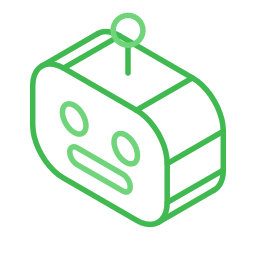
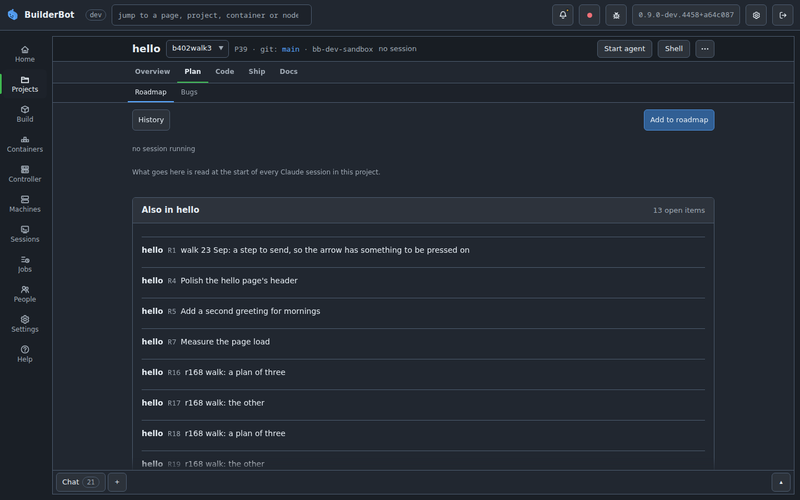
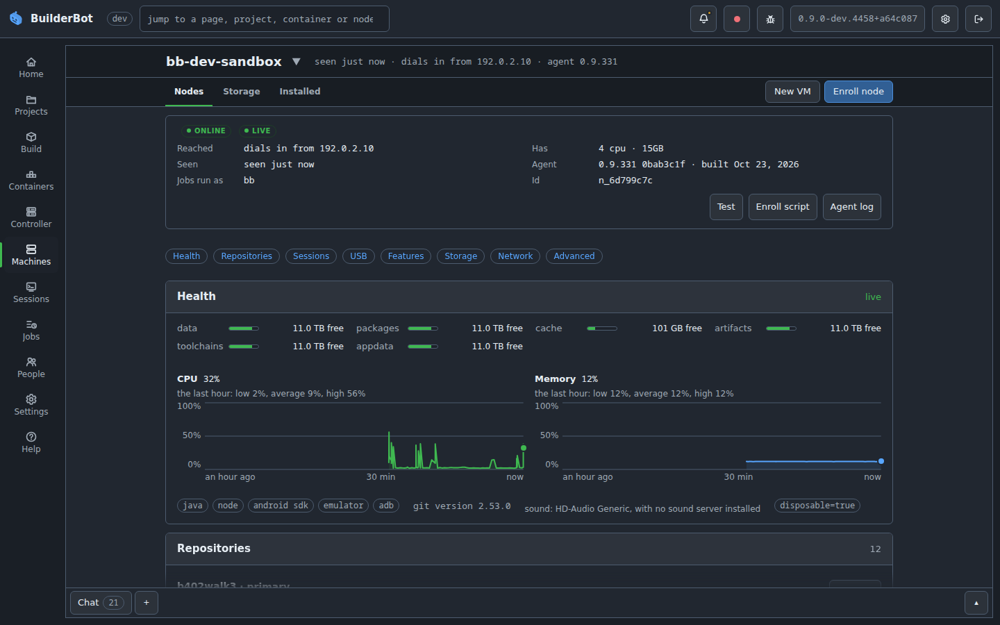
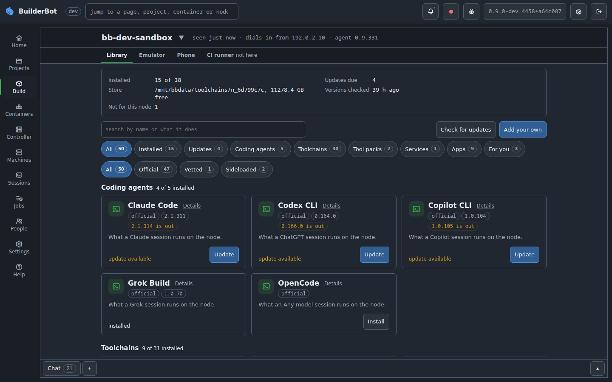
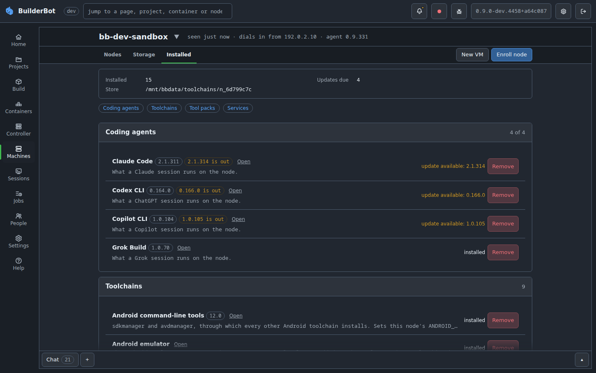
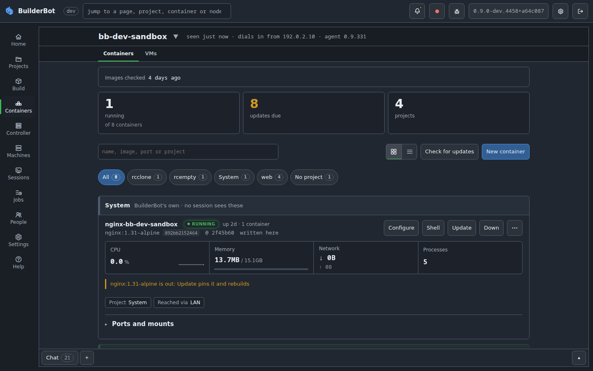
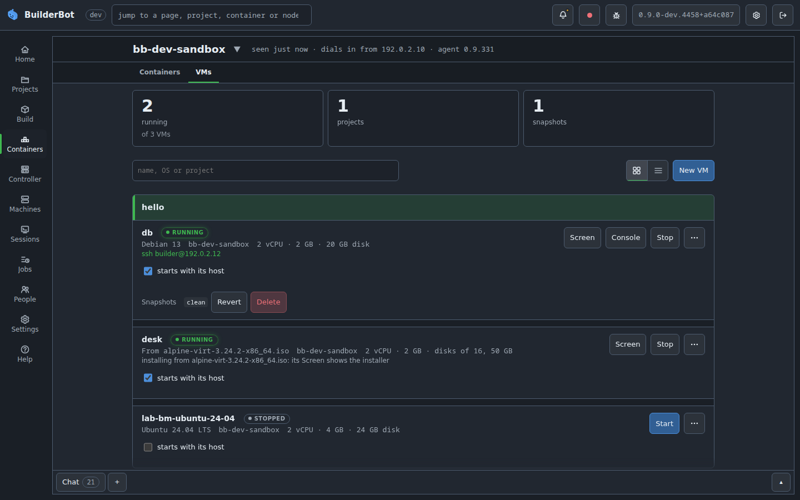
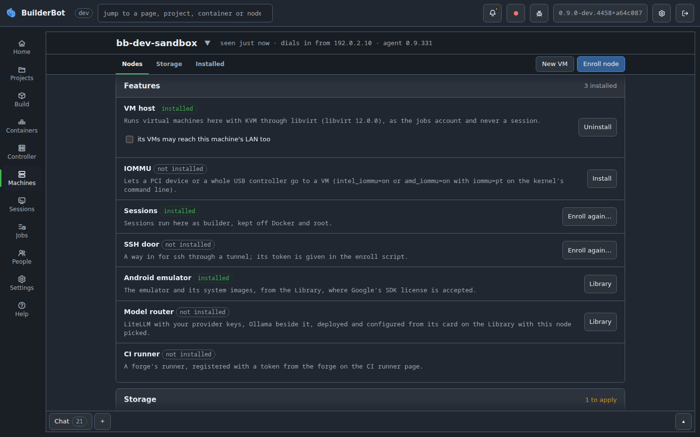
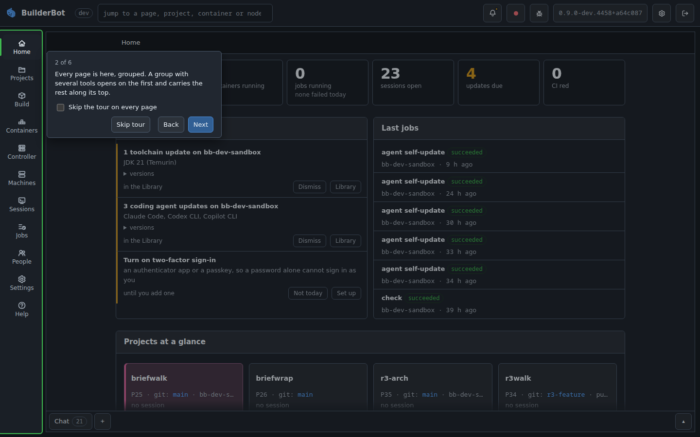
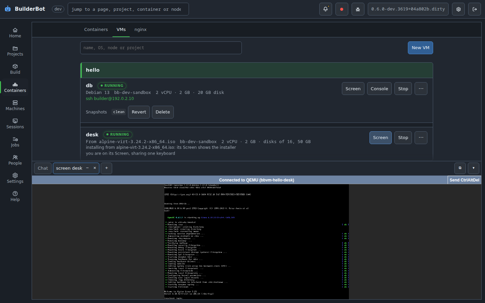

<p align="center">
  
</p>

<h1 align="center">BuilderBot</h1>

<p align="center">
  A self-hosted workshop for coding agents (Claude Code, ChatGPT's Codex CLI,
  GitHub's Copilot CLI and xAI's Grok Build): your projects, the machines that build them, and
  the sessions working on them, in one dashboard.
</p>

<p align="center">
  <a href="https://github.com/aquilaelabs/builderbot/actions/workflows/build-image.yml"></a>
  <a href="https://github.com/aquilaelabs/builderbot/actions/workflows/lint.yml"></a>
  <a href="https://github.com/aquilaelabs/builderbot/actions/workflows/dashboard.yml"></a>
  <a href="LICENSE"></a>
  <a href="https://github.com/aquilaelabs/builderbot/pkgs/container/builderbot"></a>
</p>

> [!WARNING]
> **BuilderBot is early software.** It runs coding agents' sessions that edit,
> commit, run and push code on your machines, and it is still changing fast.
> Do not point it at production repositories or at anything you cannot afford
> to lose: try it on separate repositories made for testing, and keep backups
> of what it works on.
>
> **Check a project's rules before you use it there.** Some open source
> projects, employers and clients forbid AI coding tools, or contributions
> written with them. That is their call to make, and BuilderBot does not
> check it for you.

## What it is

BuilderBot is a **controller** and the machines you enroll under it, the
**nodes**. The controller keeps the dashboard and the record of every
project: its plan, its bugs, its rules, its design. The nodes do the work:
the agents' sessions, builds, tests, CI, Android emulators, containers and
virtual machines.

Each project holds git repositories on a shared disk. Open it from the
browser, on a desktop or a phone, and a session of Claude, ChatGPT, Copilot
or Grok starts on its node already briefed with the project's house rules,
roadmap and open bugs. Close the tab and the session keeps going.

## The editions

One controller, from one tree, in four shapes. They differ only where the
machine does.

| Edition | Runs on | What it is for | How it installs | State |
| --- | --- | --- | --- | --- |
| **Container** | Any host with Docker: a NAS, a home server, a VPS | The dashboard beside everything else the host runs; nodes elsewhere | `docker compose up` with the compose file below, or the app template on a NAS | Released |
| **Bare-metal install** | A Linux machine of its own (every system a node runs on) | One box that is the controller and its own node: the dashboard, the builds, the sessions and the storage on one machine | `nodes/install-controller.sh --install` on the machine, updates from the page | Released |
| **BuilderBot OS** | A machine installed from the ISO, or a VM from the qcow2 or OVA | The bare-metal install as an appliance: a read-only root in two slots, an update that falls back by itself, the disks as pools, an array and shares | Boot the ISO and pick a disk, or import the VM image | Experimental: it boots and updates in the lab and on one machine, and it is the edition most likely to break |
| **USB edition** | A stick in any x86-64 machine | BuilderBot OS loaded into memory at boot, its configuration kept on the stick, the machine's disks its storage | `tools/builderbot-stick.py write` on Windows, a Mac or Linux | Experimental, with the OS edition |

The container and bare-metal editions are what BuilderBot has shipped as
since 0.6. The OS and USB editions are new in 0.9: try them on a machine or
a VM you can wipe, and expect rough edges ([docs/image.md](docs/image.md)).

## Features

- **Coding agents from the browser.** Claude (Claude Code), ChatGPT (Codex
  CLI), Copilot (Copilot CLI), Grok (Grok Build) and any model through a
  node's model router (OpenCode), each started with Start agent and held to
  the same briefing, rules and guards. Real terminals in a dock at the foot
  of every page, at a desk or on a phone, each session in its own project's
  view of the disk. Resume, restart, pick the model and effort, and a note on
  the project's page when a running session is behind what changed.
- **A page per project.** Its overview and house rules, roadmap, bug
  tracker, git, tests, static analysis, artifacts, containers, VMs, wiki and
  design, shared between you and every session that works there.
- **Nodes that do the work.** Enroll a Linux machine or VM with one script:
  Ubuntu, Debian, Fedora, Rocky Linux, AlmaLinux, CentOS Stream, Arch Linux or
  openSUSE, each walked end to end on a real machine. The Machines group
  wears one header: pick a node once and its Nodes, Storage and Installed
  pages follow.
- **One Library for everything a node installs or runs.** Coding agents,
  toolchains (JDK, Android SDK, Flutter, Node, Python, Playwright and more),
  tool packs from a vetted catalog or your own, services like the model
  router, and apps as containers, as one store of cards per node; what is
  installed is managed on the Installed page, where each thing is configured
  where it lives, and a card the node cannot take is not drawn.
- **Builds, tests and CI.** `bb build` and `bb test` run on the project's
  node, a test run is timed and recorded, a node picked as a project's test
  node runs its suites as a job, and a node can be a self-hosted GitHub
  Actions runner.
- **Android end to end.** An emulator per project, a real phone lent through
  the companion app, screenshots and frame-by-frame reels a session can read,
  and release signing with keys no session ever sees.
- **Containers and hosting.** A project's compose file becomes a dev
  instance with one click; hosting-only nodes run what a dev node built, and
  an nginx per node puts a hostname and a certificate in front of it, from
  Let's Encrypt where you ask. A public box can take in only 80 and 443,
  and Lock down stops it and revokes it in one press if it is ever taken over.
- **Virtual machines.** A project's VMs on any node with KVM, made from a
  cloud image or an installer's ISO (Windows included), each on its own
  network, with snapshots, more disks when it needs them, USB devices given
  through, and its screen and console in the dock. Ask a session for "a
  Debian 12 VM with 4 GB" and it makes one, where the project allows it.
- **Storage, on the installed editions.** The machine's disks as ZFS pools
  or an array of mixed disks with parity, SMB and NFS shares, a pool for
  each purpose, snapshots, backups of the pools and a sealed copy of the
  controller's own configuration after every change.
- **People and permissions.** Accounts with roles, per-project access, and a
  dial for everything a session may do on its own (file bugs, add rules, run
  its container, sign a release): allowed, asked of a person, or refused.
  Two-factor sign-in, passkeys, and the bell reaching you by email, a
  webhook, ntfy, Gotify, Pushover, Telegram, Discord or Slack.
- **Secrets kept sealed.** A key made at install seals what the controller
  keeps. Each person has a store of their own for their agents' sign-ins
  and the git tokens they give a project, which they can hold under a key
  of their own or purge at any time. A session reaches a git host only
  through `bb git`, which hands over the credential, so the session never
  holds it.
- **A controller that moves.** Prepare to move arms a move to another home;
  every node hears where and follows by itself once the new home answers,
  however long that takes.
- **A tour of each page** the first time you open it, which you can skip
  once for every page and bring back from About or your Profile. About's
  Credits name the open-source work BuilderBot is built on.
- **Logs you can read.** Every job's output, each node's own logs and the
  controller's diagnostics, kept for as long as the log policy says and
  readable by a session that has been granted them.

## Screenshots

<table>
  <tr>
    <td colspan="2"></td>
  </tr>
  <tr>
    <td width="50%"></td>
    <td width="50%"></td>
  </tr>
  <tr>
    <td width="50%"></td>
    <td width="50%"></td>
  </tr>
  <tr>
    <td width="50%"></td>
    <td width="50%"></td>
  </tr>
  <tr>
    <td width="50%"></td>
    <td width="50%"></td>
  </tr>
  <tr>
    <td colspan="2"></td>
  </tr>
  <tr>
    <td width="50%" align="center"></td>
    <td width="50%" align="center"></td>
  </tr>
</table>

## Quick start

### What you need

- **A place for the controller**: a host with Docker for the container
  edition, a Linux machine of its own for the bare-metal install, a machine
  or a VM you can wipe for BuilderBot OS, or a stick for the USB edition.
- **At least one node**, unless the controller is its own: a Linux machine
  or VM where sessions, builds and tests run, on **Ubuntu 24.04 or later**
  or **Rocky Linux 9**, the systems nodes are tested on. A separate VM keeps
  what the agents run away from your server.
- **Your repositories** on GitHub, Gitea or Forgejo, or any git remote over
  plain git.
- **An account with the agent each person will use**: Claude (a Claude
  plan), ChatGPT (a ChatGPT plan), Copilot (a GitHub account with a Copilot
  plan) or Grok (a SuperGrok or X Premium+ account). Each person signs in
  themselves, on the node, from the Installed page.
- **Repositories made for trying it** (see the warning above).

### The container edition

Make the folders it keeps its state in, owned by the user the container
should run as (`id -u` and `id -g` give yours):

```bash
mkdir -p /srv/projects /srv/builderbot/{home,config,sdk}
chown -R 1000:1000 /srv/projects /srv/builderbot
```

Then save this as `docker-compose.yml`, changing the paths and the IDs to
match:

```yaml
services:
  builderbot:
    image: ghcr.io/aquilaelabs/builderbot:0.9   # a release line; see Upgrading in docs/install.md
    container_name: BuilderBot
    hostname: builderbot
    restart: unless-stopped
    stdin_open: true
    tty: true
    environment:
      PUID: 1000          # the owner of the folders above
      PGID: 1000
      TZ: Etc/UTC         # your time zone, e.g. America/Chicago
      DASHBOARD_PORT: 7680
    volumes:
      - /srv/projects:/workspace           # your projects: one folder each
      - /srv/builderbot/sdk:/sdk           # the controller's own toolchains
      - /srv/builderbot/home:/home/builder # each account's home
      - /srv/builderbot/config:/config     # accounts, settings, notebooks, logs
      - runner-tokens:/config/runner-tokens
    ports:
      - "7680:7680"
    logging:
      driver: json-file
      options: {max-size: "20m", max-file: "3"}

volumes:
  runner-tokens:
```

Start it, and open the dashboard straight away:

```bash
docker compose up -d
```

On a NAS, the app template does the same from its own page: the
[walkthrough](docs/unraid.md) has every field.

### The bare-metal install

On a Linux machine that is only BuilderBot, as root:

```bash
git clone https://github.com/aquilaelabs/builderbot.git && cd builderbot
sudo bash nodes/install-controller.sh --check        # changes nothing
sudo bash nodes/install-controller.sh --install
```

It lays the controller out under `/opt/builderbot`, starts its service and
makes the machine its own node; updates come from the page after that
([docs/install.md, Bare metal](docs/install.md#bare-metal)).

### BuilderBot OS and the USB edition (experimental)

Each release carries the appliance image: `builderbot-os-VERSION.iso` to
install on a machine, `.qcow2` and `.ova` to import as a VM, and
`.stick.raw.xz` for a stick. Boot the ISO and pick a disk, import the VM
with two processors and 4 GB, or write a stick:

```bash
sudo python3 tools/builderbot-stick.py list
sudo python3 tools/builderbot-stick.py write /dev/sdX      # the newest release
```

The machine comes up as its own controller and node at
`http://ITS-ADDRESS:7680`. What the image is, how it boots and updates, and
what is not there yet: [docs/image.md](docs/image.md).

### The first page

Go to `http://YOUR-SERVER:7680`. The first page asks you to make the owner
account, so do this before anyone else can reach it. Then:

1. **Your profile** (the gear, then Profile): your name, email and git
   identity, which your commits carry.
2. **Enroll a node** (the container edition): Machines, then **Enroll
   node**. It gives you one command to run on the node machine, which sets
   it up and connects it. An installed edition is its own node already.
3. **Install an agent on the node**: Build, then the Library, with that node
   picked: Claude Code, Codex CLI for ChatGPT, Copilot CLI or Grok Build;
   then sign in to it on the Installed page under Machines.
4. **Add a project** on the Projects page (clone one, start an empty one,
   or upload an archive), and press **Start agent**.

The full checklist, with every option, is
**[docs/install.md](docs/install.md)**. Once it is running, the people you
give accounts to start with **[Start here](docs/start-here.md)**, the
getting started guide, which is also the About screen's guide in the
dashboard.

## Documentation

Everything else, from installing to the full command reference, is in
**[docs/](docs/README.md)**, which is also the dashboard's Help:

- [Everything it does](docs/features.md), one area at a time
- [Install](docs/install.md), with the [NAS template walkthrough](docs/unraid.md)
- [BuilderBot OS](docs/image.md): the appliance image, the stick and the VM
- [Storage](docs/nas.md): pools, the array, shares, what is built on top
- [Start here](docs/start-here.md), for an account on somebody else's BuilderBot
- [How it works](docs/how-it-works.md), the overview, with a doc for each part
  of the dashboard: [projects](docs/projects.md), [a project's page](docs/notebook.md),
  [sessions](docs/sessions.md), [building](docs/building.md),
  [toolchains](docs/toolchains.md), [containers](docs/containers.md), [VMs](docs/vms.md),
  [machines](docs/machines.md) and [people](docs/people.md)
- [Reference](docs/reference.md): settings, every `bb` command, Android signing
- [Versions](docs/versions.md): release lines and channels
- [Data and privacy](docs/privacy.md): what an install keeps and contacts; nothing is sent to us
- [Architecture](docs/architecture.md) and [Contributing](CONTRIBUTING.md)

## License

[Apache License 2.0](LICENSE). Copyright 2026 aquilaeLabs; see [NOTICE](NOTICE).
